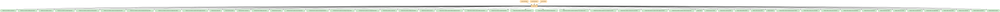

# shared

Android / Desktop / Web の各 `app` から共通利用される、アプリ全体のナビゲーション・画面骨格・`:feature:*` の Koin モジュール束ねを提供するモジュール。`moduleGraphAssert` により `:core:*` へは依存できない（データ層は各 `app` エントリーポイントの composition root で別途束ねる）。

トップレベルタブは「自動」（自動読み上げ）「手動」（手動読み上げ）「ログ」「その他」の順に表示する。「手動」タブは選択中シミュレーター名入りの手動読み上げセット一覧を表示し、シミュレーター切り替え時にペインの状態をリセットする。

## 主要なファイルの役割

- `AppScreen.kt` / `AppScreenEffects.kt`: アプリ全体のトップレベル画面（ボトムナビゲーション、コネクション・TTS・音量警告バナー等の配置）と副作用処理。
- `AppNavigationState.kt`: アプリ全体のトップレベルナビゲーション状態。
- `OtherContent.kt` / `OtherNavigationState.kt`: 「その他」タブの list/detail 画面。`AutoReadoutContent.kt`（`feature:auto-readout-list`）と同様に `Material3 Adaptive` の `ListDetailPaneScaffold` と Navigation 3 の `NavBackStack` を組み合わせるパターンを使う（詳細は `docs/list-detail-navigation-pattern.md` を参照）。
- `FeatureModules.kt`: `:feature:*` 各モジュールの Koin モジュールを束ねた `featureModules` リスト。新しい feature モジュールを追加した際はここに追記する。
- `ConnectionBanner.kt` / `ConnectionBannerContent.kt` / `ConnectionBannerNavigation.kt` / `ConnectionBannerSnackbarMessage.kt`: シミュレーター接続状態を示すバナーの表示・タップ時の遷移先解決・Snackbarメッセージ。
- `TtsUnavailableBanner.kt` / `TtsUnavailableDialog.kt`: 接続バナーの下に、TTS利用不可の間だけ赤い警告バナーを表示する。起動・復帰時に再判定し、バナーのタップで原因別の案内を開く。「その他」と同じインストール先・設定を開き、案内を閉じてもバナーから再表示できる。利用可能になるとバナーと案内を非表示にする。
- `WarningBanners.kt`: TTS警告を音量警告より優先して表示する。接続バナーと共通の上方向スライド＋フェード（登場300ms・退場200ms）を使い、1dpの隙間も一緒に動かす。退場中は直近の表示内容を保持する。
- `LowVolumeBanner.kt`: TTS警告が表示されていない間に、端末または KoDriver の音量低下を示すバナーを表示し、音量設定への移動と警告の閉じる操作を提供する。
- `VersionMismatchBottomSheet.kt` / `VersionMismatchBottomSheetContent.kt`: アプリとサーバーのバージョン不一致時に表示するボトムシート。閉じる操作のハプティックはユーザー設定に従う。
- `AppTheme.kt` / `AppThemeMode.kt`: アプリ全体のテーマ（ダイナミックカラー等）適用。プラットフォームごとの実装は `AppTheme.android.kt` 等の expect/actual で分離。
- `AppPaneWidth.kt`: list/detail 構成の画面の一覧ペインの初期幅（400.dp）。`:core:*` への依存禁止により `:core:designsystem` の `KoDriverListPaneWidth` と同値を別定義しているため、幅を変更する場合は両方を同期させる。
- `DesktopSplashHost.kt`: デスクトップアプリのスプラッシュ画面ホスト。
- `KeepScreenOnEffect.kt` / `KeepScreenOnModifier.*.kt`: 画面の自動スリープ抑止。
- `PredictiveBack.kt`: Android の予測的戻るジェスチャー対応。

<!-- MODULE-GRAPH-START -->
## Module Dependencies

<!-- MODULE-GRAPH-END -->
