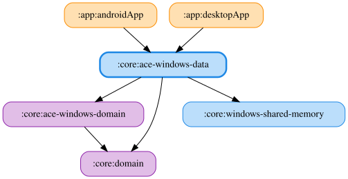

# ace-windows-data

Assetto Corsa EVO 向けのデータ実装を提供する Kotlin Multiplatform モジュール（JVM + Android）です。`jvmMain` は Windows 共有メモリ読み取りと ACE 固有の構造体パース、`jvmAndroidMain` は DataStore による設定永続化、`androidMain` は KoDriver サーバーの WebSocket クライアントを担当します。`jvmTest` は JVM 向けユニットテスト、`androidHostTest` は Android WebSocket クライアントのホストテストを担当します。共有メモリI/Oの汎用部分は `:core:windows-shared-memory` にあります（JVM source set のみで利用）。

## DataStore helper の複製

`:core:data` との依存は moduleGraphAssert により data 系モジュール間で禁止されているため、ACE が使う共通 DataStore helper・WebSocket helper を `internal` のままこのモジュールに複製しています。`MyBestLapPreferences` も ACE 用に複製し、ProtoNumber 1 と 4 のフィールド・既定値を維持しています。番号2（GT7）・3（LMU）は定義せず、他シミュレーターのドメインに依存しません。ACE 固有コードは `kurou.kodriver.core.acewindowsdata.preferences` / `.websocket` パッケージに置き、同一クラス名の jar 間衝突を避けます。

<!-- MODULE-GRAPH-START -->
## Module Dependencies

<!-- MODULE-GRAPH-END -->
