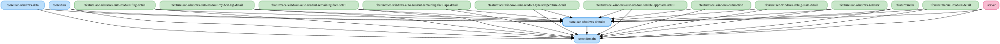

# core:ace-windows-domain

ACE（Assetto Corsa EVO）固有のドメイン層（モデル・Repository インターフェース・UseCase）。

- `:core:domain` に依存する（共有型 `ReadoutItemKey` / `SpeechEvent` 等を参照するため）。
- `:core:domain` に残すのは、共有の `ReadoutItemKey` 階層（`*ReadoutItemKey`）と、それと組で参照される `*ReadoutDefaults.kt`（読み上げ一覧の既定値）のみ。`SpeechEvent` の実装（`*SpeechEvents.kt`）・モデル・Repository・UseCase・`*Defaults.kt` は本モジュールに置く。
- パッケージ名は `kurou.kodriver.domain.acewindows` のまま（`:core:domain` と同一パッケージを分割して持つ）。

<!-- MODULE-GRAPH-START -->
## Module Dependencies

<!-- MODULE-GRAPH-END -->
