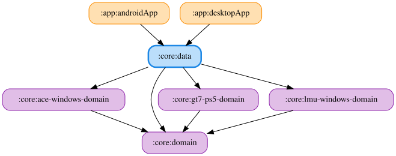

# data

`:core:domain` で定義された Repository インターフェースの実装を提供するモジュール。JVM（デスクトップ）/ Android の両ターゲットを持つ `kotlinMultiplatform` モジュールで、プラットフォーム固有の実装は `androidMain` / `jvmMain` に、共通実装は `jvmAndroidMain` に置く。

自動読み上げ詳細設定のファイル名にはシミュレーター接頭辞の直後に `auto_` を置き、共通の一覧設定は Desktop では `auto_readout_preferences.pb`、Android では `auto_readout_preferences.preferences_pb` に保存する。導入時はユーザー了承のもと設定を意図的に初期化し、旧ファイルの移行は行わない。開始音・ホットキーなどの共通設定ファイル名は維持する。

## Koin モジュール

Android は `androidDataModule(context)`、Desktop は `desktopDataModule` が共通の Repository を登録し、
各プラットフォームの `LmuWindowsDataModule`・`AceWindowsDataModule`・`Gt7Ps5DataModule` を
`includes(...)` で束ねる。シミュレーター固有の設定は各ファイルへ、Android の LMU・ACE WebSocket
登録も対応するファイルへ置く。WebSocket 用 `HttpClient` は Android の共通モジュールで共有する。

## サブパッケージの責務

- `preferences`: Jetpack DataStore（Proto DataStore）によるユーザー設定の永続化。シミュレーター（GT7 PS5 / LMU Windows / ACE Windows）ごと・設定項目ごとに `XxxPreferences`（proto定義）・`XxxPreferencesSerializer`・`XxxPreferencesDataStoreFactory`・`XxxPreferencesRepositoryImpl`・`XxxPreferencesRepositoryFactory` の5点セットを増やしていくパターンを取る。新しい設定項目を追加する際は、既存の類似設定（同じシミュレーター向けのもの）をコピーして書くのが最も安全。
- `websocket`: `:server` が配信する WebSocket エンドポイント（`/ws/<Simulator.id>/<feature>`）に接続し、`Flow` として購読するクライアント側実装。`WebSocketFlowFactory` / `WebSocketHttpClientFactory` が共通の接続処理を担い、`WebSocketXxxRepository` がエンドポイントごとのデシリアライズを担当する。Android の `LmuWindowsBrakeWearRepository` は `WebSocketLmuWindowsBrakeWearRepository` を登録し、`/ws/lmu_windows/brake_wear` から REST API 由来のブレーキ残り厚さを受信する。JSON `null` もそのまま流す。
- `telemetrylog`: Room（`TelemetryLogDatabase` / `TelemetryLogDao` / `TelemetryLogEntity`）によるテレメトリログの永続化。DB バージョンは 5。4→5 の移行で `readoutItemKey` の `lmu_windows_` / `ace_windows_` / `gt7_ps5_` 直後に `auto_` を追加し、既存ログを保持する。変更済みのキーは維持する。
- `device`: 端末固有機能（ローカルネットワークアクセス許可の確認、触覚フィードバック対応可否）へのアクセス。
- `release`: サーバー・アプリのバージョン情報の取得。`ServerVersionRepository`（`:server` のバージョン確認、Android 版アプリのみ登録。`:server` は Windows デスクトップアプリと同一プロセスで動作するため）は Android では `HttpServerVersionRepository` で `:server` へ HTTP アクセスして取得し、`AppUpdateRepository`（アプリ自体の最新リリース確認）は両プラットフォームで `GitHubAppReleaseRepository` により GitHub Releases API から取得する。
- `feedback`: Sentry User Feedback API へのフィードバック送信（`SentryFeedbackSenderRepository`）。

## オーバーレイ文字サイズのプレビュー

`OverlayTextSizePreferencesRepositoryImpl` は保存値のFlowとメモリ上の nullable な
`MutableStateFlow` を `combine` し、プレビュー値を優先して配信する。プレビューはDataStoreへ書き込まない。
`null` で解除すると最新の保存値へ戻る。Android／DesktopのDataModuleはRepositoryを `single` 登録し、
設定ダイアログとオーバーレイが同じ一時値を共有する。

## オーバーレイ背景透明度のプレビュー

`OverlayBackgroundOpacityPreferencesRepositoryImpl` も文字サイズと同様に、保存値のFlowとメモリ上の
nullable な `MutableStateFlow<Int?>` を `combine` し、プレビュー値を優先して配信する。
プレビューはDataStoreへ書き込まず、`null` で解除すると最新の保存値へ戻る。
Android／DesktopのDataModuleはRepositoryを `single` 登録し、設定ペインとオーバーレイで一時値を共有する。

<!-- MODULE-GRAPH-START -->
## Module Dependencies

<!-- MODULE-GRAPH-END -->

LMU自己ベストラップの自由文言は、共有 `MyBestLapPreferences` のLMU専用 `@ProtoNumber(3) lmuWindowsReadoutText` に保存する。既定値は「自己ベストラップ更新 {laptime}」。GT7の自由文言は番号2 `readoutText` に保存し、ACE自己ベストラップの自由文言は番号4 `aceWindowsReadoutText`（既定値は同じく「自己ベストラップ更新 {laptime}」）に保存する。既存の番号1 `voiceType` はどのシミュレーターも参照しないが、旧データの互換性のため維持する。LMU・GT7・ACEの自由文言は口調を読み取らず、旧口調設定の移行は行わない。シミュレーターごとにDataStoreファイルが分かれているため文言は混在しない。

ACEフラッグ文言は `AceWindowsFlagReadoutTextKey` ごとに既存のフィールドを取得・更新する。
`AceWindowsFlagReadoutTextPreferences` のフィールド・ProtoNumberは維持し、
他フラッグの保存値を残して対象文言のみ更新する。

## LMUピットタイミング設定

`LmuWindowsPitTimingPreferencesRepository` は予想残り周回数・読み上げ有効状態、
`LmuWindowsPitTimingReadoutTextPreferencesRepository` は予告・直前の読み上げ文言を扱う。
Factoryは両Repositoryの組を返し、Android／DesktopのDIで同じDataStoreを共有する。
フィールド・ProtoNumberは維持する。保存ファイル名の `auto_` 導入時は設定を意図的に初期化し、旧ファイルの移行は行わない。

## LMUタイヤ温度設定

`LmuWindowsTyreTemperaturePreferencesRepository` は有効状態・低温警告対象フェーズ、
`LmuWindowsTyreTemperatureReadoutTextPreferencesRepository` は過熱・低温警告の文言を扱う。
Factoryが返す両RepositoryはAndroid／DesktopのDIで1つのDataStoreを共有する。
現行フィールドのProtoNumberは維持する。保存ファイル名の `auto_` 導入時は設定を意図的に初期化し、旧ファイルの移行は行わない。廃止したProtoNumber 1は再利用しない。

オーバーレイ文字色は `OverlayTextColorPreferences` の ARGB Long として `overlay_text_color_preferences.pb` に永続化する。
詳細ダイアログのOKで保存し、一覧とオーバーレイが保存値のFlowを購読する。
既定値はドメインの `OVERLAY_TEXT_COLOR_DEFAULT` を参照し、既存の保存形式は維持する。

## デバッグ読み上げ

`jvmAndroidMain` の `InMemoryDebugReadoutRequestRepository` は replay なしの `MutableSharedFlow` で要求をプロセス内配信する。購読前の要求は保持せず、送信中の要求は現在の全購読者に渡す。DesktopDataModule と AndroidDataModule で同じ実装を single 登録する。永続化やテレメトリソースへの送信は行わない。

LMU のデバッグ専用の現在値読み上げホットキーは `ReadoutHotkeyPreferencesRepository` が
`lmu_windows_readout_hotkey_preferences.pb` に仮想キーコードを保存する。既定値は domain の F1 定数を参照する。
Desktop・Android 両方で設定 Repository を登録し、Android の `HotkeyRepository` は `Unsupported` 状態のみを提供する。

## 手動読み上げセット

`ManualReadoutSetPreferencesRepository` は手動読み上げセットを
`manual_readout_set_preferences_${simulator.id}.pb` にシミュレーターごとに保存する。
Desktop／Android とも `named(simulator.id)` で登録し、セット識別子・項目キーの順序・項目キーごとの文言テンプレートを保持する。
文言は `ManualReadoutSetPreference` の protobuf フィールド3に `Map<String, String>` として保存する。
旧データの文言フィールドがないセットは空 Map として読み込み、Narrator と詳細画面で既定文言を使う。

## 手動読み上げ依頼

`InMemoryManualReadoutRequestRepository` は `jvmAndroidMain` の共通実装で、Android / Desktop の
DataModule にシングルトンとして登録する。`MutableSharedFlow` の追加バッファは64件で、
満杯なら `emit` が待機し、購読中の Narrator へ連続依頼を順番通り届ける。
依頼は永続化せず、購読開始前・終了後の依頼を再配信しない。
