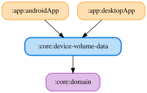

# device-volume-data

端末（OS）のマスター音量を取得・設定するRepositoryを実装するJVM / Androidマルチプラットフォームモジュールです。
KoDriver自体のアナウンス音量設定とは異なり、OS側の再生音量（読み上げが実際に聞こえるかどうかに関わる音量）を扱います。

- jvmMain: Windows Core Audio（WASAPI `IAudioEndpointVolume`）をJNA経由で直接呼び出す`WindowsDeviceVolumeRepository`。
  非Windowsでは何もしないNo-Op実装にフォールバックする。
- androidMain: `AudioManager`（`STREAM_MUSIC`）を使う`AndroidDeviceVolumeRepository`。
  Android SDKには公開のマスター音量APIが存在しないため、読み上げ音声（メディア扱い）に対応する
  `STREAM_MUSIC`をマスター音量の代替として扱う。

いずれも`core:domain`の`DeviceVolumeRepository`（値は0-100のパーセンテージ）を実装する。

<!-- MODULE-GRAPH-START -->
## Module Dependencies

<!-- MODULE-GRAPH-END -->

## テスト

`WasapiMasterVolumeSourceTest` は `WasapiNativeApi` のFakeを使い、音量の取得・設定、
COM初期化結果に応じた終了処理、各取得段階と音量操作の失敗時のリソース解放を検証する。
`JnaWasapiNativeApiTest` は `WasapiComBridge` のFakeを使い、COM初期化結果、GUID、
vtable番号・引数、戻りポインター・音量値、HRESULTの確認と例外伝播、解放先を検証する。
`JnaWasapiComBridgeTest` は遅延取得する `Ole32` をモックに差し替え、COM初期化・終了・生成の
引数、HRESULT、出力ポインター、例外伝播を検証する。JNAのメモリとコールバックで疑似COMの
vtableを構成し、指定スロットの呼び出しと `Release` は実際のJNA経路を通して検証する。
HRESULTの成功確認は直接実行し、失敗確認はWindowsのエラーメッセージ取得を避けるため
`COMUtils.checkRC` を差し替えて例外伝播を検証する。
`JnaWasapiComBridge` と `WasapiComInvoker` はKover集計対象とする。
既定の `Ole32.INSTANCE` の取得だけはWindows専用のため、非Windowsのユニットテストでは実行しない。
実際のWASAPI接続はWindows環境での確認が必要。
