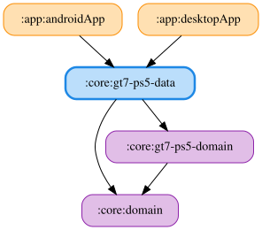

# gt7-ps5-data

グランツーリスモ7（PS5）の UDP テレメトリを受信し、ドメイン層の Repository と DataStore による設定永続化を実装する JVM / Android マルチプラットフォームモジュールです。

`Gt7Ps5AutoReadoutSettingsResetter` は GT7 の自動読み上げ設定・自由文言を端末ローカルで既定値に戻し、Desktop / Android で `AutoReadoutSettingsResetter` として登録します。接続用の UDP ポート設定は対象外です。

## DataStore helper の複製

`:core:data` との依存は moduleGraphAssert によりデータモジュール間で禁止されているため、GT7 が使う共通 DataStore helper を `internal` のままこのモジュールに複製しています。`MyBestLapPreferences` も GT7 用に複製し、ProtoNumber 1 と 2 のフィールド・既定値を維持しています。番号3（LMU）・4（ACE）は定義せず、他シミュレーターのドメインに依存しません。GT7 固有コードは `kurou.kodriver.core.gt7ps5data.preferences` パッケージに置き、同一クラス名の jar 間衝突を避けます。

<!-- MODULE-GRAPH-START -->
## Module Dependencies

<!-- MODULE-GRAPH-END -->
