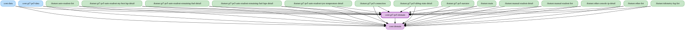

# core:gt7-ps5-domain

GT7（Gran Turismo 7 PS5）固有のドメイン層（モデル・Repository インターフェース・UseCase）。

- `:core:domain` に依存する（共有型 `ReadoutItemKey` / `SpeechEvent` 等を参照するため）。
- `:core:domain` は本モジュールに依存しない。`:core:domain` から参照されるGT7定数・デフォルト値・`ObserveGt7Ps5UseCase` などは `:core:domain` の `domain.gt7ps5` パッケージに残している。ユーザー設定のデフォルト値（`*Defaults.kt`）は規約により `:core:domain` に置く。
- パッケージ名は `kurou.kodriver.domain.gt7ps5` のまま（`:core:domain` と同一パッケージを分割して持つ）。

<!-- MODULE-GRAPH-START -->
## Module Dependencies

<!-- MODULE-GRAPH-END -->
