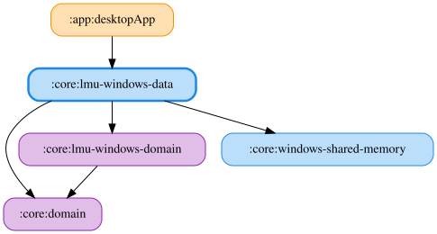

# lmu-windows-data

Le Mans Ultimate 向けのデータ実装を提供する Kotlin Multiplatform モジュール（JVM + Android）です。
`jvmMain` は Windows 共有メモリ読み取りと LMU 固有の構造体パース、`jvmAndroidMain` は DataStore による設定永続化、`androidMain` は KoDriver サーバーの WebSocket クライアントを担当します。共有メモリI/Oの汎用部分は `:core:windows-shared-memory` にあります（JVM source set のみで利用）。

共有メモリに含まれない情報（天候予報、Virtual Energy消費履歴、ピットメニューの状態等）をLMU内蔵のローカルREST APIから補えないかを調査した資料が [`docs/lmu-windows-rest-api.md`](../../docs/lmu-windows-rest-api.md) にあります（未統合の調査メモ）。

`LmuWindowsAutoReadoutSettingsResetter` は LMU の自動読み上げ設定・自由文言を端末ローカルで既定値に戻し、Desktop / Android で `AutoReadoutSettingsResetter` として登録します。PitTiming・TyreTemperature・VehicleApproach の設定と文言は共有 DataStore を設定側から一度だけリセットします。

## DataStore helper の複製

`:core:data` との依存は moduleGraphAssert により data 系モジュール間で禁止されているため、LMU が使う共通 DataStore helper・WebSocket helper を `internal` のままこのモジュールに複製しています。proto の `FlagReadoutTextPreferences` と `MyBestLapPreferences` もフィールド番号・既定値を維持して複製し、ACE は `:core:ace-windows-data`、GT7 は `:core:gt7-ps5-data` にそれぞれ自モジュールへ複製した定義を持ちます。LMU 固有コードは `kurou.kodriver.core.lmuwindowsdata.preferences` / `.websocket` パッケージに置き、同一クラス名の jar 間衝突を避けます。

## 車両クラス（mVehicleClass）の取りうる値

Scoring セグメントの `mVehicleClass` (char[32]、オフセット +200) は人間可読なクラス名を返す。
2026年8月時点で実機から確認できた値は以下の通り（今後のアップデートで追加・変更される可能性がある）。

- `GT3`
- `GTE`
- `LMP3`
- `LMP2`
- `LMP2_ELMS`
- `Hyper`

参照: `LmuWindowsMapper.readVehicleClassName`, `LmuWindowsVehicleClassData`

Virtual Energy を使うのは Hypercar（`Hyper`）と GT3（`GT3`）のみで、それ以外のクラスと未知クラスは燃料を使う。判定には `lmuWindowsVehicleClassEnergySource` を使う。

## TimingData のラップタイム

`LmuWindowsMapper` は Scoring セグメントのプレイヤー車両からラップタイム系フィールド（`currentLapTimeMs`, `lastLapTimeMs`, `bestLapTimeMs`, `sector1Ms`, `sector1And2Ms`）を取得する。Scoring のプレイヤー車両が見つからない場合は `0L` にフォールバックする。

## 共有メモリのオフセット情報

`LmuWindowsMapper.kt` のコメントに pyLMUSharedMemory の ctypes レイアウト（`_pack_=4`）を記載済み。

## 車両との時間差

`LmuWindowsCarGapRepositoryImpl` はプレイヤー車両の Telemetry +780〜+792 から4種類の時間差を秒単位で読み取る。プレイヤー車両が無効なら配信せず、非 Windows では空 Flow を返す。
共有メモリの生の値を保持し、車両不在時の値の意味（0か負値か）は実機未確認のため解釈しない。
server は `/ws/lmu_windows/car_gap` で同一値も継続配信する。Android は `WebSocketLmuWindowsCarGapRepository` で受信し、`LmuWindowsCarGapData` として復元する。

<!-- MODULE-GRAPH-START -->
## Module Dependencies

<!-- MODULE-GRAPH-END -->

## 燃料残量警告設定

`LmuWindowsRemainingFuelPreferences` は閾値%と自由文言を `lmu_windows_auto_remaining_fuel_preferences.pb` に保存する。既定値・文言置換は ACE 燃料警告と同じ。燃料テレメトリ自体は新規Repositoryを作らず `LmuWindowsRepository.telemetryStream()` から取得する。

Android では `WebSocketLmuWindowsRepository` が timing と fuel を WebSocket で受信して補う。fuel 未受信時および実受信から5秒間更新がない場合は容量0の値で timing の配信を継続する。再接続後に新しい fuel を受信すると復帰する。fuel の実受信時刻は通信に含めないローカルなメタデータとして保持し、timing の更新で鮮度を延長しない。

LMUピットタイミングの燃料は `LmuWindowsReadoutItemKey.PitTiming.Fuel`（`lmu_windows_auto_pit_timing_fuel`）で保存する。
詳細のスイッチ・閾値（既定3周、1〜5周）・通常／切迫時文言は既存の PitTiming DataStore を共有し、
ProtoNumber 8〜10を追加する。既存フィールド1〜7は維持し、旧データでは燃料の既定値を使う。
`ObserveLmuWindowsPitTimingEnabledStatesUseCase` の既定値は有効で、Narratorのマージ済み有効状態と
`determinePitTimingFuel` が `PitTiming.Root`／`PitTiming.Fuel` を判定する。
燃料警告は `energySource == LmuWindowsEnergySource.Fuel`（P2/P2Elms/P3/GTE/Unknown）でのみ発火し、
VEクラス・無効設定でも燃料消費の追跡と評価周の更新を続ける。詳細の燃料設定はクラスに関わらず表示し、listPaneは変更しない。
`pitTimingJob` が `exactPercent / 100.0` を一度だけ追跡し、手動の燃料残り周回数と `fuelLapsTrackingState` を共有する。
VE・タイヤ・燃料の候補の最小周回数を選び、共通の `PitTimingLapGate` を通った候補だけ読み上げ履歴へ記録する。
給油周を消費量の推定から除外し、給油で警告履歴を再武装、周回巻き戻りで追跡・評価履歴を初期化する。
通常の既定文言は「燃料は残り約{laps}周」、0周以下は「燃料残り1周未満」。保存文言の解決・開始音・優先度・キュー・ログは
既存の `PitTiming.Root` の流儀を使い、ログに燃料スナップショットと判定状態を含める。
