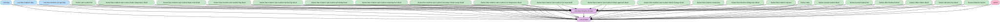

# core:lmu-windows-domain

LMU（Le Mans Ultimate）固有のドメイン層（モデル・Repository インターフェース・UseCase）。

- `:core:domain` に依存する（共有型 `ReadoutItemKey` / `SpeechEvent` 等を参照するため）。
- LMU 固有の sealed key、`LMU_WINDOWS_READOUT_ITEM_KEYS` と登録 spec（`LmuWindowsReadoutItemKeys.kt`）、読み上げ既定値は本モジュールに置く。新しい key は必ずキー一覧にも追加する。
- パッケージ名は `kurou.kodriver.domain.lmuwindows` のまま（`:core:domain` と同一パッケージを分割して持つ）。

燃料の消費量を追跡し `fuelLapsTrackingState` に蓄積する。手動の燃料の残り周回数に接続済み（自動は未接続）。

手動の「燃料の残り周回数」は `LmuWindowsReadoutItemKey.RemainingFuel.Laps.value`（`lmu_windows_auto_remaining_fuel_laps`）に対応する。
`RemainingFuel` 配下の手動専用項目で、TopLevel・自動タブ・スイッチには追加しない。手動項目定義の末尾（タイヤ摩耗の残り周回数の後）に並ぶ。
`fuelLapsTrackingState` の蓄積値を `manualFuelRemainingLaps` で読み、1周以上は `formatLmuWindowsPitTimingReadoutText` で `{laps}` を置換する。
既定文言は `LMU_WINDOWS_MANUAL_READOUT_FUEL_LAPS_TEXT_DEFAULT`（「燃料は残り約{laps}周」）、0周は
`LMU_WINDOWS_MANUAL_READOUT_FUEL_LAPS_EMPTY_TEXT_DEFAULT`（「燃料残り1周未満」）。空欄テンプレートなら0周でも空文字にする。
蓄積前・消費量が null／0以下／非有限・算出不能・最新燃料が未受信または受信から5秒超の場合はデータ無しとする。
鮮度は `latestFuelReceivedAtMs` で判定し、ピットタイミングの鮮度には依存しない。
複数項目では「燃料の残り周回数はデータがありません」を連結し、全項目がデータ無しなら「データがありません」のみを読む。
先頭項目なら開始音・優先度・ログ・キューに `RemainingFuel.Root` を使う。編集画面はACE・GT7の燃料項目と同じ「エネルギー」カテゴリに配置し、既存の
`LMU_WINDOWS_PIT_TIMING_LAPS_PLACEHOLDER` を挿入・検証に使う。項目一覧・ホットキーは共通の手動項目定義を参照する。
手動の燃料読み上げは自動警告の有効状態・評価履歴を変更しない。

## 車両との時間差

`LmuWindowsCarGapData`・`LmuWindowsCarGapRepository`・`ObserveLmuWindowsCarGapUseCase` は、前方・後方車両および前順位・後順位車両との時間差（秒）を扱う。
`overallGapAheadSeconds` / `overallGapBehindSeconds` はクラスを問わない全体の前後車両との秒差で、Scoring の位置関係から自前計算する。対象車両なし・推定ラップタイム無効・Scoring 自車未取得時は null。既存4項目は実機確認の参考用に Telemetry の生 float を保持し、車両不在時の値の意味は解釈しない。新フィールドの既定値は null で、旧 JSON も復元できる。同クラスギャップの対象車両なしを null とする仕様は維持する。

`LmuWindowsClassCarGapData`・`LmuWindowsClassCarGapRepository`・`ObserveLmuWindowsClassCarGapUseCase` は、同クラスの前後車両との時間ギャップと自車のクラス内順位を扱う。`classPosition` は 1 始まりの順位、`classVehicleCount` は自車を含む同クラスの台数で、算出不可時は null（他車の順位が未設定のときは順位のみ null）。ガレージ内の他車を除外し、自車はガレージ内でも含める。`classPosition == 1` でトップ、両項目が非 null かつ `classPosition == classVehicleCount` で最後尾と判定する。新しい2項目の既定値は null で、新フィールドのない旧 JSON も復元できる。

<!-- MODULE-GRAPH-START -->
## Module Dependencies

<!-- MODULE-GRAPH-END -->

LMUピットタイミングの燃料は `LmuWindowsReadoutItemKey.PitTiming.Fuel`（`lmu_windows_auto_pit_timing_fuel`）で保存する。
詳細のスイッチ・閾値（既定3周、1〜5周）・通常／切迫時文言は既存の PitTiming DataStore を共有し、
ProtoNumber 8〜10を追加する。既存フィールド1〜7は維持し、旧データでは燃料の既定値を使う。
`ObserveLmuWindowsPitTimingEnabledStatesUseCase` の既定値は有効で、Narratorのマージ済み有効状態と
`determinePitTimingFuel` が `PitTiming.Root`／`PitTiming.Fuel` を判定する。
燃料警告は `energySource == LmuWindowsEnergySource.Fuel`（P2/P2Elms/P3/GTE/Unknown）でのみ発火し、
VEクラス・無効設定でも燃料消費の追跡と評価周の更新を続ける。詳細の燃料設定はクラスに関わらず表示し、listPaneは変更しない。
`pitTimingJob` が `exactPercent / 100.0` を一度だけ追跡し、手動の燃料残り周回数と `fuelLapsTrackingState` を共有する。
VE・タイヤ・燃料の候補の最小周回数を選び、共通の `PitTimingLapGate` を通った候補だけ読み上げ履歴へ記録する。
給油周を消費量の推定から除外し、給油で警告履歴を再武装、周回巻き戻りで追跡・評価履歴を初期化する。
通常の既定文言は「燃料は残り約{laps}周」、0周以下は「燃料残り1周未満」。保存文言の解決・開始音・優先度・キュー・ログは
既存の `PitTiming.Root` の流儀を使い、ログに燃料スナップショットと判定状態を含める。
