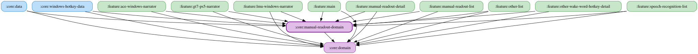

# manual-readout-domain

手動読み上げのセット操作・読み上げ依頼・ホットキー・設定リセットの Repository インターフェースと UseCase。

- `:core:domain` にのみ依存する。パッケージ名は `kurou.kodriver.domain.manualreadout` 配下とする。
- `ManualReadoutSet`・`ManualReadoutItemDefinition`・`ManualReadoutValue`・発話の照合など、`ReadoutItemKeyRegistry` やシミュレーター固有ドメインが参照する型は `:core:domain` に置く（ドメインモジュール同士は依存できないため）。

`ResetManualReadoutSettingsUseCase` は受け取った `ManualReadoutSettingsResetter` を順番に実行し、手動読み上げセット（ホットキーを含む）と再生ボタン表示設定を既定値に戻します。

`kurou.kodriver.domain.manualreadout.util` の `isManualReadoutHotkeySupported()`（expect/actual）は手動読み上げのホットキー対応判定で、Windows デスクトップのみ true を返す。`:feature:manual-readout-list` と `:feature:manual-readout-detail` が共用する。

<!-- MODULE-GRAPH-START -->
## Module Dependencies

<!-- MODULE-GRAPH-END -->
