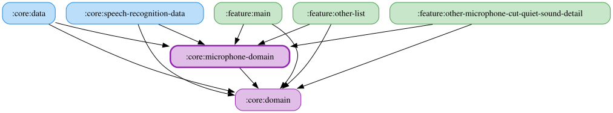

# microphone-domain

マイク入力と「小さい音をカット」設定のモデル、Repository インターフェース、UseCase。

- `:core:domain` にのみ依存する。パッケージ名は `kurou.kodriver.domain.microphone` 配下とする。

## 小さい音をカットする段階

マイク設定の「小さい音をカット」は `MICROPHONE_CUT_QUIET_SOUND_LEVEL_MIN`〜`MAX`（0〜12、0はカットしない）の段階値として
`MicrophoneCutQuietSoundPreferencesRepository` が保持する。既定値は3で、段階 × `MICROPHONE_CUT_QUIET_SOUND_LEVEL_STEP`（0.05）が
音量ゲートのしきい値（既定は0.15）に当たる。`ObserveMicrophoneCutQuietSoundLevelUseCase` で購読し、
`SaveMicrophoneCutQuietSoundLevelUseCase` が範囲外の値を拒否して保存する。「コマンド受付中もカットする」は `MICROPHONE_CUT_QUIET_SOUND_IN_COMMAND_DEFAULT`（false）を既定に、同じRepositoryの `observeMicrophoneCutQuietSoundInCommand` / `saveMicrophoneCutQuietSoundInCommand` と対応するUseCaseで扱う。

<!-- MODULE-GRAPH-START -->
## Module Dependencies

<!-- MODULE-GRAPH-END -->
