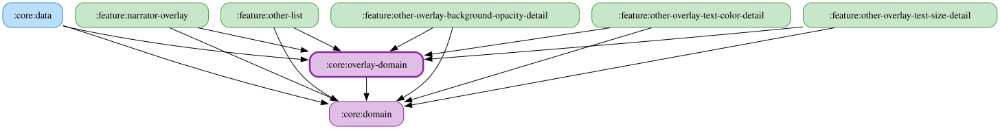

# overlay-domain

読み上げオーバーレイ（表示状態・ウィンドウ位置・文字サイズ・文字色・背景透明度）のモデル、Repository インターフェース、UseCase。

- `:core:domain` にのみ依存する。パッケージ名は `kurou.kodriver.domain.overlay` 配下とする。

## オーバーレイ文字サイズのプレビュー

`PreviewOverlayTextSizeUseCase` は `OverlayTextSizePreferencesRepository.setPreviewOverlayTextSize` に
一時値を渡す。`null` で解除し、`ObserveOverlayTextSizeUseCase` はプレビュー優先の現在値を配信する。
永続化は `SaveOverlayTextSizeUseCase` が担当する。

## オーバーレイ文字色のプレビュー

`PreviewOverlayTextColorUseCase` は `OverlayTextColorPreferencesRepository.setPreviewOverlayTextColor` に
一時値を渡す。`null` で解除し、`ObserveOverlayTextColorUseCase` はプレビュー優先の現在値を配信する。
永続化は `SaveOverlayTextColorUseCase` が担当する。

## オーバーレイ背景透明度のプレビュー

`PreviewOverlayBackgroundOpacityUseCase` は `OverlayBackgroundOpacityPreferencesRepository.setPreviewOverlayBackgroundOpacity` に
一時値を渡す。文字サイズと同様に `null` で解除し、`ObserveOverlayBackgroundOpacityUseCase` はプレビュー優先の現在値を配信する。
永続化は `SaveOverlayBackgroundOpacityUseCase` が担当する。

<!-- MODULE-GRAPH-START -->
## Module Dependencies

<!-- MODULE-GRAPH-END -->
