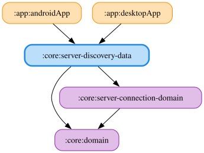

# server-discovery-data

LAN 内の Windows 版 KoDriver サーバー（`:server`）の検出と、接続先への疎通確認を行う Repository を実装する JVM / Android マルチプラットフォームモジュールです。

- jvmMain: jmDNS で mDNS 広告（`MdnsConstants.KO_DRIVER_SERVICE_TYPE`）を検出する `JmdnsWindowsServerDiscoveryRepository`。`:server` と同じ基準で選んだすべての IPv4 アドレスで検出し、同じ名前のサーバーは1件にまとめる（アドレスの選び方は両モジュールの `MdnsAddresses.kt` にあるので、片方を変えたらもう片方も合わせる）。
- androidMain: `NsdManager` で検出する `NsdWindowsServerDiscoveryRepository`。
- jvmAndroidMain: 指定した IPv4 アドレスのサーバーポートへ TCP 接続して確認する `TcpServerConnectivityRepository`。IPv4 形式でない接続先には接続しません。

いずれも `core:domain` の `WindowsServerDiscoveryRepository` / `ServerConnectivityRepository` を実装し、`serverDiscoveryDataModule` でバインドします。
検出は Flow を購読している間だけ動き、購読が終わると停止します。

<!-- MODULE-GRAPH-START -->
## Module Dependencies

<!-- MODULE-GRAPH-END -->
