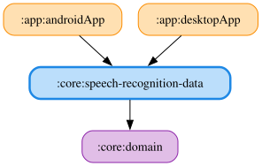

# speech-recognition-data

マイクからの音声入力と音声認識、マイク権限の確認を実装するJVM / Androidマルチプラットフォームモジュールです。`:core:domain` の `SpeechRecognitionRepository` / `MicrophoneRepository` / `AudioInputDeviceRepository` / `RecordAudioPermissionRepository` を実装し、Koin には `speechRecognitionDataModule` で登録します（Desktop は jvmMain、Android は androidMain の同名モジュール）。`Context` は Koin から解決します。

- `speech`: マイクからの聞き取り（音声認識）。
  - `setMode`（`SpeechRecognitionMode`）で聞き取る内容を切り替える。
  - モードは Repository が保持し（初期値はウェイクワード待ちで、聞き取りの開始では上書きしない。開始の前に設定するのは呼び出し側）、`SpeechTranscriber.setMode` へ `TranscriberModeSync` が断片ごとに反映する（変化したときだけ。切り替え時は途中経過を引き継がない）。
  - 実機の Vosk（Desktop・Android 共通の `ModeSwitchingTranscriber`。`Recognizer` は `VoskRecognizerAdapter` で `VoskRecognizerPort` に包む）は、語彙を `wakeWordGrammar`（ウェイクワード・空白区切りの句と `[unk]`。モデルの語彙に無い語は無視されるため、語彙にある語だけを渡す）に絞った Recognizer（ウェイクワード待ち）と絞らない Recognizer（コマンド待ち）を持って切り替え、`Paused` の間は音声を捨てる。
  - Android は下の Vosk 版を使う。
  - Desktop は `JvmSpeechRecognitionRepository` が、選択マイク（保存済みの名前が `AudioInputDeviceRepository` の一覧にあればそれ、なければ・未選択なら一覧の先頭、一覧が空なら既定）の音声を `MicrophoneRepository` から受け取り、断片ごとに音量（`Level`）も流し（16bit PCM の RMS をフルスケールに対する dB にして、-60 dB を0、-10 dB を1として正規化する `pcmLevel`。話し声で十分に振れるようにするため線形にしない）、`SpeechTranscriber`（実機は Vosk の `ModeSwitchingTranscriber`）で認識して `Partial` / `Recognized`（確定は信頼度順の最大5候補、空白は除去）として流す。
  - 日本語モデル（`vosk-model-small-ja-0.22`）はデスクトップアプリのパッケージにリソースとして同梱し（`:app:desktopApp` の `prepareVoskModel` がビルド時にチェックサムを検証して取得する）、`resolveVoskModelDirectory` が `~/.kodriver/vosk-model-ja`（手動配置。あれば優先）、無ければ同梱先（`compose.application.resources.dir` 配下の `vosk-model-ja`）の順に探す。
  - どちらにも無い・読み込めない（対応外OSのネイティブライブラリを含む）ときは `Failed(Unavailable)` を流して完了する。
  - 認識は `Dispatchers.Default` で行う。
  - マイクの取得失敗は `Failed(MicrophoneUnavailable)` / `Failed(NoSignal)`、認識中の想定外の例外は `Failed(RecognitionFailed)` として理由を区別して流し、マイクを開けない失敗・認識モデルの未配置・認識中の例外は `captureError` でログに残す（無音はOSのマイク設定が原因のため記録せず、デバイス名も記録しない）。
  - Voskは認識結果をUTF-8で返すが、JNAは既定でOSの文字コード（日本語WindowsではMS932）で読んで文字化けするため、Voskの読み込み前に `jna.encoding=UTF-8` を指定する（`useUtf8ForVoskStrings`）。
- `speech`（Android）: OSの `SpeechRecognizer` は認識を始めるたびに開始音（ポロン・テロン）を鳴らすため、`AndroidVoskSpeechRecognitionRepository` が `AudioRecord`（`PcmRecorder`）でマイクを開きっぱなしにし、Desktop と同じ `SpeechTranscriber`（Vosk、`AndroidVoskSpeechTranscriberFactory`）で認識して `Level` / `Partial` / `Recognized` を流す。
  - 日本語モデル（`vosk-model-small-ja-0.22`）は `:app:androidApp` の `prepareVoskModel` がビルド時に取得し、全ビルドの assets に同梱する。
  - Vosk の `Model` は assets を直接読めないため、初回とアプリの更新後に端末の内部ストレージへ展開する（`VoskModelInstaller`。展開先の `.ready` に、アプリの最終更新時刻を version として展開の完了後に書き、無い・version が違うときは古い内容を消して展開し直す。同梱モデルを差し替えても古いモデルのまま残らない）。
  - 権限不足は `Failed(PermissionDenied)`、モデルの未同梱・読み込み失敗は `Failed(Unavailable)`、マイクを開けない・読み取れない場合は `Failed(MicrophoneUnavailable)`、認識中の例外は `Failed(RecognitionFailed)` を流して完了する。
- `speech`（確認音）: ウェイクワード検出時の確認音を鳴らす `SpeechRecognitionChimePlayer` の実装（`JvmSpeechRecognitionChimePlayer` は `javax.sound.sampled`、`AndroidSpeechRecognitionChimePlayer` は静的な `AudioTrack`）。
  - 音は資源を持たず、確認音の種類（`SpeechRecognitionChime`）ごとの波形が計算で作る（モノラル16ビット44.1kHz）。
  - ウェイクワード検出は `wakeWordChimePcm()`（880Hz→1318.5Hzの短い上昇2音、約220ms）、コマンド待ちの時間切れは `commandTimeoutChimePcm()`（660Hz→440Hzの短い下降2音、約200ms）で、向きを逆にして聞き分けられるようにしている。
  - 読み上げの開始音（WAV）は `:core:narrator` にあるが、`:core:*data` から `:core:narrator` へは依存できないため（`moduleGraphAssert`）、このモジュールで別に鳴らす。
  - Desktop は `write` / `drain` が取り消しに応じないため、取り消されたら別スレッドから出力ラインを `stop` / `flush` して戻らせ（読み上げの開始で打ち切った確認音が読み上げに重ならないようにする）、ラインを閉じる。
  - 出力デバイス・`AudioTrack` の生成は差し替え可能にしてあり、テストでは実機の出力なしで検証する（実際に音が鳴ることは実機でしか確認できない）。
- `microphone`: Desktop（JVM）のマイク入力。
  - `JvmAudioInputDeviceRepository` が入力デバイスの名前一覧を、`JvmMicrophoneRepository` が指定デバイス（null は既定）の音声を16kHz・モノラル・16bit PCM の100ミリ秒ごとの断片（`MicrophoneAudioEvent.Chunk`）として流す。
  - OS依存部分は `AudioInputSource` / `AudioCapture` に分け、実機は `JavaSoundAudioInputSource`（`javax.sound.sampled`）が担う。
  - デバイスを開けない・取得中に使えなくなったときは `Failed(Unavailable)`、完全な無音（全バイト0）が5秒続いたら `Failed(NoSignal)` を流して完了する。
  - Windows のデスクトップアプリにはマイク権限のダイアログがなく、プライバシー設定でブロックされていても開けて全ゼロが届くため、権限の代わりに無音で検出する。
  - デバイスは名前で選ぶが、名前は安定したIDではない。
  - 取得は別コルーチンで行い、収集のキャンセル時は読み込み中でもデバイスを閉じて解除する。
  - 0バイトの読み込みが100回続いたときも `Failed(Unavailable)` にする。
  - 同名のデバイスは一覧に1件で、開くときは名前が一致するものを順に試す。
  - Desktop では上記の音声認識がこの断片を使う。
  - Android には登録しない。
- `device`: マイク（RECORD_AUDIO）権限の確認。Android は `AndroidRecordAudioPermissionRepository`、Desktop は常に許可済みを返す `JvmRecordAudioPermissionRepository`。

<!-- MODULE-GRAPH-START -->
## Module Dependencies

<!-- MODULE-GRAPH-END -->
