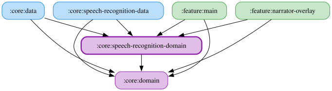

# speech-recognition-domain

音声認識（認識モード・ウェイクワード・認識結果の通知・開始/終了音）のモデル、Repository インターフェース、UseCase。

- `:core:domain` にのみ依存する。パッケージ名は `kurou.kodriver.domain.speechrecognition` 配下とする。
- 認識の取り違えを補正する `SPEECH_RECOGNITION_CORRECTIONS` は、`:core:domain` の手動読み上げの発話照合が参照するため `:core:domain` に置く。

`SpeechRecognitionTranscript`（認識途中の文字列と、直近に確定した発話の先頭候補）と `SpeechRecognitionTranscriptRepository`（`StateFlow` で最新の状態を保持）、送信・購読用の `ReportSpeechRecognitionTranscriptUseCase` / `ObserveSpeechRecognitionTranscriptUseCase` を提供する。聞き取りを行う `:feature:main` が通知し、オーバーレイなど他の feature が購読する（認識エンジンの聞き取りを購読し直すとマイクを二重に開くため、結果だけを共有する）。

<!-- MODULE-GRAPH-START -->
## Module Dependencies

<!-- MODULE-GRAPH-END -->
