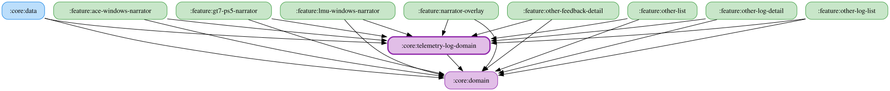

# telemetry-log-domain

読み上げ履歴（テレメトリログ）のモデル、Repository インターフェース、UseCase。

- `:core:domain` にのみ依存する。パッケージ名は `kurou.kodriver.domain.telemetrylog` 配下とする。

テレメトリログは読み上げの起点を `NarrationSource` で保持する。手動読み上げは `MANUAL`（`manual`）、それ以外（デバッグ読み上げを含む）は `AUTO`（`auto`）として保存する。

<!-- MODULE-GRAPH-START -->
## Module Dependencies

<!-- MODULE-GRAPH-END -->
