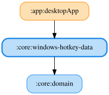

# windows-hotkey-data

Windowsグローバルホットキーを検出するJVM専用のI/O基盤です。
`GlobalHotkey` で修飾キーと仮想キーコードを指定し、
`GlobalHotkeySource.observe()` から登録結果と押下の `GlobalHotkeyEvent` を受け取ります。
非 Windows 環境ではネイティブ API を読み込まず `Unsupported` を通知します。
`HotkeyRepositoryImpl` は DataStore に保存された LMU のキーを監視し、変更時は解除後に再登録します。
既定は `Ctrl + Alt + Shift + F1`。LMU Windows デバッグ状態詳細ペインで末尾のキーを変更できます。
SimHub Control Mapper 側も同じ組み合わせに設定すると残りバーチャルエナジー現在値を読み上げます。
`windowsHotkeyDataModule` がドメインの `HotkeyRepository` をデスクトップアプリに提供します。
Repository 内の共有 Flow で Narrator の押下購読とデバッグペインの状態購読を一つの登録にまとめます。
登録状態は保持し、過去の押下は再配信しません。

`ManualReadoutHotkeyRepositoryImpl` は全シミュレーターの保存済みセットを監視し、
キーを割り当てたセットごとに `Ctrl + Alt + Shift` と保存済みキーを登録します。
押下は `(simulatorId, setId)` の `ManualReadoutRequest` として配信し、過去の押下は再配信しません。
押下・状態の購読で登録を共有し、キー変更・解除・セット削除では対象の登録だけを解除します。
文言や項目だけの変更では再登録せず、競合・失敗時の再試行も対象セットだけを登録し直します。
最後の購読終了時にすべて解除します。未割り当て・削除済みセットの状態は `Unsupported` です。
`windowsHotkeyDataModule` が全シミュレーターの名前付き設定 Repository と結び付けます。

Flowの購読中だけ専用メッセージループスレッドで `RegisterHotKey` / `GetMessage` を実行します。
`MOD_NOREPEAT` で長押しによる連続通知を防ぎます。登録に失敗した場合は Sentry へ記録し、GetLastError が 1409 なら `Conflict`、それ以外は `Failed(errorCode)` を通知します。
キャンセル時はキューの準備を待って `PostThreadMessage(WM_QUIT)` を呼び、登録したスレッドで
`UnregisterHotKey` を実行してからスレッドの終了を待ちます。

`JnaHotkeyNativeApi` はプラットフォーム固有の外部APIを直接呼び出すため、ユニットテストとカバレッジの対象外です。
上位の登録・通知・解除・OS分岐は `HotkeyNativeApi` のFakeでテストします。

<!-- MODULE-GRAPH-START -->
## Module Dependencies

<!-- MODULE-GRAPH-END -->
