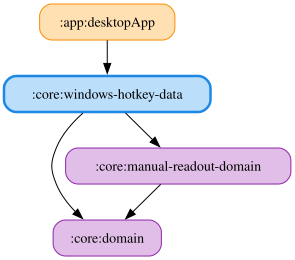

# windows-hotkey-data

Windowsグローバルホットキーを検出するJVM専用のI/O基盤です。
`GlobalHotkey` で修飾キーと仮想キーコードを指定し、
`GlobalHotkeySource.observe()` から登録結果と押下の `GlobalHotkeyEvent` を受け取ります。
非 Windows 環境ではネイティブ API を読み込まず `Unsupported` を通知します。
`windowsHotkeyDataModule` はドメインの `ManualReadoutHotkeyRepository` をデスクトップアプリに提供します。

`ManualReadoutHotkeyRepositoryImpl` は全シミュレーターの保存済みセットを監視し、
キーを割り当てたセットごとに保存済みの修飾キー（3択）とキーを登録します。
押下は `(simulatorId, setId)` の `ManualReadoutRequest` として配信し、過去の押下は再配信しません。
押下・状態の購読で登録を共有し、キー・修飾キー変更・解除・セット削除では対象の登録だけを解除します。
文言や項目だけの変更では再登録せず、競合・失敗時の再試行も対象セットだけを登録し直します。
最後の購読終了時にすべて解除します。未割り当て・削除済みセットの状態は `Unsupported` です。
`windowsHotkeyDataModule` が全シミュレーターの名前付き設定 Repository と結び付けます。

Flowの購読中だけ専用メッセージループスレッドで `RegisterHotKey` / `GetMessage` を実行します。
`MOD_NOREPEAT` で長押しによる連続通知を防ぎます。登録に失敗した場合は Sentry へ記録し、GetLastError が 1409 なら `Conflict`、それ以外は `Failed(errorCode)` を通知します。
キャンセル時はキューの準備を待って `PostThreadMessage(WM_QUIT)` を呼び、登録したスレッドで
`UnregisterHotKey` を実行してからスレッドの終了を待ちます。

`JnaHotkeyNativeApi` はプラットフォーム固有の外部APIを直接呼び出すため、ユニットテストとカバレッジの対象外です。
上位の登録・通知・解除・OS分岐は `HotkeyNativeApi` のFakeでテストします。

<!-- MODULE-GRAPH-START -->
## Module Dependencies

<!-- MODULE-GRAPH-END -->
