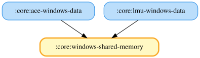

# windows-shared-memory

Windows共有メモリ（`OpenFileMappingA` / `MapViewOfFile`）を読み取る汎用I/O基盤を提供するJVM専用モジュールです。
シミュレーター固有の構造体レイアウトやパースロジックは持たず、`core:lmu-windows-data` / `core:ace-windows-data` など、
Windows共有メモリからテレメトリを取得する各データモジュールに共通の下層基盤として使われます。

`SharedMemoryPollingSource` は、`SharedMemoryReader` を一定間隔でポーリングして `Flow<ByteBuffer>` として配信する
共通ロジック（open/close・再接続・排他制御・heap バッファへのコピー）を提供します。接続判定など reader への
追加操作が必要な呼び出し元は `withReaderLock` を使うことで、ポーリングループと同じ排他制御の下で安全に実行できます。

<!-- MODULE-GRAPH-START -->
## Module Dependencies

<!-- MODULE-GRAPH-END -->

## Kernel32の遅延初期化テスト

`Kernel32FileMappingTest` は `INSTANCE` の初回参照までライブラリを取得しないこと、
`kernel32` を指定したJNAプロキシを一度だけ生成して再利用すること、
ロード失敗を伝播し次の参照で再試行することを検証します。
`Native.load` は実行し、DLL取得の境界である `NativeLibrary.getInstance` だけをモック化します。
モックは各テストの `finally` で解除します。

`by lazy` の保持値が他のテストへ残らないよう、対象インターフェースとその生成クラスだけを
テストごとのクラスローダーで読み込み、リフレクションで `INSTANCE` を参照します。
JNAやKotlinのクラスは通常のクラスローダーを共有します。本物のWindows DLLは読み込みません。
