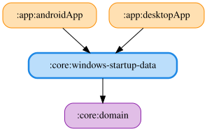

# windows-startup-data

OS起動時にKoDriverを自動起動するかどうかの設定を、Windowsレジストリ（`HKCU\Software\Microsoft\Windows\CurrentVersion\Run`）への登録・解除で実現するJVM専用モジュールです。
レジストリへのアクセスは`Advapi32Util`（JNA）を直接呼び出すため、Windows以外の環境では何もしないNo-Op実装にフォールバックします。

<!-- MODULE-GRAPH-START -->
## Module Dependencies

<!-- MODULE-GRAPH-END -->

## テスト

`RegistryStartupRegistrySource` は `StartupRegistryApi` のFakeとコマンド取得関数を注入し、
登録先・登録値、未登録時の削除抑止、コマンド取得失敗と外部APIの例外伝播を検証します。
JNAを直接呼ぶ `JnaStartupRegistryApi` はユニットテストとカバレッジの対象外です。
実際のWindowsレジストリへの接続はWindows上での統合確認が必要です。
