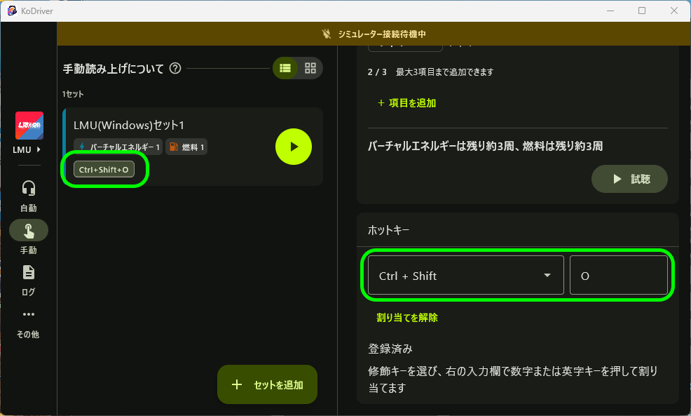
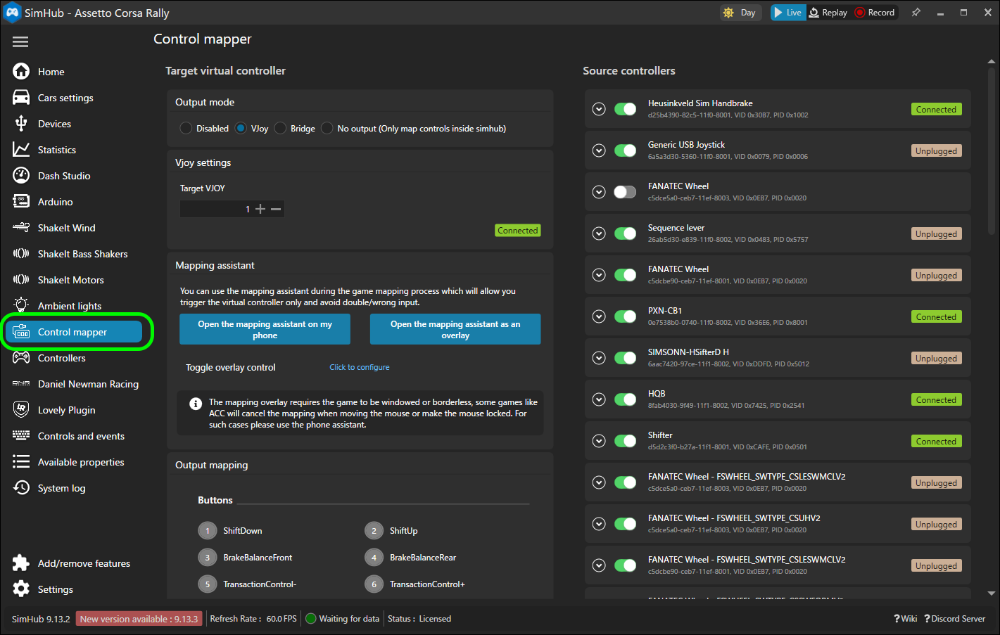
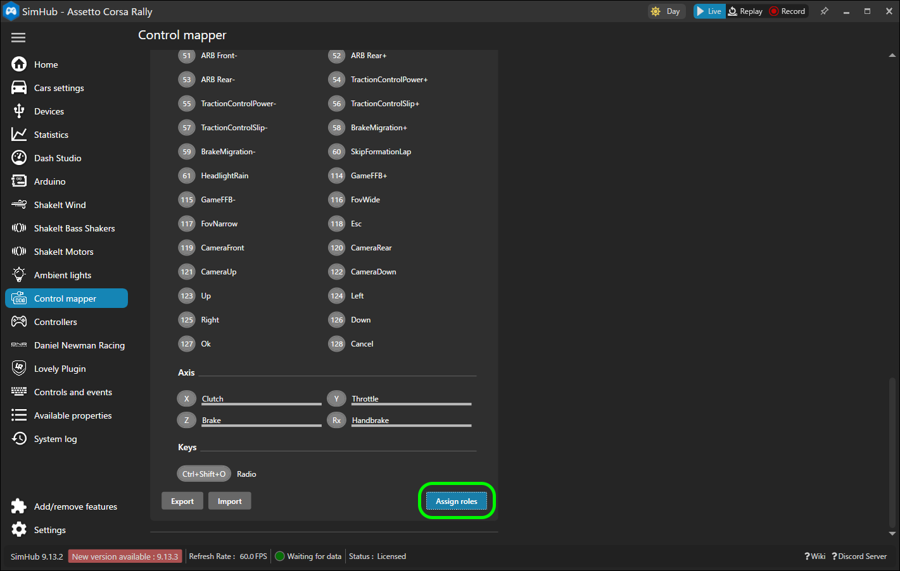
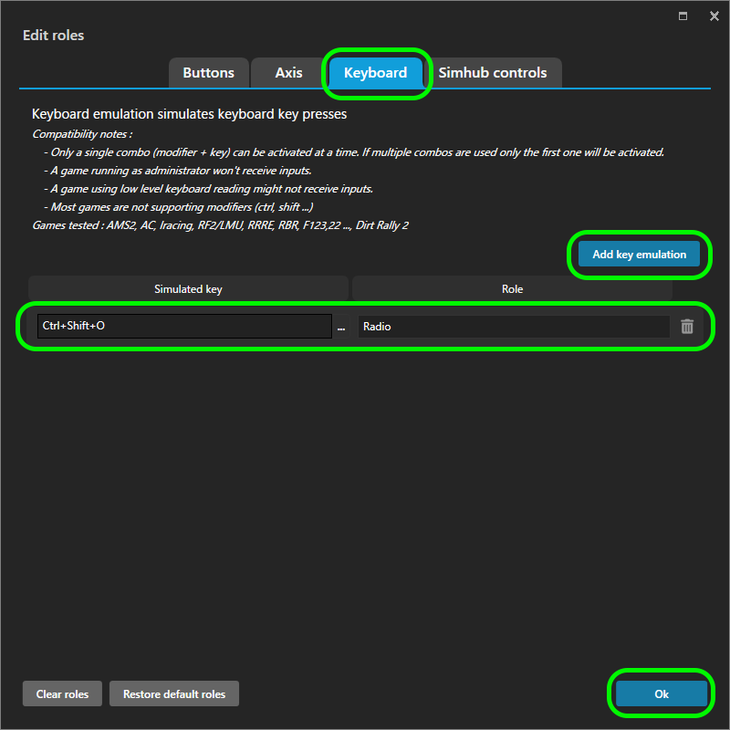
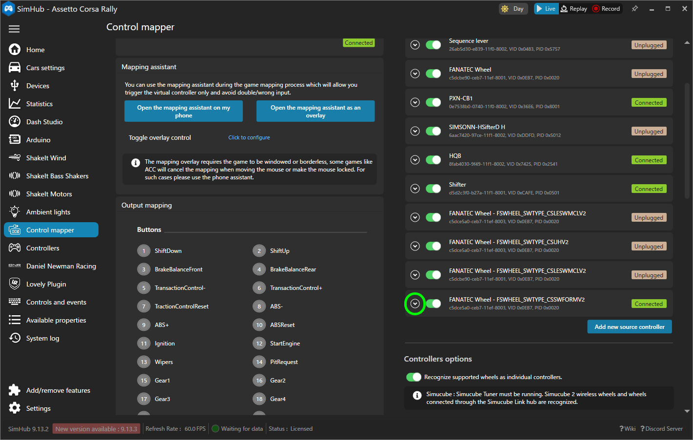
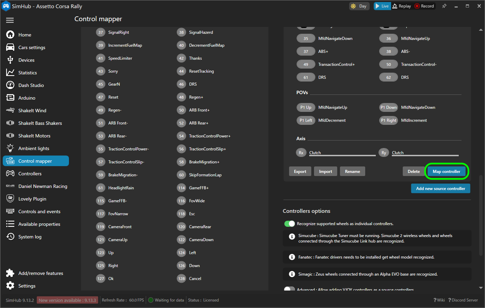
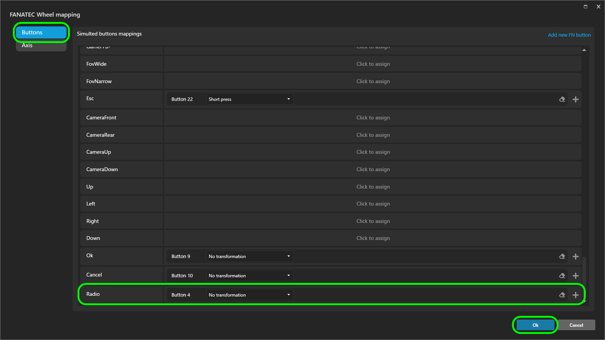

# ステアリングのボタンから手動読み上げを実行する設定（SimHub Control mapper）

Windows 版 KoDriver の手動読み上げセットは、キーボードのホットキーで実行できます。SimHub の Control mapper でキーボード入力のエミュレーションを設定すると、同じホットキーをステアリングのボタンから実行できます。

この手順書では、KoDriver のホットキーと SimHub の Control mapper を連携させる部分だけを説明します。Control mapper 自体の使い方は、SimHub の [Wiki](https://github.com/SHWotever/SimHub/wiki) など公開されている情報を参照してください。

この手順は実機で動作を確認しています。

## 前提

- Windows 版 KoDriver を使用している（ホットキーは Windows デスクトップ版のみ対応）。
- SimHub がインストール済みで、使用するステアリングが SimHub に認識されている。

以降の例では、ホットキーを `Ctrl+Shift+O`、SimHub の Role 名を `Radio` とします。

## 手順1: KoDriver でホットキーを割り当てる

1. KoDriver の「手動」タブで、ボタンから実行したいセットを開きます。
2. 詳細画面の「ホットキー」で、左のプルダウンから修飾キーを選びます。
3. 右の入力欄で、数字または英字のキーを押して割り当てます。
4. 「登録済み」と表示されることを確認します。一覧のセットにもホットキーのチップ（例: `Ctrl+Shift+O`）が表示されます。

> **注意**
> - 同じ組み合わせを複数のセットに割り当てることはできません。
> - 他のアプリが使用中の組み合わせは登録できません。詳細画面にその旨が表示されるので、別の組み合わせを選んでください。

## 手順2: SimHub でキーボード入力の Role を作る

1. SimHub の左メニューから「Control mapper」を開きます。

   

2. 画面を下へスクロールし、「Assign roles」を押します。

   

3. 「Edit roles」の「Keyboard」タブを開き、「Add key emulation」を押します。
4. 追加された行の「Simulated key」に、手順1で割り当てたものと同じ `Ctrl+Shift+O` を設定し、「Role」に `Radio` と入力して「Ok」を押します。

   

## 手順3: ステアリングのボタンを Role に割り当てる

1. 「Source controllers」で、使用するステアリングの行の展開矢印を押します。

   

2. 展開した欄の下部にある「Map controller」を押します。

   

3. 「Buttons」タブで、手順2で作った `Radio` の行をクリックし、割り当てたいステアリングのボタンを押します（画像では Button 4）。割り当てたら「Ok」を押します。

   

## 動作確認

ステアリングのボタンを押して、KoDriver がセットを読み上げることを確認します。

読み上げられない場合は、次を確認してください。

- KoDriver の詳細画面のホットキーが「登録済み」になっている。
- SimHub の Simulated key と KoDriver のホットキーが同じ組み合わせになっている。
- 他のアプリが同じ組み合わせを使っていない。

SimHub のキーボードエミュレーションには、次の制限があります（SimHub の「Edit roles」の Keyboard タブにも記載されています）。

- 修飾キーとキーの組み合わせは、1つしか有効になりません。複数設定した場合は最初の1つだけが有効です。
- 管理者権限で動作しているゲームには、入力が届かない場合があります。
