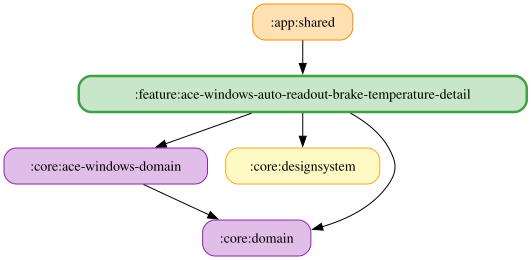

# ace-windows-auto-readout-brake-temperature-detail

ACE のブレーキ温度アナウンスの詳細画面。過熱警告の有効/無効、読み上げ文言、過熱閾値（600〜1000℃、既定800℃）を設定して保存する。
Narrator はこれらの設定をまだ参照せず、ブレーキ温度を自動では読み上げない。タイトルはタイトルバーが表示する。

読み上げ文言の `{celsius}` は過熱閾値（℃）に置き換わる（実測温度ではない）。未知のプレースホルダーは警告を表示し、そのまま読み上げる。試聴は画面に表示中の閾値を使い、空白・TTS利用不可・音量ゼロ以下では再生しない。開始音は `BrakeTemperature.Root` を参照する。試聴中に試聴ボタンを再押しするか、詳細ペインを離れると停止する。

UI 状態の合成は `AceWindowsAutoReadoutBrakeTemperatureDetailFlow` が cold Flow として担う。共有・初期値・`viewModelScope` での実行は ViewModel が管理する。

<!-- MODULE-GRAPH-START -->
## Module Dependencies

<!-- MODULE-GRAPH-END -->
