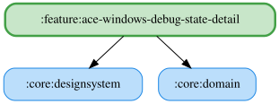

# ace-windows-debug-state-detail

ACE Windows 専用のデバッグ状態画面。シミュレーター、車両位置、フラグ情報、周辺車両、自己ベストラップ、タイヤカーカス温度、燃料残量・残り周数を7枚のカードで表示し、ドラッグしたカード順序を保存する。
既存の `:feature:debug-state-detail` と並存する自己完結モジュールで、表示ヘルパーもこのモジュール内に保持する。
現在はアプリから使われておらず、Koin モジュールもアプリには登録していない。

<!-- MODULE-GRAPH-START -->
## Module Dependencies

<!-- MODULE-GRAPH-END -->

## 主要ファイル

- `AceWindowsDebugStateDetailPane.kt`: ViewModel を取得する Pane と、状態・操作を受け取る公開 PaneContent。画面幅に合わせて1〜3列に切り替える。
- `AceWindowsDebugStateDetailViewModel.kt` / `AceWindowsDebugStateDetailUiState.kt`: ACE 状態、受信済みカード、カード順序を管理する。シミュレーターカードは常に ACE を表示し、有効にする。
- `AceWindowsDebugStateSource.kt` / `AceWindowsDebugState.kt`: ACE の UseCase 購読、状態の集約、受信済みカードの通知。
- `AceWindowsDebugStateCards.kt` / `DebugState*Card.kt`: ACE 専用のカード表示。フレーム、未取得表示、温度・ラップタイム等の整形ヘルパーも同梱する。
- `AceWindowsDebugStateDetailModule.kt` / `AceWindowsDebugStateModule.kt`: ViewModel と UseCase の Koin 定義。利用側が必要な Repository を登録する。

## カード順序と未取得表示

ドメイン層の Observe / Resolve / Save UseCase を使用し、保存済み順序を優先して不足カードを既定順で補完する。ACE 非対応カードは保存済み順序から除外する。
既定順はシミュレーター、車両位置、フラグ情報、周辺車両、自己ベストラップ、タイヤカーカス温度、燃料消費。
未受信カードは薄く表示し、データがない場合は「未取得」、温度が欠損した輪は `-` と表示する。燃料または残り周数を受信すると燃料カードを有効にし、残り周数は正の有限値の場合のみ表示する。

## テスト

`src/jvmTest` に ACE の購読、状態集約、カード順序・保存、カード表示、フォーマッター、Pane の配線を検証するテストを置く。
Desktop のスクリーンショットテスト（`AceWindowsDebugStateDetailPaneScreenshotTest`）を持つ。ゴールデンPNGはCIが記録するためコミットしない。Android と Desktop で表示が異なるケースはないため Android 向けは追加しない。
