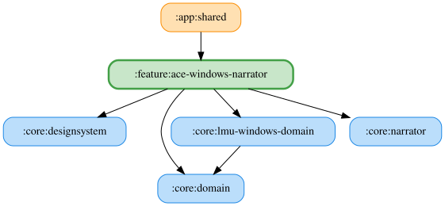

# ace-windows-narrator

ACE (Assetto Corsa EVO) Windows版の開始音WAV再生・自由文言TTSとアナウンス制御。`feature:lmu-windows-narrator` /
`feature:gt7-ps5-narrator` に相当する ACE 版。

`AceWindowsNarratorViewModel` が `ObserveAceWindowsFuelUseCase` の燃料残量と
`ObserveAceWindowsRemainingFuelThresholdPercentageUseCase` の閾値を監視し、
`AceWindowsNarratorEventProcessor` を通じて `AceWindowsRemainingFuelWarning` を
`TextToSpeechEngine` 実装の `AceWindowsNarratorEngine`（`:core:narrator` の `NarratorEngine` に委譲する薄いアダプタ）に
渡して、`AceWindowsReadoutTextSpeaker` の自由文言をOS標準TTSで読み上げる。
保存先は `AceWindowsRemainingFuelPreferences` のフィールド2（`readoutText`）、既定文言は「燃料は残り{percent}パーセント」。
`{percent}` は判定時の実残量を四捨五入した整数（0〜100）に置換する。閾値・有効判定は従来どおり。
ACEの自由文言イベントは `ReadoutTextEvent` を継承する sealed interface `AceWindowsSpeechEvent` を実装する。
全10種類のフラッグは、その下位の sealed interface `AceWindowsFlagSpeechEvent` にまとめる。
残燃料周回数・残燃料・タイヤ過熱・車両接近・自己ベストラップの5種類は `AceWindowsSpeechEvent` を直接実装する。
SpeakerはACEイベントと `DebugReadoutText` を対象とし、ACE本文とフラッグ本文を網羅的な `when` で解決する。
他シミュレーターのイベントは、解決済み本文を持つ場合も読み上げない。
Processorで解決した本文をイベントの `resolvedText` に保持し、キュー待機中の設定変更後も発話とログを一致させる。
空白・TTS利用不可では開始音も本文も要求せず、空文字と `SKIPPED` をログに保存する。
開始音・優先度・キューは `RemainingFuel.Root` を維持する。WAVフォールバックは行わない。
詳細画面では自由文言の編集・既定値へのリセット・`{percent}` の末尾挿入と未知プレースホルダーの警告を提供する。試聴は画面に表示中の残量閾値を使い、`RemainingFuel.Root` の開始音とOS標準TTSで再生する。空白文言・TTS利用不可・音量ゼロ以下では開始音も本文も再生しない。

燃料残り周回数（`AceWindowsRemainingFuelLapsWarning`）も同様に、保存した自由文言をOS標準TTSで読み上げる。
保存先は `AceWindowsRemainingFuelLapsPreferences` のフィールド2（`readoutText`、既定「燃料は残り約{laps}周」）と
フィールド3（`emptyReadoutText`、0周以下用、既定「燃料残り1周未満」）。`{laps}` は判定時の整数周回数に置換する。
Processorで解決した本文を `resolvedText` に保持し、空白・TTS利用不可では開始音も本文も要求せず `SKIPPED` を記録する。
開始音・優先度・キューは `RemainingFuelLaps.Root` を維持する。WAVフォールバックは行わない。
詳細画面では通常文言・0周以下用文言の自由文言編集と既定値へのリセットを提供し、通常文言には `{laps}` の末尾挿入と未知プレースホルダーの警告を表示する。試聴は通常文言を画面に表示中の閾値周回数で置換し、0周以下用文言はそのまま使い、`RemainingFuelLaps.Root` の開始音とOS標準TTSで再生する。空白文言・TTS利用不可・音量ゼロ以下では開始音も本文も再生しない。
イベント別のWAVは持たず、WAVは開始音のみ。開始音のパスは `AceWindowsNarratorModule.kt` で定義する。
`SoundPlayer` 等の音声再生基盤の実装は `:core:narrator` を参照。

Checkered・White・Green・Red・Blue・Yellow・Black・BlackWhite・OrangeCircle・RedYellowStripes の全10種は、`AceWindowsReadoutTextSpeaker` が保存文言（既定値は各SpeechEventのnarratedTextと同じ）を
OS標準TTSで読み上げる。`NarratorEngine` の `customSpeak` 経路を使い、WAVへフォールバックしない。
空白文言・TTS利用不可では本文も開始音も要求せず、テレメトリログに空文字と `SKIPPED` を記録する。
開始音・優先度・キューは `AceWindowsReadoutItemKey.Flag.Root` を参照する。全フラッグが自由文言のOS標準TTSで、フラッグのWAVは使用しない。
判定時に解決した本文を `resolvedText` に保持し、キュー待機中に設定が変わっても発話とログを一致させる。

車両接近も保存した固定の自由文言を `AceWindowsReadoutTextSpeaker` がOS標準TTSで読み上げる。
判定時に解決した本文を `resolvedText` に保持し、キュー待機中に設定が変わっても発話とログを一致させる。
既定文言は「車両接近」で、既存の車両接近DataStoreのフィールド5に保存する。プレースホルダーはない。
Narratorで都度文言を解決し、空白・TTS利用不可では開始音も本文も要求せず、空文字と `SKIPPED` をログに保存する。
有効判定は `VehicleApproach.Root` と `StartReadout` を維持し、開始音・優先度・キューは `VehicleApproach.Root` を使う。
WAVへのフォールバックは行わない。

タイヤ過熱も保存した自由文言をOS標準TTSで読み上げる。既定文言は「タイヤ過熱 {celsius}度」で、
`AceWindowsTyreTemperaturePreferences` のフィールド3に保存する。`{celsius}` は判定時点の全輪最大カーカス温度を
`roundToInt` で四捨五入した整数に置換する。過熱・解除の判定ロジックは従来どおり。
Processorで解決した本文を `AceWindowsTyreOverheat.resolvedText` に保持し、発話とログを一致させる。
空白・TTS利用不可では開始音も本文も要求せず、空文字と `SKIPPED` をログに保存する。
開始音・優先度・キューは `TyreTemperature.Root` を維持する。WAVフォールバックは行わない。

自己ベストラップ更新（`AceWindowsMyBestLap`）も保存した自由文言をOS標準TTSで読み上げる。
保存先は共有 `MyBestLapPreferences` の `@ProtoNumber(4) aceWindowsReadoutText`、既定文言は「自己ベストラップ更新 {laptime}」。
`{laptime}` は更新後の `bestLapTimeMs` を「1分23秒456」形式に置換する。旧口調設定（`voiceType`）は読み取らない。
Processorで解決した本文を `resolvedText` に保持し、空白・TTS利用不可では開始音も本文も要求せず `SKIPPED` を記録する。
開始音・優先度・キューは `MyBestLap.Root` を使う。WAVへのフォールバックは行わない。

Koinモジュールは`ObserveVoiceSpeedUseCase`・`ObserveVoicePitchUseCase`を提供し、`:core:data`の`VoiceSpeedPreferencesRepository`・`VoicePitchPreferencesRepository`を消費する。
`SpeakTextUseCase`は試聴・本文の読み上げに保存済み速度・声の高さ（ともに0.5〜2.0、既定1.0）を使用する。

<!-- MODULE-GRAPH-START -->
## Module Dependencies

<!-- MODULE-GRAPH-END -->

自由文言の解決で例外が発生した場合はエラーを記録し、当該イベントの開始音・本文を要求せず、
空文字と `SKIPPED` をテレメトリログに保存する。同じ入力の後続イベントと次回以降の収集は継続する。
`CancellationException` は再スローし、キャンセル後の読み上げ・ログ保存は行わない。

## デバッグ読み上げ要求

ViewModel の独立した Job が `ObserveDebugReadoutRequestUseCase` を購読し、自分のシミュレーター宛ての要求だけを EventProcessor の `processDebugReadout` に渡す。テレメトリ未受信でも処理し、項目の有効スイッチと determine 系の判定は通さない。

`DebugReadoutText` の本文は入力をそのまま保持する。通常の文言解決・優先度・キュー・開始音・TTS・安全なログ保存の経路を使い、空白または TTS 利用不可の本文は SKIPPED として記録する。ログの JSON は現在の `state`、`settings`、`observedAtMs` と `debugReadout: true` を含む。ログを購読するオーバーレイは通常の最新読み上げログ経路で表示する。

JVM テストで未受信・項目無効の要求の発話とログ保存、別シミュレーター宛ての要求の無視、空白スキップとテンプレートをそのまま TTS に渡すことを検証する。

## 手動読み上げセット

ACE の手動読み上げは、一覧の ▶ と Windows のセットホットキーからの依頼を合流し、
`Simulator.AceWindows.id` 宛てで保存済みセットが見つかり、ACE が選択中の場合だけ処理する。
`manualReadoutItemKeys(Simulator.AceWindows.id)` は既存の `AceWindowsReadoutItemKey.RemainingFuel.Root.value`
（`ace_windows_auto_remaining_fuel`）を返し、手動の「残り燃料」を選択できる。
`currentRemainingFuelPercent(data)` は `AceWindowsFuelData.remainingPercent`（0〜100）を四捨五入した整数％を返す。
未受信・受信から5秒超・非有限・0未満・100超は null とし、シミュレーター切替時は最新値と受信時刻をクリアする。
鮮度判定済みの `AceWindowsManualReadoutItem(key, textTemplate, value)` を保存順に最大3件処理し、
手動専用の `ACE_WINDOWS_MANUAL_READOUT_REMAINING_FUEL_TEXT_DEFAULT`（「燃料は残り{percent}パーセント」）か
セットの編集文言を `formatAceWindowsRemainingFuelReadoutText` で置換する。
空白文言を除外して「、」で連結し、`AceWindowsManualReadoutText` の1イベントにまとめる。
値が null の項目は「残り燃料はデータがありません」を読む（全項目がデータ無しでも同じ）。
対応項目なしは
「読み上げる項目がありません」、全項目が空白なら空文字とする。
自動読み上げのスイッチ・閾値・`remainingFuelWarned` 等の判定状態は変更せず、
開始音・ログ・常時キュー末尾追加には既存の `RemainingFuel.Root` を使う。
`manualReadoutItemKeys(Simulator.AceWindows.id)` は続けて既存の `AceWindowsReadoutItemKey.RemainingFuelLaps.Root.value`（`ace_windows_auto_remaining_fuel_laps`）を返し、手動の「残り燃料の周回数」を選択できる。
`currentRemainingFuelLaps(data)` は `AceWindowsRemainingFuelLapsData.remainingLaps` の整数部を返し、未受信・受信から5秒超・非有限・0以下・上限超過は null（データなし）とする。
手動専用の `ACE_WINDOWS_MANUAL_READOUT_REMAINING_FUEL_LAPS_TEXT_DEFAULT`（「燃料は残り約{laps}周」）を `formatAceWindowsRemainingFuelLapsReadoutText` で置換し、値が null の項目は「残り燃料の周回数はデータがありません」を読む。
自己ベストラップも同じ手動セットで選択でき、最新の `bestLapTimeMs > 0` の値を（Android ではサーバーが値の変化時しか送らないため5秒の鮮度判定はせず、未受信・0以下・シミュレーター切替後はデータなし） `formatAceWindowsMyBestLapReadoutText` で整形する。自動用 `AceWindowsMyBestLap` イベントの動作は変えない。

`processManualReadout` のログ JSON は `state`・`settings`・`observedAtMs` の3フィールドで、
状態と設定は `toRawTelemetryLogJson` を使い、テレメトリの前回値・現在値を含めない。

ACE の手動項目は `RemainingFuel`、`RemainingFuelLaps`、`MyBestLap`、`TyreTemperature` の順。
手動「タイヤ温度」は既存の `AceWindowsReadoutItemKey.TyreTemperature.Root` を使い、
`currentMaxTyreTemperatureCelsius` で `AceWindowsTyreCarcassTemperatureData.wheels` の有限かつ0より大きい
最高値を四捨五入した整数℃を取得する。未受信・受信から5秒超・有効な温度なし・ACE以外への切り替え後は
「タイヤ温度はデータがありません」を読む。既定文言は `ACE_WINDOWS_MANUAL_READOUT_TYRE_TEMPERATURE_TEXT_DEFAULT`
（「タイヤ温度{celsius}℃」）。既存の `formatAceWindowsTyreTemperatureReadoutText` と
`findUnknownAceWindowsTyreTemperatureReadoutPlaceholders` を使い、詳細画面ではタイヤカテゴリ、プレビューは90℃。
`AceWindowsTyreTemperatureCurrentValue` の本文をセットの保存順に連結し、空欄は読み上げない。
自動過熱警告のしきい値・ヒステリシス・スイッチ判定は適用せず、警告状態も変更しない。
開始音とログには既存の `RemainingFuel.Root` を使い、常にキュー末尾へ追加する。

テレメトリログは読み上げの起点を `NarrationSource` で保持する。手動読み上げは `MANUAL`（`manual`）、それ以外（デバッグ読み上げを含む）は `AUTO`（`auto`）として保存する。
