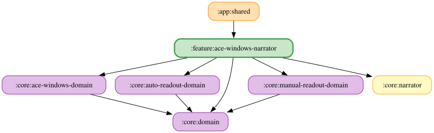

# ace-windows-narrator

ACE (Assetto Corsa EVO) Windows版の開始音WAV再生・自由文言TTSとアナウンス制御。`feature:lmu-windows-narrator` /
`feature:gt7-ps5-narrator` に相当する ACE 版。

`AceWindowsNarratorFlow` は、選択シミュレーターに応じた一覧設定・順序の購読切り替え、
一覧と詳細の有効設定の合成、ACE 選択中だけのテレメトリ購読、手動要求とホットキー要求の合流を担う。
`stateIn`・`shareIn` の共有と初期値、`viewModelScope`、イベント処理と最新テレメトリの保持は
`AceWindowsNarratorViewModel` が管理する。設定のスナップショットも ViewModel で各 StateFlow の現在値から取得する。

`AceWindowsNarratorViewModel` はテレメトリと閾値を監視し、`AceWindowsNarratorEventProcessor` が判定したイベントを
`TextToSpeechEngine` 実装の `AceWindowsNarratorEngine`（`:core:narrator` の `NarratorEngine` に委譲する薄いアダプタ）に渡して、
`AceWindowsReadoutTextSpeaker` の自由文言をOS標準TTSで読み上げる。
ACEの自由文言イベントは `ReadoutTextEvent` を継承する sealed interface `AceWindowsSpeechEvent` を実装する。
全10種類のフラッグは、その下位の sealed interface `AceWindowsFlagSpeechEvent` にまとめる。
残燃料周回数・残燃料・タイヤ過熱・車両接近・自己ベストラップの5種類は `AceWindowsSpeechEvent` を直接実装する。
SpeakerはACEイベントと `DebugReadoutText` を対象とし、ACE本文とフラッグ本文を網羅的な `when` で解決する。
他シミュレーターのイベントは、解決済み本文を持つ場合も読み上げない。
イベント別のWAVは持たず、WAVは開始音のみ。開始音のパスは `AceWindowsNarratorModule.kt` で定義する。
`SoundPlayer` 等の音声再生基盤の実装は `:core:narrator` を参照。

自動読み上げ各項目（フラッグ・車両接近・タイヤ過熱・燃料残量・燃料残り周回数・自己ベストラップ）の既定文言・保存先・プレースホルダー・開始音のキー、
および全項目共通の動作（`resolvedText` の保持、空白・TTS利用不可時の `SKIPPED`、WAVへフォールバックしないこと）は
[`docs/readout-item-key-wiring.md`](../../docs/readout-item-key-wiring.md) から辿れる ACE の項目表を正とする。

Koinモジュールは`ObserveVoiceSpeedUseCase`・`ObserveVoicePitchUseCase`を提供し、`:core:data`の`VoiceSpeedPreferencesRepository`・`VoicePitchPreferencesRepository`を消費する。
`SpeakTextUseCase`は試聴・本文の読み上げに保存済み速度・声の高さ（ともに0.5〜2.0、既定1.0）を使用する。

<!-- MODULE-GRAPH-START -->
## Module Dependencies

<!-- MODULE-GRAPH-END -->

自由文言の解決で例外が発生した場合はエラーを記録し、当該イベントの開始音・本文を要求せず、
空文字と `SKIPPED` をテレメトリログに保存する。同じ入力の後続イベントと次回以降の収集は継続する。
`CancellationException` は再スローし、キャンセル後の読み上げ・ログ保存は行わない。

## デバッグ読み上げ要求

ViewModel の独立した Job が `ObserveDebugReadoutRequestUseCase` を購読し、自分のシミュレーター宛ての要求だけを EventProcessor の `processDebugReadout` に渡す。テレメトリ未受信でも処理し、項目の有効スイッチと determine 系の判定は通さない。

`DebugReadoutText` の本文は入力をそのまま保持する。通常の文言解決・優先度・キュー・開始音・TTS・安全なログ保存の経路を使い、空白または TTS 利用不可の本文は SKIPPED として記録する。ログの JSON は現在の `state`、`settings`、`observedAtMs` と `debugReadout: true` を含む。ログを購読するオーバーレイは通常の最新読み上げログ経路で表示する。

JVM テストで未受信・項目無効の要求の発話とログ保存、別シミュレーター宛ての要求の無視、空白スキップとテンプレートをそのまま TTS に渡すことを検証する。

## 手動読み上げセット

ACE の手動読み上げは、一覧の ▶ と Windows のセットホットキーからの依頼を合流し、
`Simulator.AceWindows.id` 宛てで保存済みセットが見つかり、ACE が選択中の場合だけ処理する。
`manualReadoutItemKeys(Simulator.AceWindows.id)` は既存の `AceWindowsReadoutItemKey.RemainingFuel.Root.value`
（`ace_windows_auto_remaining_fuel`）を返し、手動の「燃料残量」を選択できる。
`currentRemainingFuelPercent(data)` は `AceWindowsFuelData.remainingPercent`（0〜100）を四捨五入した整数％を返す。
未受信・受信から5秒超・非有限・0未満・100超は null とし、シミュレーター切り替え時は最新値と受信時刻をクリアする。
鮮度判定済みの `AceWindowsManualReadoutItem(key, textTemplate, value)` を保存順に最大3件処理し、
手動専用の `ACE_WINDOWS_MANUAL_READOUT_REMAINING_FUEL_TEXT_DEFAULT`（「燃料は残り{percent}%」）か
セットの編集文言を `formatAceWindowsRemainingFuelReadoutText` で置換する。
空白文言を除外して「、」で連結し、`AceWindowsManualReadoutText` の1イベントにまとめる。
値が null の項目は「燃料残量はデータがありません」を読む（全項目がデータ無しでも同じ）。
対応項目なしは
「読み上げる項目がありません」、全項目が空白なら空文字とする。
自動読み上げのスイッチ・閾値・`remainingFuelWarned` 等の判定状態は変更せず、
開始音・ログ・手動優先の読み上げには既存の `RemainingFuel.Root` を使う。
`manualReadoutItemKeys(Simulator.AceWindows.id)` は続けて既存の `AceWindowsReadoutItemKey.RemainingFuelLaps.Root.value`（`ace_windows_auto_remaining_fuel_laps`）を返し、手動の「燃料残り周回数」を選択できる。
`currentRemainingFuelLaps(data)` は `AceWindowsRemainingFuelLapsData.remainingLaps` の整数部を返し、未受信・受信から5秒超・非有限・負値・上限超過は null（データなし）とする。ちょうど0は0周として扱い、固定文言「燃料は残り1周未満」を読む。
手動専用の `ACE_WINDOWS_MANUAL_READOUT_REMAINING_FUEL_LAPS_TEXT_DEFAULT`（「燃料は残り約{laps}周」）を `formatAceWindowsRemainingFuelLapsReadoutText` で置換し、値が null の項目は「燃料残り周回数はデータがありません」を読む。
自己ベストラップも同じ手動セットで選択でき、最新の `bestLapTimeMs > 0` の値を（Android ではサーバーが値の変化時しか送らないため5秒の鮮度判定はせず、未受信・0以下・シミュレーター切り替え後はデータなし） `formatAceWindowsMyBestLapReadoutText` で整形する。自動用 `AceWindowsMyBestLap` イベントの動作は変えない。

`processManualReadout` のログ JSON は `state`・`settings`・`observedAtMs` の3フィールドで、
状態と設定は `toRawTelemetryLogJson` を使い、テレメトリの前回値・現在値を含めない。

ACE の手動項目は `RemainingFuel`、`RemainingFuelLaps`、`MyBestLap`、`TyreTemperature`、`CarGap` の順。
手動「タイヤ温度」は既存の `AceWindowsReadoutItemKey.TyreTemperature.Root` を使い、
`currentMaxTyreTemperatureCelsius` で `AceWindowsTyreCarcassTemperatureData.wheels` の有限かつ0より大きい
最高値を四捨五入した整数℃を取得する。未受信・受信から5秒超・有効な温度なし・ACE以外への切り替え後は
「タイヤ温度はデータがありません」を読む。既定文言は `ACE_WINDOWS_MANUAL_READOUT_TYRE_TEMPERATURE_TEXT_DEFAULT`
（「タイヤ温度は{celsius}℃」）。既存の `formatAceWindowsTyreTemperatureReadoutText` と
`findUnknownAceWindowsTyreTemperatureReadoutPlaceholders` を使い、詳細画面ではタイヤカテゴリ、プレビューは90℃。
`AceWindowsTyreTemperatureCurrentValue` の本文をセットの保存順に連結し、空欄は読み上げない。
自動過熱警告のしきい値・ヒステリシス・スイッチ判定は適用せず、警告状態も変更しない。
開始音とログには既存の `RemainingFuel.Root` を使い、手動優先で読み上げる。

手動「前後車ギャップ」は新設の `AceWindowsReadoutItemKey.CarGap.Root`（`ace_windows_auto_car_gap`）を使う手動専用の1項目で、
自動読み上げのスイッチ・保存設定は持たない（LMU の `ClassCarGap.Ahead` / `Behind` とは違い前後を1項目にまとめる）。
`AceWindowsGapRepository` の `AceWindowsGapData`（前車・後車との符号付き秒数）を `ObserveAceWindowsGapUseCase` 経由で受信し、
受信から5秒以内のものを `AceWindowsManualReadoutItem.gap` に渡す。未受信・鮮度切れ・ACE以外への切り替え後は
「前後車とのギャップはデータがありません」を読む。既定文言は `ACE_WINDOWS_MANUAL_READOUT_CAR_GAP_TEXT_DEFAULT`
（「前方{ahead}秒、後方{behind}秒」）で、`formatAceWindowsCarGapReadoutText` が `{ahead}` `{behind}` を単位なしの数値（例「1.5」「2.3」）に置換する。
秒数は符号を無視した絶対値を小数1桁に丸める。0・小数1桁で0になる値・非有限値は節全体（「前方{ahead}秒」「後方{behind}秒」）を「前方車なし」「後方車なし」に置換する。節を含まない文言（例「{ahead}と{behind}」）では、車なし時のプレースホルダーを「なし」に置換する。
`findUnknownAceWindowsCarGapReadoutPlaceholders` で `{ahead}` `{behind}` 以外を未知として検出し、詳細画面の挿入チップは
「前方{ahead}秒、後方{behind}秒」をまとめて挿入する。詳細画面のカテゴリはタイム、プレビューは前方1.5秒・後方2.3秒（既定文言）。
`AceWindowsCarGapCurrentValue` の本文をセットの保存順に連結し、空欄は読み上げない。
読み上げ時の開始音とログには他の ACE 手動項目と同じ `RemainingFuel.Root` を使い、試聴の開始音には `VehicleApproach.Root` を使う（`AceWindowsCarGapCurrentValue.readoutItemKey`・定義の `eventKey`）。ACE の共有メモリはクラス情報を持たず、マルチクラスレースもないため、
クラス内かどうかは区別しない。

音声認識の発話から届く `ObserveManualReadoutItemRequestsUseCase`（`ManualReadoutItemRequest(simulatorId, itemKey)`）も別の Job で購読し、ACE 宛ての依頼だけを、指定項目1つの一時セットとして `readManualReadout` に渡す。保存済みセットの編集文言は使わず既定文言で読む。1件の失敗で購読が止まらないよう依頼ごとに例外を `captureError` で記録する。
読み上げに至った（`processManualReadout` が `SKIPPED` 以外の結果を返した）依頼は、`NotifyManualReadoutItemSpokenUseCase` で通知する。音声タブがこれを受けて、一致した語句（`ManualReadoutItemRequest.matchedPhrase`）を強調する。

テレメトリログは読み上げの起点を `NarrationSource` で保持する。手動読み上げは `MANUAL`（`manual`）、それ以外（デバッグ読み上げを含む）は `AUTO`（`auto`）として保存する。
