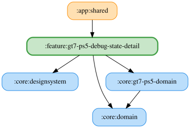

# gt7-ps5-debug-state-detail

GT7 PS5 専用のデバッグ状態画面。シミュレーター、車両クラス、現在のラップ、自己ベストラップ、タイヤ表面温度、燃料消費の6枚を表示する。
自己完結モジュールとして、表示ヘルパーもこのモジュール内に保持する。
「その他」タブのバージョンを5回タップすると、選択中のシミュレーターに対応するペインを表示する。

<!-- MODULE-GRAPH-START -->
## Module Dependencies

<!-- MODULE-GRAPH-END -->

## 主要ファイル

- `Gt7Ps5DebugStateDetailPane.kt`: ViewModel を取得する Pane と公開 PaneContent。画面幅に合わせて1〜3列に切り替える。
- `Gt7Ps5DebugStateDetailViewModel.kt` / `Gt7Ps5DebugStateDetailUiState.kt`: GT7 状態、受信済みカード、固定のカード順序を管理する。シミュレーターカードは常に GT7 を表示し、有効にする。
- `Gt7Ps5DebugStateSource.kt` / `Gt7Ps5DebugState.kt`: GT7 のテレメトリと車両クラスの UseCase 購読、状態の集約、受信済みカードの通知。
- `Gt7Ps5DebugStateCards.kt` / `DebugState*Card.kt`: GT7 専用のカード表示。フレーム、未取得表示、温度・ラップタイム・燃料の整形ヘルパーも同梱する。
- `Gt7Ps5DebugStateDetailModule.kt` / `Gt7Ps5DebugStateModule.kt`: ViewModel と UseCase の Koin 定義。利用側が必要な Repository を登録する。

## カード順序と未取得表示

シミュレーター → 車両クラス → 現在のラップ → 自己ベストラップ → タイヤ表面温度 → 燃料消費の固定順で表示する。
ドラッグによる並べ替えとカード順序の保存は行わない。
未受信カードは alpha 0.38 で薄く表示し、値がない場合は「未取得」と表示する。自己ベストラップは0以下を未取得として扱う。
タイヤ表面温度は4輪の摂氏値を小数1桁で表示し、GT7 の既定警告閾値を使用した4段階の色で示す。
燃料は残量割合、レース開始からの平均消費量（L/周）、推定残り周数を小数1桁で表示する。消費量を計算できない場合も残量割合は表示する。

## テスト

`src/jvmTest` に GT7 の UseCase 購読、受信済みカード、固定順、状態更新、全カード表示、フォーマッター、Pane の配線を検証するテストを置く。
Desktop のスクリーンショットテスト（`Gt7Ps5DebugStateDetailPaneScreenshotTest`）はデータ未取得と全カード取得済みの2ケースを持つ。取得済みケースではタイヤ温度の4段階色も確認する。
ゴールデンPNGはCIが記録するためコミットしない。Android と Desktop で表示が異なるケースはないため Android 向けは追加しない。
