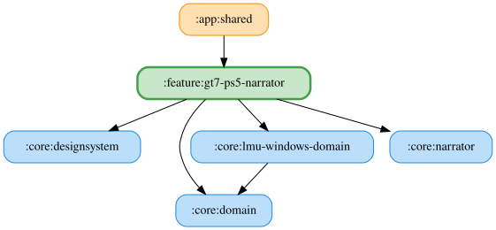

# gt7-ps5-narrator

Koinモジュールは`ObserveVoiceSpeedUseCase`・`ObserveVoicePitchUseCase`を提供し、`:core:data`の`VoiceSpeedPreferencesRepository`・`VoicePitchPreferencesRepository`を消費する。
`SpeakTextUseCase`は試聴・本文の読み上げに保存済み速度・声の高さ（ともに0.5〜2.0、既定1.0）を使用する。

<!-- MODULE-GRAPH-START -->
## Module Dependencies

<!-- MODULE-GRAPH-END -->

燃料残り周回数は保存した自由文言をOS標準TTSで読み上げる。`{laps}` は推定残り周回数に置換し、
0周以下では燃料なし用の文言を使う。空白文言・TTS利用不可の場合は読み上げず、WAVにはフォールバックしない。
判定時に文言を確定してイベントに保持するため、キュー待機中に設定が変わってもログと発話は一致する。
詳細ペインの試聴は `PlayStartSoundForKeyUseCase` でGT7のナレーターエンジンの開始音を再生した後、
`SpeakTextUseCase` からOS標準TTSで入力文言を再生する。1周以上用の `{laps}` は現在のスライダー閾値に置換し、
燃料なし用の文言はそのまま再生する。空白文言・TTS利用不可・音量ゼロ以下では開始音・本文を再生しない。

燃料残量警告も保存した自由文言をOS標準TTSで読み上げる。既定文言は「燃料は残り{percent}パーセント」。
`{percent}` は実際の残量割合を四捨五入した整数（0..100）に置換する。警告判定と有効状態は既存どおりで、
開始音・優先度・キューは `RemainingFuel.Root` を使う。文言は判定時に確定してイベントとログに保持する。
空白・TTS利用不可では開始音・本文を要求せず、空文字と `SKIPPED` をログに記録し、WAVへはフォールバックしない。
燃料残量の詳細ペインで自由文言を設定でき、試聴は現在の閾値をサンプル残量として `{percent}` に置換してTTSで再生する。
空白文言・TTS利用不可・音量0以下では本文も開始音も再生しない。開始音は `RemainingFuel.Root` を参照する。

タイヤ過熱警告は自由文言のOS標準TTSのみを使用する。既定文言は「タイヤ過熱 {celsius}度」。
`{celsius}` は判定時の全輪の最高タイヤ温度を整数に丸めた摂氏に置換し、解決文言をイベントの
`resolvedText` に保持するためキュー待機中も発話とログが一致する。判定条件・閾値・ヒステリシスは従来どおり。
空白文言・TTS利用不可では開始音も本文も要求せず、空文字と `SKIPPED` を記録する。
`tyre_overheat.wav` は使用せず、WAVへのフォールバックは行わない。開始音・優先度・キュー設定は
`TyreTemperature.Root` を参照する。詳細画面の試聴は現在の高温閾値をサンプル温度として同じキーの開始音とTTSで再生する。

自己ベストラップ更新は保存した自由文言をOS標準TTSで読み上げる。既定文言は「自己ベストラップ更新 {laptime}」。
`{laptime}` は判定時の更新後の `bestLapTimeMs` を「1分23秒456」の形式に置換する。1分未満では分を省略し、
ミリ秒は3桁固定、60分以上も時間にせず分で表す。解決した文言は `resolvedText` に保持し、キュー待機中も発話とログを一致させる。
判定条件と `MyBestLap.Root` / `DetailEnabled` の有効状態は従来どおり。開始音・優先度・キューは `MyBestLap.Root` を参照する。
リザルト画面などで周回数が一度に2以上増えた場合は、自己ベストを読み上げず前回タイム・周回数だけ更新し、読み上げ済み自己ベストは変更しない。
空白文言・TTS利用不可では開始音も本文も要求せず、空文字と `SKIPPED` を記録する。formal/casual の収録WAVは削除し、
WAVへフォールバックしない。共有protoの `voiceType` は旧データの互換性のため残すが、どのシミュレーターも参照せず、GT7は `readoutText` を使用する。

`Gt7Ps5NarratorEventProcessor.process` のログ用コンテキストは必須。呼び出し側が判定前の状態・
判定に使った設定・判定後の状態を渡し、既定の空設定による誤解を招くログを防ぐ。

TTS利用可否は判定時の文言解決で確認する。解決済み本文を持つイベントの再生では確認を繰り返さず、
未解決イベントを直接再生する場合は文言取得と利用可否確認を行う。キュー待機中にTTSが利用不可に
変化した場合の実際の再生結果はOS標準TTS側に委ねる。ログの結果は再生要求の結果を表す。

すべての具象 `SpeechEvent` は `ReadoutTextEvent` を実装する。Processorは文言を解決し、
`withResolvedText` で本文を保持する。音声エンジンの対象判定は `ReadoutTextEvent` を使う。
Speakerの文言取得はGT7のイベントを `when` で判定し、他シミュレーターのイベントには `null` を返す。

GT7の全自由文言イベントで、空文字・空白だけの本文は読み上げなしとして扱う。SpeakerとProcessorで
空白を除外し、音声エンジンへ開始音・本文を要求せず、空文字と `SKIPPED` をログに保存する。
この仕様の整理はGT7のみを対象とし、LMUの空白文言の扱いは変更しない。

自由文言の解決で例外が発生した場合はエラーを記録し、当該イベントの開始音・本文を要求せず、
空文字と `SKIPPED` をテレメトリログに保存する。同じ入力の後続イベントと次回以降の収集は継続する。
`CancellationException` は再スローし、キャンセル後の読み上げ・ログ保存は行わない。

## デバッグ読み上げ要求

ViewModel の独立した Job が `ObserveDebugReadoutRequestUseCase` を購読し、自分のシミュレーター宛ての要求だけを EventProcessor の `processDebugReadout` に渡す。テレメトリ未受信でも処理し、項目の有効スイッチと determine 系の判定は通さない。

`DebugReadoutText` の本文は入力をそのまま保持する。通常の文言解決・優先度・キュー・開始音・TTS・安全なログ保存の経路を使い、空白または TTS 利用不可の本文は SKIPPED として記録する。ログの JSON は現在の `state`、`settings`、`observedAtMs` と `debugReadout: true` を含む。ログを購読するオーバーレイは通常の最新読み上げログ経路で表示する。

JVM テストで未受信・項目無効の要求の発話とログ保存、別シミュレーター宛ての要求の無視、空白スキップとテンプレートをそのまま TTS に渡すことを検証する。

## 手動読み上げセット

GT7 の手動読み上げは、一覧の ▶ と Windows のセットホットキーからの依頼を合流し、
`Simulator.Gt7Ps5.id` 宛てで保存済みセットが見つかり、GT7 が選択中の場合だけ処理する。
`manualReadoutItemKeys(Simulator.Gt7Ps5.id)` は「残り燃料」の
`Gt7Ps5ReadoutItemKey.RemainingFuel.Root.value`、続いて「残り燃料の周回数」の
`Gt7Ps5ReadoutItemKey.RemainingFuelLaps.Root.value`、続いて「タイヤ温度」の
`Gt7Ps5ReadoutItemKey.TyreTemperature.Root.value` に対応する。詳細画面で保存したセットの
`itemKeys`・`itemTexts` を ViewModel が参照し、`Gt7Ps5ManualReadoutItem` を判定へ渡す。
最新テレメトリの `gasLevel / gasCapacity * 100` を四捨五入して0〜100に制限する。
未受信・受信から5秒超・不正な燃料値は null とし「残り燃料はデータがありません」を読む。
既定文言は `GT7_PS5_MANUAL_READOUT_REMAINING_FUEL_TEXT_DEFAULT` の
「燃料は残り{percent}パーセント」で、既存の燃料用フォーマット関数を再利用する。
判定は対応項目を最大3件、保存順に空欄を除いて「、」で連結し、
`Gt7Ps5ManualReadoutText` の1イベントを返す。現在値イベントは `Gt7Ps5RemainingFuelCurrentValue` と `Gt7Ps5RemainingFuelLapsCurrentValue`。
対応項目なしの場合は従来どおり「読み上げる項目がありません」を読む。
自動読み上げのスイッチ・警告済み状態は変更せず、常にキュー末尾へ追加して同じ本文をログに保存する。
開始音とログには、項目なしの場合も既存の `RemainingFuel.Root` を使う。
GT7 と LMU のキーはそれぞれ `gt7_ps5_`・`lmu_windows_` 接頭辞を持ち衝突しない。
手動項目の選択・文言はシミュレーター別のセット設定に保存し、自動項目のスイッチとは独立して判定する。

`processManualReadout` のログ JSON は `state`・`settings`・`observedAtMs` の3フィールドで、
状態と設定は `toRawTelemetryLogJson` を使い、テレメトリの前回値・現在値を含めない。

手動の残り燃料周回数は `currentRemainingFuelLaps(state)` で `fuelTrackingState` から算出する。
開始燃料＋総給油量－現在燃料を、完走周回数＋`CURRENT_LAP_CONSUMPTION_WEIGHT`（0.9）で割った平均消費を使い、
現在燃料÷平均消費を整数へ切り捨てる。開始燃料・開始周回が未設定、完走周回数が0以下、消費燃料が0以下なら null。
最終受信から5秒以内だけ推定値を使い、未受信・鮮度切れは「残り燃料の周回数はデータがありません」を読む。
`Gt7Ps5ManualReadoutItem.value` の単位は残り燃料が％、残り燃料の周回数が周、タイヤ温度が℃。
既定文言は `GT7_PS5_MANUAL_READOUT_REMAINING_FUEL_LAPS_TEXT_DEFAULT`（「燃料は残り約{laps}周」）で、
`formatGt7Ps5RemainingFuelLapsReadoutText` で置換する。0周以下は「燃料残り1周未満」。
テンプレートが空欄なら、0周以下やデータなしでも読まない。
自動側のしきい値・重複抑止・周回内タイミング・有効スイッチは手動側に適用しない。
テレメトリごとに `determineRemainingFuelLaps` が呼ばれ、有効スイッチの判定より前に燃料追跡が更新されるため、
自動読み上げが無効でも手動用の追跡が続く。

GT7 の手動「タイヤ温度」は `TyreTemperature.Root` を使い、`currentMaxTyreTemperatureCelsius(telemetry)` で
4輪の有限値の最高温度を `roundToInt()` した整数℃を取得する。未受信・5秒超・全輪非有限値は
「タイヤ温度はデータがありません」。既定文言は `GT7_PS5_MANUAL_READOUT_TYRE_TEMPERATURE_TEXT_DEFAULT`
（「タイヤ温度{celsius}℃」）で、既存の GT7 用フォーマッターとプレースホルダー検証を使う。
詳細のカテゴリはタイヤ、プレビューは90℃。空文言は読まず、自動のしきい値・ヒステリシス・重複抑止・
スイッチ判定は適用しない。最大3項目を「、」で連結し、開始音・ログのキーは `RemainingFuel.Root` を維持する。
