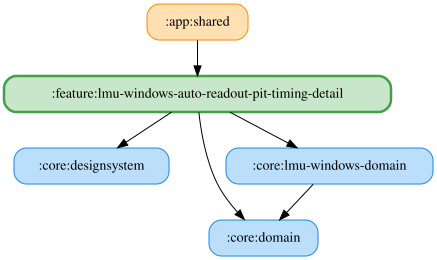

# lmu-windows-auto-readout-pit-timing-detail

文言欄は最新入力の正規化値と保存値が異なる間、古い保存結果による巻き戻りを防ぐ。前後の空白除去・30文字制限後の保存値が一致したら待機を解除し、以降の外部更新を反映する。保存値が変わらない入力でも待機を解除する。編集直後に編集前の保存値へ戻す操作の競合は [#1884](https://github.com/ai-kurou/KoDriver/issues/1884) で別途扱う。

UI 状態の合成は `LmuWindowsAutoReadoutPitTimingDetailFlow` が cold Flow として担う。共有・初期値・`viewModelScope` での実行は ViewModel が管理する。

<!-- MODULE-GRAPH-START -->
## Module Dependencies

<!-- MODULE-GRAPH-END -->

バーチャルエネルギー・タイヤ摩耗・燃料それぞれの通常（残り1周以上）文言とピットイン必須（残り1周未満）文言を設定・試聴できる。通常文言の `{laps}` は予想残り周回数に置き換わり、試聴では各スライダーに表示中の周回数を使う。ピットイン必須文言は置換せずそのまま読み上げる。

文言は30文字まで。6つの文言欄には「デフォルトに戻す」ボタンがあり、編集した文言をそれぞれの既定値に戻せる。既定値と同じ場合はリセットできない。通常文言の `{laps}` 挿入ボタンは、追加後に30文字を超える場合は無効になる。未知の `{...}` は通常文言だけ警告し、入力内容は維持する。空欄では読み上げず、OS標準TTSを利用できない端末では入力・試聴・リセットを無効にする。音量0では開始音も本文も試聴しない。

3ソースとも自由文言TTSを使用し、ピットタイミング用の収録WAVは使用しない。試聴の開始音は `LmuWindowsReadoutItemKey.PitTiming.Root` の設定を共用する。

ピットタイミングの判定対象はバーチャルエネルギー・タイヤ摩耗・燃料。バーチャルエネルギー残量警告（残量%の閾値判定）とは異なり、直近に完走したラップの消費量から予想残り周回数を求める。バーチャルエネルギー残量の増加やタイヤ交換を検出したラップは消費量の計算に使わず、その後に補充・交換なしで完走したラップの消費量を推定基準として採用する。

試聴中に試聴ボタンを再押しすると停止する。詳細ペインを離れたときも試聴を停止する。

LMUピットタイミングの燃料は `LmuWindowsReadoutItemKey.PitTiming.Fuel`（`lmu_windows_auto_pit_timing_fuel`）で保存する。
詳細のスイッチ・閾値（既定3周、1〜5周）・通常／切迫時文言は既存の PitTiming DataStore を共有し、
ProtoNumber 8〜10を追加する。既存フィールド1〜7は維持し、旧データでは燃料の既定値を使う。
`ObserveLmuWindowsPitTimingEnabledStatesUseCase` の既定値は有効で、Narratorのマージ済み有効状態と
`determinePitTimingFuel` が `PitTiming.Root`／`PitTiming.Fuel` を判定する。
燃料警告は `energySource == LmuWindowsEnergySource.Fuel`（P2/P2Elms/P3/GTE/Unknown）でのみ発火し、
VEクラス・無効設定でも燃料消費の追跡と評価周の更新を続ける。詳細の燃料設定はクラスに関わらず表示し、listPaneは変更しない。
`pitTimingJob` が `exactPercent / 100.0` を一度だけ追跡し、手動の燃料残り周回数と `fuelLapsTrackingState` を共有する。
VE・タイヤ・燃料の候補の最小周回数を選び、共通の `PitTimingLapGate` を通った候補だけ読み上げ履歴へ記録する。
給油周を消費量の推定から除外し、給油で警告履歴を再武装、周回巻き戻りで追跡・評価履歴を初期化する。
通常の既定文言は「燃料は残り約{laps}周」、0周以下は「燃料残り1周未満」。保存文言の解決・開始音・優先度・キュー・ログは
既存の `PitTiming.Root` の流儀を使い、ログに燃料スナップショットと判定状態を含める。
