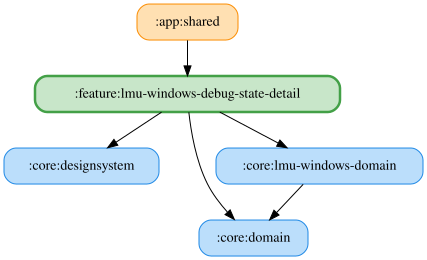

# lmu-windows-debug-state-detail

LMU Windows 専用のデバッグ状態画面。テレメトリ、レース状態、タイヤ・ブレーキ、燃料消費、並走時間などを18枚のカードで表示し、ドラッグしたカード順序を保存する。
自己完結モジュールとして、表示ヘルパーもこのモジュール内に保持する。
「その他」タブのバージョンを5回タップすると、選択中のシミュレーターに対応するペインを表示する。

<!-- MODULE-GRAPH-START -->
## Module Dependencies

<!-- MODULE-GRAPH-END -->

## 主要ファイル

- `LmuWindowsDebugStateDetailPane.kt`: ViewModel を取得する Pane と、状態・操作を受け取る公開 PaneContent。画面幅に合わせて1〜3列に切り替える。
- `LmuWindowsDebugStateDetailViewModel.kt` / `LmuWindowsDebugStateDetailUiState.kt`: LMU 状態、受信済みカード、カード順序を管理する。シミュレーターカードは常に LMU を表示し、有効にする。
- `DebugStateCardOrderUseCases.kt`: カード順序の Observe / Resolve / Save UseCase を束ねる `DebugStateCardOrderUseCases`。
- `LmuWindowsDebugStateSource.kt` / `LmuWindowsDebugState.kt`: LMU の UseCase 購読、状態の集約、受信済みカードの通知。
- `LmuWindowsSideBySideDurationTracker.kt`: 左右それぞれの最長並走時間を車両IDごとに追跡する。Source が並走中に周期的に更新する。
- `LmuWindowsDebugStateCards.kt` / `DebugState*Card.kt`: LMU 専用のカード表示。フレーム、未取得表示、温度・摩耗・ラップタイム等の整形ヘルパーも同梱する。
- `LmuWindowsDebugStateDetailModule.kt` / `LmuWindowsDebugStateModule.kt`: ViewModel と UseCase の Koin 定義。利用側が必要な Repository を登録する。

## カード順序と未取得表示

カードキーは feature 専用の `LmuWindowsDebugStateCardKey` に定義する。`DebugStateCardOrderUseCases` で保存名と enum を変換し、未知の保存名を除外する。保存名は従来と同じ enum の `name` を使用する。

ドメイン層の Observe / Resolve / Save UseCase を使用し、保存済み順序を優先して不足カードを既定順で補完する。

保存先はシミュレーターごとに別ファイル（`debug_state_card_order_preferences_<Simulator.id>.pb`）で、Repository は `named(Simulator.LmuWindows.id)` で Koin に登録される。
未受信カードは薄く表示する。ブレーキ残量は各輪の残量（小数1桁の %）と厚さ（小数3桁の mm）を表示し、欠損した輪は `--`、取得失敗時は「取得できません」と表示する。

## テスト

`src/jvmTest` に LMU の購読、カード順序、並走時間、カード表示、フォーマッター、Pane の配線を検証するテストを置く。
Desktop のスクリーンショットテスト（`LmuWindowsDebugStateDetailPaneScreenshotTest`）を持つ。ゴールデンPNGはCIが記録するためコミットしない。Android と Desktop で表示が異なるケースはないため Android 向けは追加しない。

## デバッグ読み上げ

並べ替えグリッドの上の固定カードで、このペインのシミュレーターの TopLevel 読み上げ項目と自由文言を指定する。既定選択は先頭項目で、空白のみでは送信できず、送信後も入力を保持する。固定カードはグリッド外なのでカード順序とドラッグのインデックスには影響しない。

ViewModel は `RequestDebugReadoutUseCase` から要求を送信し、Narrator が項目スイッチやテレメトリ受信に依存せず処理する。文言のテンプレート置換は行わない。利用側は `DebugReadoutRequestRepository` を登録する。
