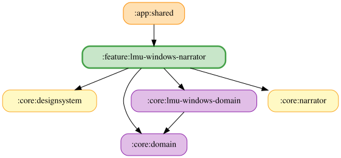

# lmu-windows-narrator

LMUの4種類のフラッグ本文と車両接近開始時・継続時の左右文言とバーチャルエネルギー残量警告とタイヤ摩耗警告とブレーキ過熱警告と車両故障警告とタイヤ過熱警告とバーチャルエネルギー・タイヤ摩耗由来のピットタイミング警告は、保存した自由文字列をOS標準TTSで読み上げる。
空白文言またはTTS利用不可時は本文を読み上げず、収録WAVへのフォールバックは行わない。
開始音は既存の設定に従う。

LMU車両故障のオーバーヒート・部品脱落・タイヤ脱落は、各1つのグローバルな自由文言をOS標準TTSで読み上げる。既定文言は「オーバーヒート」「部品脱落」「タイヤ脱落」。文言は既存の `LmuWindowsVehicleDamagePreferences` に保存し、保存時は `trim().take(READOUT_CUSTOM_TEXT_MAX_LENGTH)` で正規化する。判定時に解決した本文をイベントの `resolvedText` に保持し、キュー待機中の設定変更でもログと発話を一致させる。空白文言・TTS利用不可時は本文と開始音を要求せず、ログに空文字と `SKIPPED` を記録する。一覧の `VehicleDamage.Root` と詳細の `Overheat` / `PartDetached` / `TyreDetached` のスイッチ配線は維持し、開始音・優先度・キューと試聴は `VehicleDamage.Root` を参照する。旧オーバーヒート音声タイプは廃止し、3種類の警告は収録WAVへフォールバックしない。

Koinモジュールは`ObserveVoiceSpeedUseCase`・`ObserveVoicePitchUseCase`を提供し、`:core:data`の`VoiceSpeedPreferencesRepository`・`VoicePitchPreferencesRepository`を消費する。
`SpeakTextUseCase`は試聴・本文の読み上げに保存済み速度・声の高さ（ともに0.5〜2.0、既定1.0）を使用する。

<!-- MODULE-GRAPH-START -->
## Module Dependencies

<!-- MODULE-GRAPH-END -->

フラッグ・車両接近開始時・継続時のテレメトリログには、読み上げ要求時点の自由文字列を記録する。空欄・TTS利用不可の場合は本文を要求せず、空文字と `SKIPPED` を記録する。`SPOKEN` / `QUEUED` は再生要求の結果であり、非同期発話の完了を保証しない。

`LmuWindowsReadoutTextSpeaker` が各設定の最新文言を取得し、OS標準TTSへ渡す。
車両接近開始時・継続時の既定文言は左「カーレフト」、右「カーライト」。継続時は左側車両「キープライト」、右側車両「キープレフト」。旧開始時・継続時の種別は移行せず、既定文言を使用する。保存時は前後の空白を除去し、30文字までに制限する。

ピットタイミングの両ソースの警告は、残り1周以上で通常文言の `{laps}` を置換し、0周以下で専用文言を使う。空白・TTS利用不可時は開始音も要求せず、空文字と `SKIPPED` を記録する。通常・切迫時文言はピットタイミング詳細画面で設定・試聴できる。通常文言の試聴は `{laps}` を各スライダーに表示中の周回数に置換し、切迫時文言はそのまま読む。両ソースとも自由文言TTSを使用し、ピットタイミング用の収録WAVは使用しない。

バーチャルエネルギー残量警告は設定した閾値（%）をイベントに持ち、保存文言の `{percent}` をその閾値に置換する。実際の残量は置換値に使わない。空白文言・TTS利用不可時は開始音も要求せず、ログに空文字と `SKIPPED` を記録する。残量警告の収録WAVは使用しない。

LMUタイヤ過熱・低温警告は保存した自由文言の `{celsius}` を、警告を発生させた判定時点の全輪の最高カーカス温度を四捨五入した整数（℃）に置換してOS標準TTSで読み上げる。低温警告も全輪の最高温度を使い、`{wheel}` は対応しない。判定時に解決した本文をイベントの `resolvedText` に保持し、キュー待機中に設定が変わっても発話とログを一致させる。既定文言は「タイヤ過熱 {celsius}度」「タイヤ低温 {celsius}度」。DataStore の保存済み文言は変更せず、未設定の場合と「デフォルトに戻す」操作で新しい既定文言を使用する。DataStore の移行は不要。詳細画面は挿入チップと未知プレースホルダーの警告を提供し、試聴では過熱は選択中車両クラスの高温閾値（スライダーの現在値）、低温は60℃固定に置換する。空白文言・TTS利用不可時は開始音も要求せず、ログに空文字と `SKIPPED` を記録する。収録WAVへのフォールバックは行わない。開始音・優先度・キュー設定と試聴の開始音は `TyreTemperature.Root` を参照する。

タイヤ摩耗警告は設定した残存率閾値（%）をイベントに持ち、保存文言の `{percent}` をその閾値に置換する。実際の残存率は置換値に使わない。判定時に解決した文言を `resolvedText` に保持し、キュー待機中の設定変更でもログと発話を一致させる。空白文言・TTS利用不可時は開始音も要求せず、ログに空文字と `SKIPPED` を記録する。`tyre_wear_caution.wav` は廃止し、WAVへはフォールバックしない。

ブレーキ過熱警告は設定した車両クラスの温度閾値（℃）をイベントに持ち、全クラス共通の自由文言の `{celsius}` をその閾値に置換する。実測温度は使用しない。既定文言は「ブレーキ温度{celsius}℃以上」。判定時に文言を `resolvedText` へ保持し、キュー待機中もログと発話を一致させる。空欄・TTS利用不可では開始音も要求せず空文字と `SKIPPED` を記録する。`brake_overheat.wav` は廃止し、WAVへはフォールバックしない。

LMU自己ベストラップ更新は自由文言のOS標準TTSを使う。既定文言は「自己ベストラップ更新 {laptime}」。`{laptime}` は更新後の `telemetry.timing.bestLapTimeMs`（Long）を「1分23秒456」形式に置換し、1分未満では分を省略、ミリ秒は3桁固定、60分以上も分で表す。判定時に本文を `resolvedText` へ保持して発話とログを一致させる。空白・TTS利用不可では開始音も本文も要求せず、ログに空文字と `SKIPPED` を記録する。更新判定と一覧の `MyBestLap.Root`・詳細の `MyBestLap.DetailEnabled` のスイッチ配線は維持し、開始音・優先度・キュー・試聴は `MyBestLap.Root` を使う。詳細画面で文言編集・`{laptime}` 挿入・未知プレースホルダー警告・リセット・サンプルタイム83456msでの試聴を提供する。LMUの口調設定は移行せず参照しない。自己ベスト用WAVは廃止し、WAVへのフォールバックは行わない。

LMUの全20種類の自由文字列イベントは `ReadoutTextEvent` を継承する sealed interface `LmuWindowsSpeechEvent` を実装する。
フラッグ・車両接近・車両故障・閾値警告は、それぞれ下位の sealed interface にまとめる。
現在のバーチャルエネルギー残量・自己ベストラップ・ピットタイミングは `LmuWindowsSpeechEvent` を直接実装する。
`LmuWindowsNarratorEventProcessor` の共通 `processEvents` が判定時の本文を `withResolvedText` で保持し、同じ本文をログに保存する。
自己ベストラップの処理名は `processMyBestLap`。空白本文は共通処理でスキップする。
`LmuWindowsReadoutTextSpeaker` は解決済み本文を優先し、未解決の場合だけ設定を参照する。
SpeakerはLMU本文と各グループの本文を網羅的な `when` で解決する。
`LmuWindowsNarratorModule` は `isCustomSpeakEvent = ::isLmuWindowsCustomSpeakEvent` で対象を判定し、
Speakerと同じくLMUイベントと `DebugReadoutText` を対象とする。他シミュレーターのイベントは解決済み本文を持つ場合も読み上げない。
ピットタイミングの周回ゲートとソース選択は本文ではなく `laps` を使い続ける。
読み上げ済みの周回数は、ソース選択と周回ゲートを通過した警告のみViewModelで記録する。

自由文言の解決で例外が発生した場合はエラーを記録し、当該イベントの開始音・本文を要求せず、
空文字と `SKIPPED` をテレメトリログに保存する。同じ入力の後続イベントと次回以降の収集は継続する。
`CancellationException` は再スローし、キャンセル後の読み上げ・ログ保存は行わない。

ピットタイミングの消費量推定は初回取得周を除外し、周回番号が1つ進む境界から計測した周だけを採用する。セッション変更・周回番号の巻き戻りでは再計測し、番号が飛んだ区間とその直後の周、補給・タイヤ交換を検出した周は採用しない。有効な消費量が得られるまで予想周回数の読み上げを待つ（残量閾値警告は独立して動作する）。

## デバッグ読み上げ要求

ViewModel の独立した Job が `ObserveDebugReadoutRequestUseCase` を購読し、自分のシミュレーター宛ての要求だけを EventProcessor の `processDebugReadout` に渡す。テレメトリ未受信でも処理し、項目の有効スイッチと determine 系の判定は通さない。

`DebugReadoutText` の本文は入力をそのまま保持する。通常の文言解決・優先度・キュー・開始音・TTS・安全なログ保存の経路を使い、空白または TTS 利用不可の本文は SKIPPED として記録する。ログの JSON は現在の `state`、`settings`、`observedAtMs` と `debugReadout: true` を含む。ログを購読するオーバーレイは通常の最新読み上げログ経路で表示する。

JVM テストで未受信・項目無効の要求の発話とログ保存、別シミュレーター宛ての要求の無視、空白スキップとテンプレートをそのまま TTS に渡すことを検証する。

## 手動読み上げ依頼

`RemainingVirtualEnergyUseCases` に束ねた `ObserveManualReadoutRequestsUseCase` と `ObserveManualReadoutHotkeyPressesUseCase` を `merge` し、独立した Job で購読する。Windows のセットホットキーもタブの操作と同じ依頼経路で処理する。
依頼の `simulatorId` が `Simulator.LmuWindows.id` で、選択中のシミュレーターも LMU の場合だけ処理する。
同じ UseCase 群の `ObserveManualReadoutSetsUseCase` は `named(Simulator.LmuWindows.id)` の Repository を参照する。
依頼ごとに保存済みセットを取得し、`setId` に対応するセットの `itemKeys` に
`RemainingVirtualEnergy.Root.value`・`TyreWear.Root.value`・`BrakeWear.Root.value`・`BrakeTemperature.Root.value`・`TyreTemperature.Root.value`・`MyBestLap.Root.value`・`PitTiming.VirtualEnergy.value`・`PitTiming.TyreWear.value` を保存順に走査し、各項目の現在値の文を「、」で連結し、1依頼につき1イベントで読み上げる。
セットが見つからない場合は何もしない。いずれの対応項目も含まれない場合は `determineManualReadout` で項目なし文言を読み上げる。
対象セットの `itemTexts` から文言テンプレートを取得し、未保存なら
`manualReadoutItemTextDefault` の項目ごとの既定値を使う。
手動判定時に `{percent}` を四捨五入した現在残量、`{celsius}` を四捨五入した項目ごとの最高温度、`{laptime}` をセッションの自己ベストラップタイム、`{laps}` をエネルギー・タイヤ摩耗の残り周回数へ置換し、イベントの `resolvedText` と `narratedText` に反映する。
キュー待機中も解決済み文言を維持し、発話とテレメトリログは同じ文言になる。空白文言は発話せずスキップとしてログに残す。
`readManualReadout` が最新値と受信から5秒以内の鮮度を確認し、項目キー・テンプレート・残存率・摂氏温度・ラップタイムms（データ無しは null）を
`determineManualReadout` へ渡し、同UseCase内で既存の `PERCENTAGE_SCALE` により整数%へ四捨五入して連結する。
連結イベントを `processManualReadout` へ1回だけ渡す。先頭の対応項目のキーをイベントに使い、そのキーのキュー設定を true にする。
手動はタブの操作・セットホットキー押下ともに自動読み上げスイッチを無視し、ユーザーのキュー設定に関係なく常にキューの末尾に並ぶ。
開始音・文言・テレメトリログは既存経路を使い、自動警告の読み上げ済み状態は変えない。
F9 は従来どおり有効スイッチとキュー設定に従う。
Android でも WebSocket で受信した値を使う。未受信・鮮度切れの項目は「<項目名>はデータがありません」とし、すべての項目がデータ無しなら「データがありません」だけを読み上げる（1項目のデータ無しも同じ）。
文言は domain の `LMU_WINDOWS_MANUAL_READOUT_NO_DATA_TEXT` を使う。手動セットの `telemetryJson` はデバッグ未受信時に合わせて状態・設定・観測時刻を記録し、テレメトリ値は含めない。F9 は未受信・鮮度切れなら従来どおり何もしない。

JVM テストで連続依頼・警告状態の維持・未受信・鮮度の境界・宛先と選択中シミュレーターの照合・
未受信・鮮度切れそれぞれのタブ依頼とセットホットキー押下のデータ無し発話（queue=true）・ログ保存・切り替え後の古い値の破棄・セット別文言・空白文言・F9との分離・タブの操作とセットホットキー押下のキューとログ、Koin の UseCase 群の解決を確認する。

LMU の手動依頼（一覧の ▶・セットホットキー）で、対象セットにバーチャルエネルギー残量・タイヤ摩耗・ブレーキ残量・ブレーキ温度・タイヤ温度・自己ベストラップ・エネルギーの残り周回数・タイヤ摩耗の残り周回数のいずれのキーも含まれない場合は、データの有無に関係なく「読み上げる項目がありません」を開始音付きで読み上げる。文言は編集不可の `LMU_WINDOWS_MANUAL_READOUT_NO_ITEMS_TEXT` を使い、データ無しと同じ経路で常にキュー末尾へ追加してログを保存する。存在しないセット ID は読み上げない。

タイヤ摩耗は共有前の Flow で最新値と受信時刻を保持し、シミュレーター切り替え時に破棄する。受信から5秒以内なら最小残存率を domain に渡し、UseCase で整数%に丸めて他の項目と同じ連結用イベントで処理する。既定文言は「タイヤ摩耗残り{percent}%」。未受信・鮮度切れ・空の wheels はデータ無しとして扱う。自動警告の前回値・警告済み状態は変更しない。

手動ブレーキ残量は `BrakeWear.Root` に対応し、4輪の `remainingPercent`（0〜100）の最小値を四捨五入して、既定文言「ブレーキ残量{percent}%」へ置換する。セットの保存順に他項目と連結し、先頭項目の開始音と常時キュー追加を使う。未受信・受信から5秒超・空の wheels はデータ無しとして扱い、自動警告の前回値・警告済み状態は変更しない。

手動ブレーキ温度は `BrakeTemperature.Root` に対応し、`LmuWindowsBrakeTemperatureData.wheels` の最高温度を四捨五入した整数℃を、既定文言「ブレーキ温度{celsius}℃」へ置換する。未受信・受信から5秒超・空の wheels はデータ無しとして扱う。セットの保存順に他項目と連結し、先頭項目の開始音と常時キュー追加を使う。自動過熱警告の前回値・警告済み状態は変更しない。

手動タイヤ温度は `TyreTemperature.Root` に対応し、`LmuWindowsTyreCarcassTemperatureData.wheels` の `CelsiusReading.value` の最大カーカス温度を四捨五入した整数℃を、既定文言「タイヤ温度{celsius}℃」へ置換する。未受信・受信から5秒超・空の wheels はデータ無しとして扱う。セットの保存順に他項目と連結し、先頭項目の開始音と常時キュー追加を使う。自動過熱・低温警告の前回値・警告済み状態は変更しない。

手動自己ベストラップは `LmuWindowsReadoutItemKey.MyBestLap.Root.value` に対応し、セッションの `timing.bestLapTimeMs` を読む。既定文言は `LMU_WINDOWS_MANUAL_READOUT_MY_BEST_LAP_TEXT_DEFAULT`（「自己ベストラップ {laptime}」）。既存の `formatLmuWindowsMyBestLapReadoutText` で `{laptime}` を「1分23秒456」形式に置換する。未受信・最後の受信から `CURRENT_VALUE_MAX_AGE_MS`（5秒）超・0以下はデータ無しとし、複数項目では「自己ベストラップはデータがありません」を連結、全項目がデータ無しなら「データがありません」のみ。自動の `MyBestLap.Root` / `DetailEnabled` スイッチとは独立し、`determineMyBestLap`・`personalBestMs` の自動更新判定の状態は変更しない。保存順に連結した1イベントを常にキュー末尾へ追加し、開始音・優先度・ログには先頭項目のキーを使う。

手動エネルギー残り周回数は `LmuWindowsReadoutItemKey.PitTiming.VirtualEnergy.value` に対応し、蓄積済みの `pitTimingVirtualEnergyTrackingState` から `(currentValue / lastValidLapConsumption).toInt()` で算出する。既定文言は `LMU_WINDOWS_MANUAL_READOUT_VIRTUAL_ENERGY_LAPS_TEXT_DEFAULT`（「エネルギーは残り約{laps}周」）で、1周以上なら `formatLmuWindowsPitTimingReadoutText` で置換し、0周なら固定文言「エネルギー残り1周未満」を読む。蓄積前（`currentLap == -1`）、消費量が null・0以下、算出結果が負、最新エネルギーが未受信・受信から5秒超の場合はデータ無しとし、複数項目では「エネルギーの残り周回数はデータがありません」を連結、全項目がデータ無しなら「データがありません」のみ。自動のスイッチ・閾値・ベストラップ経過時間には依存せず、追跡状態・自動判定状態（`lastAnnouncedPitTimingVirtualEnergyLaps` 等）は変更しない。保存順の1イベントを常にキュー末尾へ追加し、先頭がこの項目なら開始音・優先度・ログには `PitTiming.Root` を使う。タイヤ摩耗の残り周回数は別項目として扱う。

手動タイヤ摩耗残り周回数は `LmuWindowsReadoutItemKey.PitTiming.TyreWear.value`（項目名「タイヤ摩耗の残り周回数」）に対応し、蓄積済みの `pitTimingTyreWearTrackingState` からエネルギーと同じ式で算出する（共通の private ヘルパーを `manualPitTimingTyreWearRemainingLaps` から呼ぶ）。既定文言は `LMU_WINDOWS_MANUAL_READOUT_TYRE_WEAR_LAPS_TEXT_DEFAULT`（「タイヤは残り約{laps}周」）で、1周以上なら `formatLmuWindowsPitTimingReadoutText` で置換し、0周なら固定文言「タイヤ残り1周未満」を読む（空欄テンプレートなら0周でも空文字）。蓄積前・消費量が null・0以下・非有限、算出結果が負、最新タイヤ摩耗が未受信・受信から5秒超の場合はデータ無しとし、`PitTiming.Root` を開始音・優先度・ログに使う。エネルギーの残り周回数とは別項目で、既存の「タイヤ摩耗」(%) 項目とも別。

ブレーキ温度も共有前の Flow で最新値と受信時刻を保持し、シミュレーター切り替え時に破棄する。手動セットは共通の `LmuWindowsManualReadoutText` / `processManualReadout` を使い、温度用の単独現在値イベントは追加しない。

タイヤ温度は既存の自動警告用購読を流用し、受信時に手動用の最新値と時刻を保持する。フラッグ更新では受信時刻を更新せず、`CURRENT_VALUE_MAX_AGE_MS`（5秒）で鮮度を判定する。

自己ベストは `lmuTelemetryFlow` の共有前に受信値と受信時刻を保持し、シミュレーター切り替えで破棄する。手動依頼時に鮮度を判定し、`LmuWindowsManualReadoutItem.lapTimeMs` へ渡す。手動イベントは `LmuWindowsManualReadoutText` として Speaker / EventProcessor の共通経路を通るため、自動自己ベストの文言解決・有効判定は適用しない。
