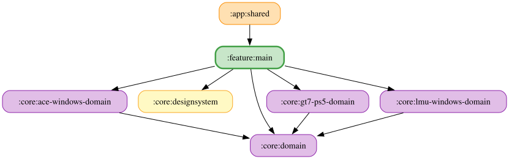

# main

AppScreen の設定・接続状態に加え、端末または KoDriver の音量低下警告を監視する `LowVolumeWarningViewModel` を提供します。警告を閉じた状態は ViewModel のメモリにのみ保持し、音量が閾値以上に戻る（警告が解消する）までバナーを再表示しません。音量詳細設定から警告バナーをオフにできます。

音量警告の状態生成は `LowVolumeWarningFlow` が cold Flow として担当し、警告解消時の dismissal リセットと表示状態の合成を行います。`LowVolumeWarningViewModel` は閉じた状態と操作、`viewModelScope`・`SharingStarted.WhileSubscribed(5_000)`・初期値による `stateIn` を管理します。

接続バナーの状態生成は `ConnectionBannerFlow` が担当します。選択中のシミュレーターに応じた LMU / ACE のステータス購読、GT7 のコンソール IP 設定監視と周期的な接続確認を cold Flow として構成します。`ConnectionBannerViewModel` は入力の配線と、`viewModelScope`・`SharingStarted.WhileSubscribed()`・既定の `ConnectionBannerVmUiState` による `stateIn` を担当します。
AppScreen の UI 状態の合成は `AppScreenFlow` が cold Flow として担います。共有・初期値・`viewModelScope` での実行は `AppScreenViewModel` が管理します。

<!-- MODULE-GRAPH-START -->
## Module Dependencies

<!-- MODULE-GRAPH-END -->

## 音声認識（ウェイクワード方式）

`SpeechRecognitionViewModel` が `ObserveSpeechRecognitionUseCase` の聞き取りを開始・停止し、状態（停止中・準備中・ウェイクワード待ち・コマンド待ち・マイクの権限が許可されていません・この端末では音声認識を利用できません）、認識途中の文字列、確定結果の履歴（新しい順に最大5件）、入力音量（`level`、0.0〜1.0。Android は認識エンジンの通知、デスクトップは取得した音声の断片ごとの音量。届いた間だけカードにゲージを表示し、停止・失敗で消す。）、入力デバイスの一覧と選択中のデバイス名（デスクトップのみ。後述）を `SpeechRecognitionUiState` で保持します。アプリ全体で1つの ViewModel を共有するため、タブを切り替えても聞き取りは止まりません。

- `rememberSpeechRecognitionSection()`: `AppScreen` から一度だけ呼ぶ。マイクの権限の要求（`rememberRecordAudioPermissionRequester`、Android のみ実行時ダイアログ）、アプリが見えなくなったとき（ON_STOP）の停止、前面に戻ったとき（ON_START）の再開を担い、デバッグ状態画面（`DebugStateDetailPane`）のグリッド先頭に差し込むカード（`SpeechRecognitionCard`）を返す。カードは `isSpeechRecognitionSupportedOnPlatform()` が true のプラットフォーム（Android とデスクトップ）で返し、false なら何も出さない。カードを出すときに入力デバイスの一覧も取得する（デスクトップのみ）。
- 見えなくなる前に聞き取り中だった場合だけ、前面に戻ったときに再開する（権限が外されていれば再開しない）。スイッチを OFF にした場合や失敗の後は再開しない。ON/OFF の状態はメモリ上にのみ持つため、アプリのプロセスが終了すると OFF に戻る。
- 発話がなくても自動では止めない（ウェイクワード待ちは発話がなくて当然のため。旧仕様の5分アイドル停止は廃止した）。
- ウェイクワード方式は必須で、ユーザーが無効にする設定はない。聞き取りを始めるたびに、ViewModel が先にウェイクワード待ちのモードを伝え（前回のコマンド待ちを引き継がない。読み上げ中なら続けて停止に切り替える）、語彙をウェイクワードに絞った認識から始まり、ウェイクワード（`SPEECH_RECOGNITION_WAKE_WORDS`。「ドライバー」「このドライバー」とそのひらがな表記）が途中経過または確定結果に含まれたらコマンド待ちに移り、`SetSpeechRecognitionModeUseCase` でモードを `Command`（語彙を絞らない）に切り替える。コマンド待ちは `SPEECH_RECOGNITION_COMMAND_TIMEOUT_MS`（6秒）で時間切れになり、ウェイクワード待ちへ戻る。語句が一致して依頼を出したときも戻る。語句に一致しない確定結果ではコマンド待ちを続ける。
- コマンド待ちの間だけ、確定結果（`Recognized`）の候補を `matchLmuWindowsManualReadoutItemKey`（`:core:lmu-windows-domain`）・`matchGt7Ps5ManualReadoutItemKey`（`:core:gt7-ps5-domain`）・`matchAceWindowsManualReadoutItemKey`（`:core:ace-windows-domain`）のうち、選択中のシミュレーター（`ObserveSelectedSimulatorUseCase`）の照合だけで手動読み上げ項目の語句と照合し、一致したら `ManualReadoutItemRequest` を `RequestManualReadoutItemUseCase` で発行する（照合規則は `:core:domain` の `matchManualReadoutItemKey`）。該当シミュレーターの Narrator が受け取り、保存済みセットの編集文言を使わず既定文言で1項目だけ読み上げる。選択中でないシミュレーターの語句は照合しないため、その語句だけに一致した場合は依頼せずコマンド待ちを続ける（タイムアウトまで言い直せる）。
- 読み上げ中は `ObserveSpeechPlaybackActiveUseCase`（各 Narrator の `NarratorEngine` が `ReportSpeechPlaybackActiveUseCase` で再生中・再生待ちを通知し、`:core:data` の `InMemorySpeechPlaybackStateRepository` がシミュレーター横断で束ねる）を購読し、再生が始まったら `Paused` に切り替えてコマンド待ちも打ち切る。自分の読み上げをマイクが拾ってウェイクワードに反応しないための措置。再生が終わってから `SPEECH_RECOGNITION_RESUME_DELAY_MS`（500ms。残響よけ）待ってウェイクワード待ちへ戻り、待つ間に次の再生が始まれば待ちを取り消す。読み上げが例外で終わった場合も `NarratorEngine` が再生終了を通知するため、停止したままにならない。
- ウェイクワードを検出してコマンド待ちに入ると、`PlaySpeechRecognitionChimeUseCase`（`SpeechRecognitionChimePlayer`）で確認音を1回鳴らす。読み上げの開始音（`ReadoutStartSoundType`）とは別の音で、設定では変えられない。コマンド待ちを遅らせないよう別の Job で鳴らし、鳴らせなくても（失敗は種類だけ記録して）コマンド待ちを続ける。コマンド待ちの打ち切り・聞き取りの停止・失敗では確認音も止める。確認音の再生は読み上げの再生状態（`ObserveSpeechPlaybackActiveUseCase`）には通知しないため、確認音でコマンド待ちが止まることはない。待機中・コマンド待ちの状態は、カードの状態ラベル（`SpeechRecognitionStatus.Listening` / `CommandWaiting`）で表示する。
- 音声認識由来の依頼は `playStartSound = false` で発行し、Narrator は開始音を鳴らさずに本文だけを読み上げる（`TextToSpeechEngine.speak` の `playStartSound`）。自動タブの開始音スイッチには関係なく、音声認識では常に開始音を鳴らさない。ボタン・ホットキー・保存済みセットからの手動読み上げと自動読み上げは従来どおり。

## 入力デバイスの選択（デスクトップ）

音声認識カードのドロップダウンで入力デバイスを選ぶ。デバイスの一覧と選択は `AudioInputDeviceSelector` が扱い（`GetAudioInputDevicesUseCase` で一覧を取得し、`ObserveSelectedAudioInputDeviceNameUseCase` / `SaveSelectedAudioInputDeviceNameUseCase` で選択を読み書きする）、`SpeechRecognitionViewModel` が `devices` / `deviceName` として保持する。一覧はカードを出すときとドロップダウンを開いたときに取得し直す。保存済みのデバイスが一覧にない場合や未選択の場合は先頭を選択中として表示し、保存値は書き換えない（そのデバイスが接続されれば次の取得で選ばれる）。音声認識側（`JvmSpeechRecognitionRepository`）も同じ規則で開くデバイスを決めるため、表示と実際の入力が一致する。聞き取り中に選び直すと、選択を保存してから聞き取りをやり直す。聞き取り中に選択中のデバイスが一覧から消えた場合も、先頭に切り替えて聞き取りをやり直す。デバイス関連の Repository を登録していない Android では `AudioInputDeviceSelector` を渡さず、ドロップダウンは表示しない。
