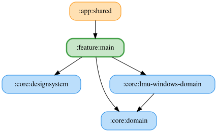

# main

AppScreen の設定・接続状態に加え、端末または KoDriver の音量低下警告を監視する `LowVolumeWarningViewModel` を提供します。警告を閉じた状態は ViewModel のメモリにのみ保持し、音量が閾値以上に戻る（警告が解消する）までバナーを再表示しません。音量詳細設定から警告バナーをオフにできます。

音量警告の状態生成は `LowVolumeWarningFlow` が cold Flow として担当し、警告解消時の dismissal リセットと表示状態の合成を行います。`LowVolumeWarningViewModel` は閉じた状態と操作、`viewModelScope`・`SharingStarted.WhileSubscribed(5_000)`・初期値による `stateIn` を管理します。

接続バナーの状態生成は `ConnectionBannerFlow` が担当します。選択中のシミュレーターに応じた LMU / ACE のステータス購読、GT7 のコンソール IP 設定監視と周期的な接続確認を cold Flow として構成します。`ConnectionBannerViewModel` は入力の配線と、`viewModelScope`・`SharingStarted.WhileSubscribed()`・既定の `ConnectionBannerVmUiState` による `stateIn` を担当します。
AppScreen の UI 状態の合成は `AppScreenFlow` が cold Flow として担います。共有・初期値・`viewModelScope` での実行は `AppScreenViewModel` が管理します。

<!-- MODULE-GRAPH-START -->
## Module Dependencies

<!-- MODULE-GRAPH-END -->
