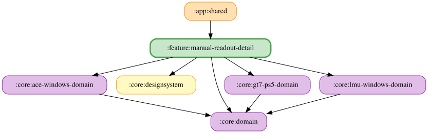

# manual-readout-detail

手動読み上げセットの詳細・編集を担う feature モジュール。シミュレーター ID とセット ID を受け取り、セット名（未設定時は作成時に採番された固定番号）によるタイトルと保存済みの選択項目を表示する。LMU は「バーチャルエネルギー残量」「燃料残量」「タイヤ摩耗」「ブレーキ残量」「ブレーキ温度」「タイヤ温度」「自己ベストラップ」「バーチャルエネルギーの残り周回数」「タイヤ摩耗の残り周回数」「燃料の残り周回数」「クラス内前方車とのギャップ」「クラス内後方車とのギャップ」の12項目、GT7 は「残り燃料」「残り燃料の周回数」「タイヤ温度」「自己ベストラップ」の4項目、ACE は「残り燃料」「残り燃料の周回数」「自己ベストラップ」「タイヤ温度」の4項目に対応する。「その他」詳細と同じ `DetailPaneScaffold` を使い、`canNavigateBack` が true の場合に戻るボタンを表示し、`onBack` を通知する。「読み上げる項目」カードには `selectedItemKeys` の順で選択済み項目のみを表示し、各行にドラッグハンドル・項目名・削除ボタンと既存の文言入力欄を置く。

## 項目カタログ

| シミュレーター | 項目 | キー（`value`） | 既定文言（定数名） | データなし時の文言 | カテゴリ・プレビュー |
| --- | --- | --- | --- | --- | --- |
| GT7 PS5 | 残り燃料 | `RemainingFuel.Root`（`gt7_ps5_auto_remaining_fuel`） | `GT7_PS5_MANUAL_READOUT_REMAINING_FUEL_TEXT_DEFAULT`（「燃料は残り{percent}パーセント」） | 「残り燃料はデータがありません」 | 燃料カテゴリ |
| GT7 PS5 | 残り燃料の周回数 | `RemainingFuelLaps.Root`（`gt7_ps5_auto_remaining_fuel_laps`） | `GT7_PS5_MANUAL_READOUT_REMAINING_FUEL_LAPS_TEXT_DEFAULT`（「燃料は残り約{laps}周」）。0周以下は `GT7_PS5_REMAINING_FUEL_LAPS_EMPTY_READOUT_TEXT_DEFAULT`（「燃料残り1周未満」） | 「残り燃料の周回数はデータがありません」 | 燃料カテゴリ。プレビュー3周 |
| GT7 PS5 | タイヤ温度 | `TyreTemperature.Root`（`gt7_ps5_auto_tyre_temperature`） | `GT7_PS5_MANUAL_READOUT_TYRE_TEMPERATURE_TEXT_DEFAULT`（「タイヤ温度{celsius}℃」） | 「タイヤ温度はデータがありません」 | タイヤカテゴリ。プレビュー90℃ |
| GT7 PS5 | 自己ベストラップ | `MyBestLap.Root`（`gt7_ps5_auto_my_best_lap`） | `GT7_PS5_MANUAL_READOUT_MY_BEST_LAP_TEXT_DEFAULT`（「自己ベストラップ {laptime}」） | 「自己ベストラップはデータがありません」 | ラップカテゴリ。プレビュー83456ms |
| ACE Windows | 残り燃料 | `RemainingFuel.Root`（`ace_windows_auto_remaining_fuel`） | `ACE_WINDOWS_MANUAL_READOUT_REMAINING_FUEL_TEXT_DEFAULT`（「燃料は残り{percent}パーセント」） | 「残り燃料はデータがありません」 | 燃料カテゴリ。プレビューは `PREVIEW_ENERGY_PERCENT`（50） |
| ACE Windows | 残り燃料の周回数 | `RemainingFuelLaps.Root`（`ace_windows_auto_remaining_fuel_laps`） | `ACE_WINDOWS_MANUAL_READOUT_REMAINING_FUEL_LAPS_TEXT_DEFAULT`（「燃料は残り約{laps}周」） | 「残り燃料の周回数はデータがありません」 | 燃料カテゴリ |
| ACE Windows | 自己ベストラップ | `MyBestLap.Root`（`ace_windows_auto_my_best_lap`） | `ACE_WINDOWS_MANUAL_READOUT_MY_BEST_LAP_TEXT_DEFAULT`（「自己ベストラップ {laptime}」） | 「自己ベストラップはデータがありません」 | ラップカテゴリ |
| ACE Windows | タイヤ温度 | `TyreTemperature.Root`（`ace_windows_auto_tyre_temperature`） | `ACE_WINDOWS_MANUAL_READOUT_TYRE_TEMPERATURE_TEXT_DEFAULT`（「タイヤ温度{celsius}℃」） | 「タイヤ温度はデータがありません」 | タイヤカテゴリ。プレビュー90℃ |
| LMU Windows | 燃料残量 | `RemainingFuel.Root`（`lmu_windows_auto_remaining_fuel`） | `LMU_WINDOWS_MANUAL_READOUT_REMAINING_FUEL_TEXT_DEFAULT`（「燃料は残り{percent}パーセント」） | 「燃料残量はデータがありません」 | 燃料カテゴリ |
| LMU Windows | 燃料の残り周回数 | `RemainingFuel.Laps.value`（`lmu_windows_auto_remaining_fuel_laps`） | `LMU_WINDOWS_MANUAL_READOUT_FUEL_LAPS_TEXT_DEFAULT`（「燃料は残り約{laps}周」）。0周は `LMU_WINDOWS_MANUAL_READOUT_FUEL_LAPS_EMPTY_TEXT_DEFAULT`（「燃料残り1周未満」） | 「燃料の残り周回数はデータがありません」 | 燃料カテゴリ |
| LMU Windows | バーチャルエネルギー残量 | `RemainingVirtualEnergy.Root`（`lmu_windows_auto_remaining_virtual_energy`） | `LMU_WINDOWS_MANUAL_READOUT_REMAINING_VIRTUAL_ENERGY_TEXT_DEFAULT`（「バーチャルエネルギー残量は{percent}パーセント」） | 「バーチャルエネルギー残量はデータがありません」（項目名付き連結） | バーチャルエネルギーカテゴリ |
| LMU Windows | バーチャルエネルギーの残り周回数 | `PitTiming.VirtualEnergy.value`（`lmu_windows_auto_pit_timing_virtual_energy`） | `LMU_WINDOWS_MANUAL_READOUT_VIRTUAL_ENERGY_LAPS_TEXT_DEFAULT`（「バーチャルエネルギーは残り約{laps}周」）。0周は `LMU_WINDOWS_MANUAL_READOUT_VIRTUAL_ENERGY_LAPS_EMPTY_TEXT_DEFAULT`（「バーチャルエネルギー残り1周未満」） | 「バーチャルエネルギーの残り周回数はデータがありません」 | バーチャルエネルギーカテゴリ |
| LMU Windows | タイヤ摩耗 | `TyreWear.Root`（`lmu_windows_auto_tyre_wear`） | `LMU_WINDOWS_MANUAL_READOUT_TYRE_WEAR_TEXT_DEFAULT`（「タイヤ摩耗残り{percent}%」） | 項目名付きのデータなし文言 | タイヤカテゴリ |
| LMU Windows | タイヤ摩耗の残り周回数 | `PitTiming.TyreWear.value`（`lmu_windows_auto_pit_timing_tyre_wear`） | `LMU_WINDOWS_MANUAL_READOUT_TYRE_WEAR_LAPS_TEXT_DEFAULT`（「タイヤは残り約{laps}周」）。0周は `LMU_WINDOWS_MANUAL_READOUT_TYRE_WEAR_LAPS_EMPTY_TEXT_DEFAULT`（「タイヤ残り1周未満」） | 項目名付きのデータなし文言 | タイヤカテゴリ |
| LMU Windows | ブレーキ残量 | `BrakeWear.Root`（`lmu_windows_auto_brake_wear`） | `LMU_WINDOWS_MANUAL_READOUT_BRAKE_WEAR_TEXT_DEFAULT`（「ブレーキ残量{percent}%」） | 項目名付きのデータなし文言 | ブレーキカテゴリ |
| LMU Windows | ブレーキ温度 | `BrakeTemperature.Root`（`lmu_windows_auto_brake_temperature`） | `LMU_WINDOWS_MANUAL_READOUT_BRAKE_TEMPERATURE_TEXT_DEFAULT`（「ブレーキ温度{celsius}℃」） | 項目名付きのデータなし文言 | ブレーキカテゴリ |
| LMU Windows | タイヤ温度 | `TyreTemperature.Root`（`lmu_windows_auto_tyre_temperature`） | `LMU_WINDOWS_MANUAL_READOUT_TYRE_TEMPERATURE_TEXT_DEFAULT`（「タイヤ温度{celsius}℃」） | 「タイヤ温度はデータがありません」 | タイヤカテゴリ |
| LMU Windows | 自己ベストラップ | `MyBestLap.Root`（`lmu_windows_auto_my_best_lap`） | `LMU_WINDOWS_MANUAL_READOUT_MY_BEST_LAP_TEXT_DEFAULT`（「自己ベストラップ {laptime}」） | 「自己ベストラップはデータがありません」 | ラップカテゴリ |
| LMU Windows | クラス内前方車とのギャップ | `ClassCarGap.Ahead.value`（`lmu_windows_auto_class_car_gap_ahead`） | `LMU_WINDOWS_MANUAL_READOUT_CLASS_CAR_GAP_AHEAD_TEXT_DEFAULT`（「クラス内前方{seconds}秒」）。先頭は `LMU_WINDOWS_MANUAL_READOUT_CLASS_CAR_GAP_TOP_TEXT_DEFAULT`（「クラス内先頭です」） | 項目名付きのデータなし文言 | ラップカテゴリ |
| LMU Windows | クラス内後方車とのギャップ | `ClassCarGap.Behind.value`（`lmu_windows_auto_class_car_gap_behind`） | `LMU_WINDOWS_MANUAL_READOUT_CLASS_CAR_GAP_BEHIND_TEXT_DEFAULT`（「クラス内後方{seconds}秒」）。最後尾は `LMU_WINDOWS_MANUAL_READOUT_CLASS_CAR_GAP_LAST_TEXT_DEFAULT`（「クラス内最後尾です」） | 項目名付きのデータなし文言 | ラップカテゴリ |

LMU のキーは `LmuWindowsReadoutItemKey.` の接頭辞を省略して記載している。上表の「項目名付きのデータなし文言」は、複数項目のとき「<項目名>はデータがありません」を連結する文言である。

## プレースホルダー一覧

| プレースホルダー | 対象（定数名） | 置換値 | 挿入・検証 |
| --- | --- | --- | --- |
| `{percent}` | 残り燃料（`GT7_PS5_REMAINING_FUEL_PERCENT_PLACEHOLDER` / `ACE_WINDOWS_REMAINING_FUEL_PERCENT_PLACEHOLDER` / `LMU_WINDOWS_REMAINING_FUEL_PERCENT_PLACEHOLDER`） | 残量（%）の整数 | 挿入ボタン・未知プレースホルダーの警告 |
| `{percent}` | バーチャルエネルギー残量（`LMU_WINDOWS_REMAINING_VIRTUAL_ENERGY_PERCENT_PLACEHOLDER`） | 実残量（%）の整数 | 挿入・検証 |
| `{percent}` | タイヤ摩耗（`LMU_WINDOWS_TYRE_WEAR_PERCENT_PLACEHOLDER`）・ブレーキ残量（`LMU_WINDOWS_BRAKE_WEAR_PERCENT_PLACEHOLDER`） | 閾値（%） | 挿入・検証 |
| `{laps}` | 残り燃料の周回数（`GT7_PS5_REMAINING_FUEL_LAPS_PLACEHOLDER` / `ACE_WINDOWS_REMAINING_FUEL_LAPS_PLACEHOLDER`）・LMU の残り周回数（`LMU_WINDOWS_PIT_TIMING_LAPS_PLACEHOLDER`） | 整数の周回数 | 挿入・検証（GT7 の詳細の試聴は3周に置換） |
| `{celsius}` | タイヤ温度（`GT7_PS5_TYRE_TEMPERATURE_CELSIUS_PLACEHOLDER` / `ACE_WINDOWS_TYRE_TEMPERATURE_CELSIUS_PLACEHOLDER` / `LMU_WINDOWS_TYRE_TEMPERATURE_CELSIUS_PLACEHOLDER`）・ブレーキ温度（`LMU_WINDOWS_BRAKE_TEMPERATURE_CELSIUS_PLACEHOLDER`） | 最高温度（整数℃） | 挿入・温度用の未知プレースホルダー検出 |
| `{laptime}` | 自己ベストラップ（`GT7_PS5_MY_BEST_LAP_LAPTIME_PLACEHOLDER` / `ACE_WINDOWS_MY_BEST_LAP_LAPTIME_PLACEHOLDER` / `LMU_WINDOWS_MY_BEST_LAP_LAPTIME_PLACEHOLDER`） | 「1分23秒456」形式 | 挿入チップ・ヒント・未知プレースホルダー検出 |
| `{seconds}` | クラス内前方・後方ギャップ（`LMU_WINDOWS_CLASS_CAR_GAP_SECONDS_PLACEHOLDER`） | 小数1桁の秒 | 挿入・検証（「ラップ」カテゴリ） |

「＋ 項目を追加」から Desktop / Android 共通の `ModalBottomSheet` を開き、未選択項目をカテゴリ別に表示する。シートのタイトルは「読み上げる項目を選択」とし、残り枠の文言と選択数のセグメントバーを表示する。カテゴリ見出しにはアイコンと候補数、カテゴリごとにまとめた選択行には丸い追加アイコンを表示する。カテゴリと表示名の対応は feature 内で管理し、現在は「バーチャルエネルギー」の LMU「バーチャルエネルギー残量」「バーチャルエネルギーの残り周回数」と「燃料」の LMU「残り燃料」「燃料の残り周回数」・GT7「残り燃料」「残り燃料の周回数」・ACE「残り燃料」「残り燃料の周回数」と「タイヤ」の LMU「タイヤ摩耗」「タイヤ摩耗の残り周回数」「タイヤ温度」・GT7「タイヤ温度」・ACE「タイヤ温度」、「ブレーキ」の「ブレーキ残量」「ブレーキ温度」、「ラップ」の LMU・GT7・ACE「自己ベストラップ」と LMU「クラス内前方車とのギャップ」「クラス内後方車とのギャップ」。選択すると末尾へ追加して閉じる。候補はスクロールでき、シート外のタップ・スワイプ・Esc で閉じる。選択数と上限（3件）は常時表示し、3件選択時は削除してから追加するよう案内する。未選択項目がない場合、または domain の `MANUAL_READOUT_SET_ITEM_MAX` に達した場合は追加ボタンを無効化する。未選択時は短い説明と追加ボタンを表示する。

項目追加ボタン・ピッカーでの選択・選択項目の削除・試聴開始／停止・セット名の編集開始と明示的な確定・ホットキーの有効なキー入力／解除／再試行／修飾キー操作では、既存の `ContextClick` 触覚フィードバックを行う。文言入力・並べ替え・フォーカス喪失によるセット名の自動保存・状態更新では追加の通知を行わない。

`libs.reorderable` の `ReorderableColumn` でドラッグ終了時に `moveItem` を呼び、`ManualReadoutSet.itemKeys` の順序を保存する。最大3項目のため、画面のスクロール内で通常の Column として配置する。試聴文は選択順に空欄を除いて「、」でつなぎ、domain の置換関数で仮想エネルギー・タイヤ摩耗・ブレーキ残量・GT7 と ACE の残り燃料のパーセントをサンプル値50に、ブレーキ温度の `{celsius}` をサンプル値500℃に、タイヤ温度の `{celsius}` をサンプル値90℃に、自己ベストの `{laptime}` を83456ms（1分23秒456）に、エネルギー・タイヤ摩耗の `{laps}` を3周に置換する。選択項目がある場合は区切り線の下に空でない試聴文を大きめに表示し、その下に試聴ボタンを右寄せで配置する。項目がなければ試聴ボタンを表示しない。Narrator の読み上げロジックは変更しない。

`ManualReadoutSetDetailViewModel` は `ObserveManualReadoutSetsUseCase` で対象セットを観測し、`UpdateManualReadoutSetUseCase` で追加・削除・並べ替えと項目ごとの文言を保存する。追加は重複・未対応キー・3件上限を検証する。未知キーは保持し、連続操作は直前の保存結果を参照する。セットが見つからない場合は説明を表示する。上部バー右端の削除アイコン（`DetailPaneScaffold` の `actions`）から確認ダイアログを開き、`DeleteManualReadoutSetUseCase` を実行し、削除完了時に Content の `onDeleted` を通知する。

UI 状態の合成は `ManualReadoutSetDetailFlow` が cold Flow として担う。`ManualReadoutSetDetailViewModel` は Flow が提供する `initialUiState` を使い、`stateIn` による共有・初期値の設定と `viewModelScope` での実行を管理する。

文言は入力ごとに前後の空白を除去して30文字まで保存し、未保存なら項目の既定文言を表示する。
空欄は読み上げず、リセットで既定文言へ戻す。選択を解除しても編集した文言は保持する。
LMU の残量では `{percent}` を現在の残量（%）に置換し、挿入ボタンと未知プレースホルダーの警告を提供する。挿入はカーソル位置に行い、選択中ならその範囲を置き換え、挿入直後へカーソルを移動する。置換後に文字数上限を超える場合は挿入しない。挿入は共通の `TextInsertState` で行う。
自動読み上げと同じ共通入力部品を使い、項目ごとの試聴ボタンは表示しない。
「試聴」ボタン（他の設定画面と同じ `FilledTonalButton`、再生中は「試聴を停止」）で、試聴文全体を `ReadoutTextPreviewHelper` により試聴する。
選択済み項目の先頭キーに対応する開始音を再生し、現在の音量で読み上げる。未知の先頭キーでは再生しない。
再押しやペイン離脱で停止し、TTS 利用不可または試聴文が空のときはボタンを無効にする。
DI は TTS・音量の Repository と、Narrator 登録済みの `named(simulatorId)` の開始音・読み上げ UseCase を消費する。

`manualReadoutSetDetailModule` は `named(simulatorId)` の Repository を解決する。Android・Desktop 共通の `featureModules` に登録する。一覧モジュールはこのモジュールに依存せず、`app:shared` が詳細スロットに接続する。

JVM テストで追加・削除・並べ替え・上限・未知キーのガードとプレビュー、ViewModel・Koin のパラメータ解決・項目選択・文言保存（空欄・正規化・上限・リセット）・削除確認・戻るボタンの表示とクリック・配線を検証する。Desktop スクリーンショットテストで項目あり・項目なし・戻るボタンなし・1ペインの戻るボタン・削除ダイアログ・項目追加シート・選択項目の既定文言・編集文言の警告・空欄を確認する。既存の画面全体のスクリーンショットは `showHotkey = false` で維持し、Windows デスクトップ向けにホットキー未割り当て・割り当て済み・他セット重複のケースを追加する。

Windows デスクトップ版のみ（macOS/Linux では表示しない）「ホットキー」カードを表示する。読み取り専用の入力欄にフォーカスして数字0–9または英字A–Zを押すと、左のドロップダウンで選択した修飾キー（Ctrl + Alt（初期値）/ Ctrl + Shift / Alt + Shift）と組み合わせて割り当てる。入力欄はキー名のみ表示する。キー未割り当てでも修飾キーを保存できる。解除すると null を保存する。Android ではカードを表示しない。Content / Pane の `showHotkey` で表示を注入できる。カード末尾の「ステアリングのボタンから実行する方法を見る」リンクから [SimHub手順書](https://github.com/ai-kurou/KoDriver/blob/main/docs/simhub-hotkey-setup.md) を外部ブラウザで開ける。

OS のホットキーはシミュレーターをまたいで共有されるため、全シミュレーターの他セットとの「修飾キー＋キー」の重複をシミュレーター名とセット名（未設定時は作成時に採番された固定番号）で表示する。修飾キー変更時も同じ判定を行い、競合時は保存しない。自セットの同じキーを再入力すると他セットとの重複エラーを解除する。保存は項目編集と同じ Mutex で直列化し、最新の保存状態を参照する。保存済みキーがある場合は登録中・登録済み・競合・失敗（エラーコード）を表示し、競合・失敗時に「再試行」を提供する。未割り当て・非対応時は登録状態を表示しない。
`manualReadoutSetDetailModule` は `ManualReadoutHotkeyRepository` から登録状態の購読・再試行 UseCase を解決する。JVM テストで状態の表示分岐と再試行の配線を、Desktop スクリーンショットで登録競合と再試行ボタンを確認する。

手動の「燃料の残り周回数」は `LmuWindowsReadoutItemKey.RemainingFuel.Laps.value`（`lmu_windows_auto_remaining_fuel_laps`）に対応する。
`RemainingFuel` 配下の手動専用項目で、TopLevel・自動タブ・スイッチには追加しない。手動項目定義の末尾（タイヤ摩耗の残り周回数の後）に並ぶ。
`fuelLapsTrackingState` の蓄積値を `manualFuelRemainingLaps` で読み、1周以上は `formatLmuWindowsPitTimingReadoutText` で `{laps}` を置換する。
既定文言は `LMU_WINDOWS_MANUAL_READOUT_FUEL_LAPS_TEXT_DEFAULT`（「燃料は残り約{laps}周」）、0周は
`LMU_WINDOWS_MANUAL_READOUT_FUEL_LAPS_EMPTY_TEXT_DEFAULT`（「燃料残り1周未満」）。空欄テンプレートなら0周でも空文字にする。
蓄積前・消費量が null／0以下／非有限・算出不能・最新燃料が未受信または受信から5秒超の場合はデータ無しとする。
鮮度は `latestFuelReceivedAtMs` で判定し、ピットタイミングの鮮度には依存しない。
複数項目では「燃料の残り周回数はデータがありません」を連結する。
先頭項目なら開始音・優先度・ログ・キューに `RemainingFuel.Root` を使う。編集画面はACE・GT7の燃料項目と同じ「燃料」カテゴリに配置し、既存の
`LMU_WINDOWS_PIT_TIMING_LAPS_PLACEHOLDER` を挿入・検証に使う。項目一覧・ホットキーは共通の手動項目定義を参照する。
自動燃料警告の設定・状態は変更せず、自動読み上げには接続しない。

手動の「クラス内前方車／後方車とのギャップ」は `LmuWindowsReadoutItemKey.ClassCarGap.Ahead.value`（`lmu_windows_auto_class_car_gap_ahead`）・`ClassCarGap.Behind.value`（`lmu_windows_auto_class_car_gap_behind`）に対応する。
TopLevel・自動タブ・スイッチ・`LmuWindowsReadoutDefaults.kt` の列挙には追加しない手動専用項目で、`LMU_WINDOWS_READOUT_ITEM_KEYS` の末尾（`MyBestLap.DetailEnabled` の後）と手動項目定義の末尾（燃料の残り周回数の後）に並ぶ。
`ObserveLmuWindowsClassCarGapUseCase` の最新値（`LmuWindowsClassCarGapData`）を `latestClassCarGap` / `latestClassCarGapReceivedAtMs` に保持し、受信から5秒（`CURRENT_VALUE_MAX_AGE_MS`）以内のものだけを項目へ渡す。未受信・鮮度切れはデータ無しとする。
周回遅れ・周回先行の車両も前後の対象に含む。トップ・最後尾は `gapAheadSeconds` / `gapBehindSeconds` ではなく `classPosition == 1` / `classPosition == classVehicleCount`（両方非 null）で判定し、固定文言
`LMU_WINDOWS_MANUAL_READOUT_CLASS_CAR_GAP_TOP_TEXT_DEFAULT`（「クラス内先頭です」）・`LMU_WINDOWS_MANUAL_READOUT_CLASS_CAR_GAP_LAST_TEXT_DEFAULT`（「クラス内最後尾です」）を読む（データありとして扱う。空欄テンプレートなら空文字）。
それ以外は null・非有限・負値の秒差をデータ無しとし、0以上の有限値を `formatLmuWindowsClassCarGapReadoutText` で小数1桁に丸めて `{seconds}`（`LMU_WINDOWS_CLASS_CAR_GAP_SECONDS_PLACEHOLDER`）を置換する。
既定文言は `LMU_WINDOWS_MANUAL_READOUT_CLASS_CAR_GAP_AHEAD_TEXT_DEFAULT`（「クラス内前方{seconds}秒」）・`..._BEHIND_TEXT_DEFAULT`（「クラス内後方{seconds}秒」）。
複数項目ではデータ無しの項目に「<項目名>はデータがありません」を連結する。
先頭項目なら開始音・優先度・ログ・キューに `VehicleApproach.Root` を使う。編集画面は既存の「ラップ」カテゴリに配置し、`{seconds}` を挿入・検証に使う。

<!-- MODULE-GRAPH-START -->
## Module Dependencies

<!-- MODULE-GRAPH-END -->

LMU の手動セットは `determineManualReadout` で各項目の文を保存順に「、」で連結し、`LmuWindowsManualReadoutText` の1イベントで読み上げる。項目のデータが無い場合は `manualReadoutItemName` の日本語名を使った「<項目名>はデータがありません」を連結する。保存データが3件を超えても先頭 `MANUAL_READOUT_SET_ITEM_MAX`（3件）までを読む。対象項目なしは「読み上げる項目がありません」を維持する。

LMU の手動「燃料残量」は既存の `LmuWindowsReadoutItemKey.RemainingFuel.Root` を使う。受信から5秒以内の `remainingPercent` を比率（0〜1）に変換し、手動判定で四捨五入した整数％を、既定文言 `LMU_WINDOWS_MANUAL_READOUT_REMAINING_FUEL_TEXT_DEFAULT`（「燃料は残り{percent}パーセント」）へ埋める。未受信・鮮度切れは「燃料残量はデータがありません」を連結する。先頭が燃料残量なら開始音・優先度・ログのキーは `RemainingFuel.Root`。自動燃料警告の `remainingFuelWarned` は変更しない。 詳細画面は ACE と共通の `manual_readout_remaining_fuel`（「残り燃料」）と `manual_readout_category_fuel` を使い、`{percent}` の挿入・未知プレースホルダー警告・リセット・50％のプレビューに対応する。

手動ブレーキ残量は `BrakeWear.Root` に対応し、4輪の `remainingPercent`（0〜100）の最小値を四捨五入して、既定文言「ブレーキ残量{percent}%」へ置換する。セットの保存順に他項目と連結し、先頭項目の開始音と常時キュー追加を使う。未受信・受信から5秒超・空の wheels はデータ無しとして扱い、自動警告の前回値・警告済み状態は変更しない。

手動ブレーキ温度は `BrakeTemperature.Root` に対応し、`LmuWindowsBrakeTemperatureData.wheels` の最高温度を四捨五入した整数℃を、既定文言「ブレーキ温度{celsius}℃」へ置換する。未受信・受信から5秒超・空の wheels はデータ無しとして扱う。セットの保存順に他項目と連結し、先頭項目の開始音と常時キュー追加を使う。自動過熱警告の前回値・警告済み状態は変更しない。

手動タイヤ温度は `TyreTemperature.Root` に対応し、`LmuWindowsTyreCarcassTemperatureData.wheels` の `CelsiusReading.value` の最大カーカス温度を四捨五入した整数℃を、既定文言「タイヤ温度{celsius}℃」へ置換する。未受信・受信から5秒超・空の wheels はデータ無しとして扱う。セットの保存順に他項目と連結し、先頭項目の開始音と常時キュー追加を使う。自動過熱・低温警告の前回値・警告済み状態は変更しない。

手動自己ベストラップは `LmuWindowsReadoutItemKey.MyBestLap.Root.value` に対応し、セッションの `timing.bestLapTimeMs` を読む。既定文言は `LMU_WINDOWS_MANUAL_READOUT_MY_BEST_LAP_TEXT_DEFAULT`（「自己ベストラップ {laptime}」）。既存の `formatLmuWindowsMyBestLapReadoutText` で `{laptime}` を「1分23秒456」形式に置換する。未受信・最後の受信から `CURRENT_VALUE_MAX_AGE_MS`（5秒）超・0以下はデータ無しとし、複数項目では「自己ベストラップはデータがありません」を連結。自動の `MyBestLap.Root` / `DetailEnabled` スイッチとは独立し、`determineMyBestLap`・`personalBestMs` の自動更新判定の状態は変更しない。保存順に連結した1イベントを常にキュー末尾へ追加し、開始音・優先度・ログには先頭項目のキーを使う。

手動バーチャルエネルギー残り周回数は `LmuWindowsReadoutItemKey.PitTiming.VirtualEnergy.value` に対応し、蓄積済みの `pitTimingVirtualEnergyTrackingState` から `(currentValue / lastValidLapConsumption).toInt()` で算出する。既定文言は `LMU_WINDOWS_MANUAL_READOUT_VIRTUAL_ENERGY_LAPS_TEXT_DEFAULT`（「バーチャルエネルギーは残り約{laps}周」）で、1周以上なら `formatLmuWindowsPitTimingReadoutText` で置換し、0周なら固定文言「バーチャルエネルギー残り1周未満」を読む。蓄積前（`currentLap == -1`）、消費量が null・0以下、算出結果が負、最新エネルギーが未受信・受信から5秒超の場合はデータ無しとし、複数項目では「バーチャルエネルギーの残り周回数はデータがありません」を連結。自動のスイッチ・閾値・ベストラップ経過時間には依存せず、追跡状態・自動判定状態（`lastAnnouncedPitTimingVirtualEnergyLaps` 等）は変更しない。保存順の1イベントを常にキュー末尾へ追加し、先頭がこの項目なら開始音・優先度・ログには `PitTiming.Root` を使う。タイヤ摩耗の残り周回数は別項目として扱う。

手動タイヤ摩耗残り周回数は `LmuWindowsReadoutItemKey.PitTiming.TyreWear.value`（項目名「タイヤ摩耗の残り周回数」）に対応し、蓄積済みの `pitTimingTyreWearTrackingState` からエネルギーと同じ式で算出する（共通の private ヘルパーを `manualPitTimingTyreWearRemainingLaps` から呼ぶ）。既定文言は `LMU_WINDOWS_MANUAL_READOUT_TYRE_WEAR_LAPS_TEXT_DEFAULT`（「タイヤは残り約{laps}周」）で、1周以上なら `formatLmuWindowsPitTimingReadoutText` で置換し、0周なら固定文言「タイヤ残り1周未満」を読む（空欄テンプレートなら0周でも空文字）。蓄積前・消費量が null・0以下・非有限、算出結果が負、最新タイヤ摩耗が未受信・受信から5秒超の場合はデータ無しとし、`PitTiming.Root` を開始音・優先度・ログに使う。バーチャルエネルギーの残り周回数とは別項目で、既存の「タイヤ摩耗」(%) 項目とも別。

ブレーキ温度・タイヤ温度の文言欄は `{celsius}` の挿入・最高温度への置換説明と、温度用の未知プレースホルダー検出を使う。1セットの選択上限は従来どおり3件。

GT7 の残り燃料は `Gt7Ps5ReadoutItemKey.RemainingFuel.Root.value` を使い、既定文言は「燃料は残り{percent}パーセント」。`{percent}` の挿入・現在の残量（%）の説明は LMU の割合項目と共通で、文言編集・リセット・試聴に対応する。保存した項目と文言は GT7 Narrator の `determineManualReadout` が参照する。未受信・受信から5秒超は「残り燃料はデータがありません」、対応項目なしは「読み上げる項目がありません」を読む。

GT7 の「残り燃料の周回数」は `Gt7Ps5ReadoutItemKey.RemainingFuelLaps.Root.value` を使う。
既定文言は「燃料は残り約{laps}周」。編集欄の挿入チップ・説明・未知プレースホルダーの検証は `{laps}` に対応し、
試聴では3周に置換する。燃料カテゴリで残り燃料の次に選択できる。
実際の手動読み上げでは0周以下は「燃料残り1周未満」、推定不能・鮮度切れは項目名付きのデータなし文言を読む。
空欄なら値の有無にかかわらず読まない。

GT7 の手動「タイヤ温度」は `TyreTemperature.Root` を使い、`currentMaxTyreTemperatureCelsius(telemetry)` で
4輪の有限値の最高温度を `roundToInt()` した整数℃を取得する。未受信・5秒超・全輪が非有限値または0（取得不能）は
「タイヤ温度はデータがありません」。既定文言は `GT7_PS5_MANUAL_READOUT_TYRE_TEMPERATURE_TEXT_DEFAULT`
（「タイヤ温度{celsius}℃」）で、既存の GT7 用フォーマッターとプレースホルダー検証を使う。
詳細のカテゴリはタイヤ、プレビューは90℃。空文言は読まず、自動のしきい値・ヒステリシス・重複抑止・
スイッチ判定は適用しない。最大3項目を「、」で連結し、開始音・ログのキーは `RemainingFuel.Root` を維持する。

GT7 の手動「自己ベストラップ」は `MyBestLap.Root` を使い、`currentBestLapTimeMs(telemetry)` でテレメトリの
`bestLapTimeMs`（ms）を取得する。未受信・5秒超・0以下（未確定）は「自己ベストラップはデータがありません」。
既定文言は `GT7_PS5_MANUAL_READOUT_MY_BEST_LAP_TEXT_DEFAULT`（「自己ベストラップ {laptime}」）で、
既存の `Gt7Ps5MyBestLap` を手動文言を `resolvedText` に指定して再利用し、既存の GT7 用フォーマッターと
プレースホルダー検証を使う。詳細のカテゴリはラップ、プレビューは83456ms。空文言は読まず、自動の
`determineMyBestLap` の状態（personalBestMs 等）は変更しない。開始音・ログのキーは `RemainingFuel.Root` を維持する。

セット名は詳細画面でインライン編集できる（最大20文字、重複可）。編集中は文字数カウンターを表示し、上限を超える入力・貼り付けは既存文字を保持したまま拒否する。確定・Done・フォーカス喪失時に保存し、ViewModel でも前後の空白除去と上限の防御を行う。未設定時は作成時に採番された固定番号による「セット N」を表示する。未採番（0）のセットは一覧上の位置を使う。削除しても他の採番済みセットの番号は変わらない。
名前は表示専用で、読み上げ文には含めない。ACE・LMU・GT7 共通仕様。

自己ベストの文言欄には「{laptime}を挿入」チップと `{laptime}` の置換ヒントを表示する。未知プレースホルダー検出は `findUnknownLmuWindowsMyBestLapReadoutPlaceholders` を再利用し、`{percent}`・`{celsius}`・`{laps}` は未知として警告する。試聴は83456msを使い、先頭項目が自己ベストなら `MyBestLap.Root` の開始音で再生する。

バーチャルエネルギーの残り周回数は「バーチャルエネルギー」、タイヤ摩耗の残り周回数は「タイヤ」カテゴリに表示し、`{laps}` 用のヒント・挿入ボタンを共用する。未知プレースホルダー検出は `findUnknownLmuWindowsPitTimingReadoutPlaceholders`、試聴は3周と `formatLmuWindowsPitTimingReadoutText` を使い、先頭項目なら `PitTiming.Root` の開始音を再生する。

ACE の「残り燃料」は `AceWindowsReadoutItemKey.RemainingFuel.Root.value` を使い、燃料カテゴリに表示する。
既定文言は `ACE_WINDOWS_MANUAL_READOUT_REMAINING_FUEL_TEXT_DEFAULT`（「燃料は残り{percent}パーセント」）。
`ACE_WINDOWS_REMAINING_FUEL_PERCENT_PLACEHOLDER` の挿入、
`findUnknownAceWindowsRemainingFuelReadoutPlaceholders` による警告、文言編集・リセット・試聴に対応する。
プレビューは `PREVIEW_ENERGY_PERCENT`（50）を既存の ACE 用フォーマッターで置換し、空白文言は除外する。
保存項目・文言は ACE Narrator が参照し、受信から5秒超・未受信・不正値はデータ無しとして扱う。
対応項目なしなら「読み上げる項目がありません」を読む。
ACE の「残り燃料の周回数」は `AceWindowsReadoutItemKey.RemainingFuelLaps.Root.value` を使い、既定文言は `ACE_WINDOWS_MANUAL_READOUT_REMAINING_FUEL_LAPS_TEXT_DEFAULT`（「燃料は残り約{laps}周」）、挿入プレースホルダーは `ACE_WINDOWS_REMAINING_FUEL_LAPS_PLACEHOLDER`、未知プレースホルダー検出は `findUnknownAceWindowsRemainingFuelLapsReadoutPlaceholders` を使う。試聴は5周のサンプル値で置換する。
ACE の「自己ベストラップ」は `AceWindowsReadoutItemKey.MyBestLap.Root.value` を使い、共有の `manual_readout_my_best_lap` 表示と `formatAceWindowsMyBestLapReadoutText` による試聴を行う。

ACE の手動項目は `RemainingFuel`、`RemainingFuelLaps`、`MyBestLap`、`TyreTemperature` の順。
手動「タイヤ温度」は既存の `AceWindowsReadoutItemKey.TyreTemperature.Root` を使い、
`currentMaxTyreTemperatureCelsius` で `AceWindowsTyreCarcassTemperatureData.wheels` の有限かつ0より大きい
最高値を四捨五入した整数℃を取得する。未受信・受信から5秒超・有効な温度なし・ACE以外への切り替え後は
「タイヤ温度はデータがありません」を読む。既定文言は `ACE_WINDOWS_MANUAL_READOUT_TYRE_TEMPERATURE_TEXT_DEFAULT`
（「タイヤ温度{celsius}℃」）。既存の `formatAceWindowsTyreTemperatureReadoutText` と
`findUnknownAceWindowsTyreTemperatureReadoutPlaceholders` を使い、詳細画面ではタイヤカテゴリ、プレビューは90℃。
`AceWindowsTyreTemperatureCurrentValue` の本文をセットの保存順に連結し、空欄は読み上げない。
自動過熱警告のしきい値・ヒステリシス・スイッチ判定は適用せず、警告状態も変更しない。
開始音とログには既存の `RemainingFuel.Root` を使い、常にキュー末尾へ追加する。
