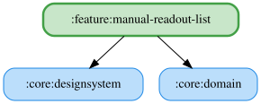

# manual-readout-list

手動読み上げタブの listPane を提供する feature モジュール。シミュレーター名を受け取り、説明シート付きの見出しと、選択中シミュレーター名入りの空状態を表示する。説明シートでは読み上げ・順番待ち・データがないときの動作を説明し、デスクトップ版のみホットキーの説明も表示する。アプリの「手動」タブから表示され、シミュレーター切り替え時にペインの状態をリセットする。

## 主要なファイルの役割

- `ManualReadoutListPane.kt`: 手動読み上げセット一覧の見出し・説明シート・空状態を表示する UI。
- `IsDesktopPlatform.kt` / `IsDesktopPlatform.android.kt` / `IsDesktopPlatform.nonAndroid.kt`: ホットキー説明の表示に使うプラットフォーム判定。
- `src/commonMain/composeResources/values/strings.xml`: 見出し・説明シート・空状態の表示文言。
- `ManualReadoutListPaneTest.kt`: 見出し・空状態・ヘルプの表示とホットキー説明の表示分岐を確認する JVM テスト。
- `ManualReadoutListPaneScreenshotTest.kt`: 見出し付きの空状態と説明シート（ホットキーあり・なし）を確認する Desktop/JVM 向けスクリーンショットテスト。
- `ManualReadoutHintSheetContentScreenshotTest.kt`: Android 版の説明シート（ホットキーの説明なし）を確認する Android 向けスクリーンショットテスト。Desktop 版と表示内容が異なるため追加している。

<!-- MODULE-GRAPH-START -->
## Module Dependencies

<!-- MODULE-GRAPH-END -->
