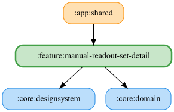

# manual-readout-set-detail

手動読み上げセットの詳細画面。シミュレーター ID とセット ID を受け取り、一覧上の番号によるタイトル・選択可能な項目と保存済み選択状態を表示する。LMU は「バーチャルエナジー残量」の1項目、ACE・GT7 は未対応の説明を表示する。「その他」詳細と同じ `DetailPaneScaffold` を使い、`canNavigateBack` が true の場合に戻るボタンを表示し、`onBack` を通知する。選択中の項目の下に文言入力欄を表示する。

`ManualReadoutSetDetailViewModel` は `ObserveManualReadoutSetsUseCase` で対象セットを観測し、`UpdateManualReadoutSetUseCase` で選択と項目ごとの文言を保存する。未知キーは保持し、連続操作は直前の保存結果を参照する。セットが見つからない場合は説明を表示する。確認ダイアログから `DeleteManualReadoutSetUseCase` を実行し、削除完了時に Content の `onDeleted` を通知する。

文言は入力ごとに前後の空白を除去して30文字まで保存し、未保存なら項目の既定文言を表示する。
空欄は読み上げず、リセットで既定文言へ戻す。選択を解除しても編集した文言は保持する。
LMU の残量では `{percent}` を現在の残量（%）に置換し、挿入ボタンと未知プレースホルダーの警告を提供する。
自動読み上げと同じ共通入力部品を使い、試聴ボタンは表示しない。

`manualReadoutSetDetailModule` は `named(simulatorId)` の Repository を解決する。Android・Desktop 共通の `featureModules` に登録する。一覧モジュールはこのモジュールに依存せず、`app:shared` が詳細スロットに接続する。

JVM テストで ViewModel・Koin のパラメータ解決・項目選択・文言保存（空欄・正規化・上限・リセット）・削除確認・戻るボタンの表示とクリック・配線を検証する。Desktop スクリーンショットテストで項目あり・項目なし・戻るボタンなし・1ペインの戻るボタン・削除ダイアログ・選択項目の既定文言・編集文言の警告・空欄を確認する。既存の画面全体のスクリーンショットは `showHotkey = false` で維持し、Windows デスクトップ向けにホットキー未割り当て・割り当て済み・他セット重複・デバッグ重複のケースを追加する。

Windows デスクトップ版のみ（macOS/Linux では表示しない）「ホットキー」カードを表示する。読み取り専用の入力欄にフォーカスして数字0–9または英字A–Zを押すと、Ctrl + Alt + Shift 固定で割り当てる。解除すると null を保存する。Android ではカードを表示しない。Content / Pane の `showHotkey` で表示を注入できる。

OS のホットキーはシミュレーターをまたいで共有されるため、全シミュレーターの他セットとの重複をシミュレーター名と一覧番号で表示し、全シミュレーター共通のデバッグ用ホットキーとの重複も拒否する。保存後にデバッグ用ホットキーが同じキーへ変更された場合も、画面表示中は重複として表示し続ける。自セットの同じキーを再入力すると他セットとの重複エラーを解除する。保存は項目編集と同じ Mutex で直列化し、最新の保存状態を参照する。保存済みキーがある場合は登録中・登録済み・競合・失敗（エラーコード）を表示し、競合・失敗時に「再試行」を提供する。未割り当て・非対応時は登録状態を表示しない。
`manualReadoutSetDetailModule` は共通の `ReadoutHotkeyPreferencesRepository` から `ObserveReadoutHotkeyVirtualKeyCodeUseCase` を、`ManualReadoutHotkeyRepository` から登録状態の購読・再試行 UseCase を解決する。JVM テストで状態の表示分岐と再試行の配線を、Desktop スクリーンショットで登録競合と再試行ボタンを確認する。

<!-- MODULE-GRAPH-START -->
## Module Dependencies

<!-- MODULE-GRAPH-END -->
