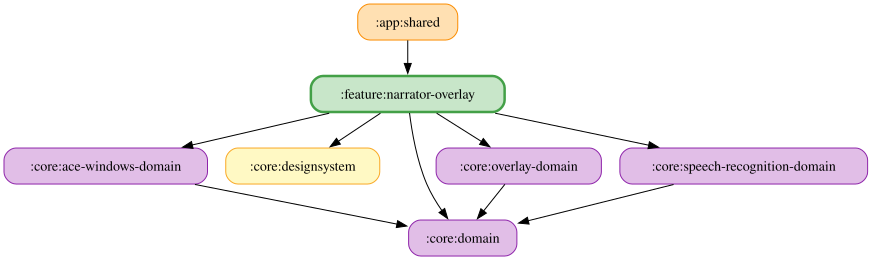

# narrator-overlay

TelemetryLog に記録された最新の読み上げ内容をライブ購読し、オーバーレイ表示する機能。

購読には `ObserveLatestNarratedTelemetryLogUseCase` を使い、**実際に読み上げられたログだけ**を対象にする。
`NarrationOutcome.SKIPPED`（読み上げ条件は整ったが、キュー再生が無効で優先度に負けて読み上げされなかった）の
ログは音が鳴っていないため除外する。除外しないと、優先度で勝った項目が再生されている最中に、負けて
読み上げられなかった項目がオーバーレイに表示され、音と表示が食い違う。

`NarratorOverlayContent` が薄い灰色の背景に現在の文字色（既定はアンバー）で読み上げ内容を表示する。長文は折り返し、
収まらない場合は縦スクロールする。この画面はデスクトップアプリ（`app:desktopApp`、Windows / macOS / Linux
共通）が常時最前面・タスクバー非表示の専用ウィンドウにホストする（`app:shared` の `NarratorOverlayScreen`
経由）。ウィンドウのドラッグ移動・リサイズ、初期表示位置・サイズについては
`app/desktopApp/src/main/kotlin/kurou/kodriver/NarratorOverlayWindow.kt` を参照。
文字にはテーマに依存しない黒い影を付け、背景が透明な場合の視認性を高める。
読み上げ内容が更新されると 150ms の短いフェードで切り替わる（背景・文字色・サイズ・影は変えない）。
文字色は `ObserveOverlayTextColorUseCase` のARGB Longを購読し、Textのcolorへ適用する。
既定値は `OVERLAY_TEXT_COLOR_DEFAULT` を参照する。文字色ダイアログの選択は共有Repositoryのプレビュー値として即時反映される。
OKで保存され、キャンセル・ダイアログ外タップ・ViewModel破棄・保存失敗では保存値に戻る。
文字サイズはその他タブの「オーバーレイ設定」から極小〜最大の7段階で選択する（中がデフォルト）。
サイズと保存IDの対応は [other-overlay-text-size-detail](../other-overlay-text-size-detail/README.md) を参照。
表示ON/OFFはその他タブの「オーバーレイ設定」→「オーバーレイを表示」で切り替える。設定は
`OverlayVisiblePreferencesRepository`（`:core:data`）に永続化し、`rememberNarratorOverlayVisible`
が購読して `NarratorOverlayWindowHost`（`app:desktopApp`）がウィンドウ自体の開閉に使う。
ウィンドウの位置・サイズも `OverlayWindowBoundsPreferencesRepository`（`:core:data`）へ永続化し、
次回起動時に復元する。ドラッグ・リサイズの直後ではなく 500ms のデバウンスを挟んで保存し、保存時と
モニタ構成が変わって画面外になる場合は既定位置（画面上部中央）にフォールバックする
（`rememberNarratorOverlayBounds` / `rememberNarratorOverlayBoundsSaver` と、`app:desktopApp` の
`NarratorOverlayWindowHost` / `OverlayWindowBoundsScreenCheck.kt` を参照）。

文字サイズは共有Repositoryのプレビュー値を含めて購読するため、設定ダイアログのラジオボタン選択で
即時に変わる。OKで保存され、キャンセル・ダイアログ外タップ・ViewModel破棄では保存値に戻る。

マイクが聞き取った文言は、読み上げ文言の下段に小さめの文字（本文サイズの0.7倍）で表示する。
`ObserveSpeechRecognitionTranscriptUseCase`（`:core:domain`）を購読し、認識途中の文字列があればそれを（文字色を薄くして）、
なければ直近に確定した発話の先頭候補を表示する。確定した発話は次の認識途中の文字列が来る・音声認識が停止または
失敗するまで残る。表示する文言がないときは下段を出さず、従来と同じ見た目になる。
下段の出現・消去は 150ms のフェードと高さの変化で行い、中央寄せの読み上げ文言も滑らかに移動する。
表示中の文言の更新（認識途中の書き換えや確定時の色の変化）はアニメーションしない。Vosk の語彙外記号 `[unk]` は
`speech_recognition_unknown_word`（このモジュールの `composeResources`）の置換語で表示する。
音声認識（マイク・Vosk）は `:feature:main` の1か所でのみ開き、結果は `:core:domain` の
`SpeechRecognitionTranscriptRepository` 経由で受け取る。文字サイズ・文字色・背景不透明度は既存のオーバーレイ設定を共有し、
マイク文言専用の設定はない（表示ON/OFFスイッチは未実装）。

`NarratorOverlayFlow` は最新の読み上げログ・文字サイズ・文字色・背景不透明度・マイク文言の5つの入力を
`NarratorOverlayUiState` に合成する冷たい Flow を提供する。
`NarratorOverlayViewModel` は UseCase から入力を取得し、`viewModelScope` と
`SharingStarted.WhileSubscribed(5_000)`、初期値 `NarratorOverlayUiState()` を指定した
`stateIn` によって、UI が購読する `StateFlow` を保持する。

<!-- MODULE-GRAPH-START -->
## Module Dependencies

<!-- MODULE-GRAPH-END -->
