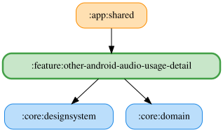

# other-android-audio-usage-detail

Android の音声の用途を6種類から選択して保存する詳細ペイン。既定値はメディア。

`ObserveAndroidAudioUsageUseCase` で保存済みの用途を監視し、`SaveAndroidAudioUsageUseCase` で選択した用途を保存する。Koin モジュールはこれらの UseCase を提供し、`:core:data` の `AndroidAudioUsagePreferencesRepository` を消費する。設定は DataStore に永続化される。

読み上げ（TTS / AudioAttributes）への反映は別途実装する。

<!-- MODULE-GRAPH-START -->
## Module Dependencies

<!-- MODULE-GRAPH-END -->
