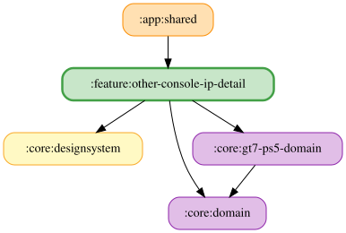

# other-console-ip-detail

GT7 PS5 の接続先IPアドレスとUDPポートを設定する画面を提供する feature モジュール。

## 主要なファイルの役割

- `OtherConsoleIpDetailViewModel.kt`: 編集状態の保持、入力イベント、stateIn による購読管理と保存処理・副作用。
- `OtherConsoleIpDetailFlow.kt`: 保存済みIPとUDPポート、編集状態から画面状態を合成する冷たい Flow。入力と選択ポートのフォールバックを担当し、IP形式判定は保存操作と共有する。
- `OtherConsoleIpDetailUiState.kt`: 入力中のIP、バリデーション結果、選択ポートと保存状態。

<!-- MODULE-GRAPH-START -->
## Module Dependencies

<!-- MODULE-GRAPH-END -->
