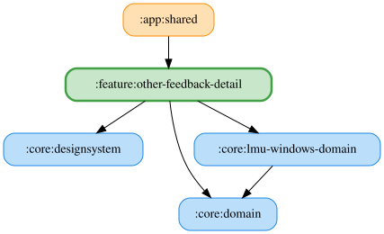

# :feature:other-feedback-detail

その他画面のフィードバック送信詳細を扱う feature モジュール。

## 主要なファイルの役割

- `OtherFeedbackDetailPane.kt`: フィードバック送信画面のUI。
- `OtherFeedbackDetailViewModel.kt`: 入力・添付ログIDの保持、ログの取得、stateIn による購読管理と送信の副作用。
- `OtherFeedbackDetailFlow.kt`: フォーム状態、添付ログ、送信可否から画面状態を合成する冷たい Flow。
- `OtherFeedbackDetailUiState.kt`: フォーム入力、送信状態、入力エラーと添付ログなどの画面状態。

<!-- MODULE-GRAPH-START -->
## Module Dependencies

<!-- MODULE-GRAPH-END -->
