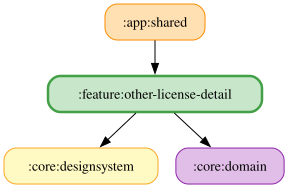

# other-license-detail

<!-- MODULE-GRAPH-START -->
## Module Dependencies

<!-- MODULE-GRAPH-END -->

## ライセンス一覧

ライセンス画面（`OtherLicenseDetailPane.kt`）は `Res.readBytes("files/aboutlibraries.json")` で、リポジトリにコミットされた
`src/commonMain/composeResources/files/aboutlibraries.json` を読む。

- `config/libraries/*.json`（`vosk.json`、`vosk-model-small-ja.json`）は `aboutLibraries.collect.configPath` によりプラグインの生成物
  （`build/generated/aboutLibraries/.../aboutlibraries.json`）にだけ入り、画面は読まない。
- コミット済みの `aboutlibraries.json` を再生成するタスクは現状ない。そのため Vosk 本体・日本語モデル・JNA は、画面にはまだ出ない（未反映。別途対応予定）。
  反映するには、生成物をコミット済みファイルへ反映する作業が別途必要。
