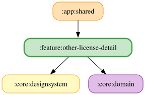

# other-license-detail

<!-- MODULE-GRAPH-START -->
## Module Dependencies

<!-- MODULE-GRAPH-END -->

## ライセンス一覧

ライセンス画面（`OtherLicenseDetailPane.kt`）は `Res.readBytes("files/aboutlibraries.json")` で、リポジトリにコミットされた
`src/commonMain/composeResources/files/aboutlibraries.json` を読む。画面に出るのはこのファイルの内容のみ。

- `config/libraries/*.json`（`vosk.json`、`vosk-model-small-ja.json`、`jna.json`、`kaldi.json`、`openfst.json`、`openblas.json`、`clapack.json`）は `aboutLibraries.collect.configPath` によりプラグインの生成物
  （`build/generated/aboutLibraries/.../aboutlibraries.json`）にだけ入る。生成物は画面が読まないため、そのままでは画面に出ない。
- Vosk 本体（`com.alphacephei:vosk`）と日本語モデル（`com.alphacephei:vosk-model-small-ja`）は、コミット済みの `aboutlibraries.json` に反映済み。
  ライセンスは既存の Apache-2.0 定義を共用する。
- JNA（`net.java.dev.jna:jna`）は Vosk が実行時に使うライブラリで、`jna.json` で定義し、コミット済みの `aboutlibraries.json` に反映済み。
  LGPL-2.1 と Apache-2.0 のデュアルライセンスのため、既存の Apache-2.0 定義を選んで共用する。
- Kaldi・OpenFst（Apache-2.0）と OpenBLAS・CLAPACK（BSD-3-Clause）は、Vosk のネイティブライブラリに静的にリンクされているため登録している。
  BSD-3-Clause の定義は `exportLibraryDefinitions` の出力から `licenses` に追加している。

### コミット済み `aboutlibraries.json` の更新手順

Gradle 依存の生成物を丸ごと置き換えると、アプリ全体の依存一覧と差が大きくなるため、次の手順で config 由来のエントリだけを反映する。

1. 生成タスクを出力先を指定して実行する（`exportLibraryDefinitions` は `config/libraries` の定義を含む一覧を出力する）:
   `./gradlew :feature:other-license-detail:exportLibraryDefinitions -PaboutLibraries.exportPath=<出力先ディレクトリ>`
2. 出力された `aboutlibraries.json` から `uniqueId` が `com.alphacephei:` で始まるエントリと `net.java.dev.jna:jna`・`org.kaldi-asr:kaldi`・`org.openfst:openfst`・`net.openblas:openblas`・`org.netlib:clapack` を取り出し（使うライセンス定義が `licenses` に無ければ併せて追加し）、
   コミット済みファイルの `libraries` に `uniqueId` 順で追加・置換する（`libraries` は `uniqueId` 昇順、JSON は 1 行の compact 形式で保つ）。
3. `git diff` で差分が対象エントリだけであることを確認する。
4. `config/libraries/*.json` を変更した場合は、この手順で同じエントリを反映し直す。
