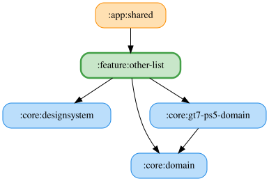

# other-list

「ゲーム機・SimHubへ接続するIPアドレス」の副テキストに保存済みIPアドレスとポート番号を「192.168.1.100:33740」の形式で表示する。IP未設定の場合は「未設定」と表示し、IP・ポートの変更に追従して更新する。

「Windows版KoDriverへ接続するIPアドレス」の副テキストに保存済みの接続先IPアドレスを表示する。未設定の場合は「未設定」を表示し、設定の変更に追従して更新する。

Windows/Androidの「読み上げ音声」項目は副テキストに保存済み音声IDを表示する。未指定の場合は「システム既定」を表示する。Androidでもこの項目を一覧に表示する。

Windows/Androidの「声の高さ」項目を読み上げ速度の次に表示し、保存済みピッチを「1.0倍」のように小数1桁で表示する。タップすると項目を選択し、スライダー（0.5〜2.0倍、0.1刻み）とデフォルト値へのリセットを備えた詳細ペインへ遷移する。

Androidの「音声の用途」項目を読み上げ設定の最下部（声の高さの次）に表示し、保存済みの現在値を副テキストに表示する。選択すると、6種類の用途から選択・保存できる詳細ペインへ遷移する。

Windows/Androidの「読み上げ速度」項目を読み上げ音声の次に表示し、現在の速度を「1.0倍」のように小数1桁で表示する。タップすると項目を選択し、速度スライダーとデフォルト値へのリセットを備えた詳細ペインへ遷移する。

「読み上げ開始音」項目の副テキストに選択中の種別「Formula無線」または「電子ノイズ」を表示する。設定の変更に追従して更新する。

「テーマ」項目の副テキストに現在の設定「システムに従う」「ライト」「ダーク」を表示する。設定の変更に追従して更新する。

「音量」項目の副テキストにアプリの音量と端末のマスター音量を整数%で表示する。端末音量は一覧の購読中、2秒ごとに取得して更新する。

端末マスター音量のポーリングは `OtherListDeviceVolumeFlow` が所有し、一覧の `uiState` が購読されている間だけ実行する。

「オーバーレイを表示」の副テキストで、読み上げ内容（順番待ちを含む）を最前面の小さなウィンドウに表示する機能であることを案内する。

「オーバーレイ」カテゴリの「文字サイズ」の副テキストに現在の設定「極小」「小」「中」「大」「特大」「超特大」「最大」を表示する（既定は「中」）。「背景の透明度」には現在の設定を「50%」のように表示する（既定は50%）。いずれも設定の変更を購読し、表示を更新する。

「ローカルネットワークへのアクセス許可」項目の副テキストに「許可済み」または「許可されていません」を表示する。未許可の場合は「タップして設定を開く」も表示する。設定画面からアプリへ戻ると既存の権限再確認により表示を更新する。この項目はAndroid 16以降で表示する。

「Windows版KoDriverへ接続するIPアドレス」（ServerIp）項目に「LMU」「ACE」、「ゲーム機・SimHubへ接続するIPアドレス」（ConsoleIp）項目に「GT7」のゲーム名タグを右端の矢印の前に表示する。他の項目にはタグを表示せず、選択中はタグの配色を切り替えて視認性を保つ。

「アプリ設定」と「情報」の間に「データ・ログ」カテゴリを表示し、「ログを全て削除」を配置する。タップすると確認ダイアログを表示し、確認後にすべてのシミュレーターのログを削除する。選択状態や詳細ペインは変わらない。削除中は二重実行を防ぎ、成功・失敗をスナックバーで通知する。削除フローの状態・操作・UseCase依存は `OtherListResetFlow` が管理し、`OtherListViewModel` は `viewModelScope` での実行と `OtherListUiState.reset` への状態合成を担う。

OS起動時自動起動の状態取得・変更と表示状態は `OtherListStartupRegistrationFlow` が管理し、`OtherListViewModel` は `viewModelScope` で操作を起動して `OtherListUiState.startupEnabled` に状態を合成する。

TTS利用可否の判定と一覧案内項目・警告表示への反映は `OtherListTtsAvailabilityFlow` が管理し、判定処理のライフサイクルは呼び出し元の `viewModelScope` に従う。`OtherListViewModel` は `OtherListUiState` へ状態を合成する。

アプリ更新の一度限りの確認と更新有無の状態は `OtherListAppUpdateFlow` が管理する。現在バージョンが空白の場合は確認せず、確認中・更新なし・リリース情報なしの場合も再実行しない。`OtherListViewModel` は `viewModelScope` で確認を実行し、`OtherListUiState.hasAppUpdate` に状態を合成する。

画面常時オン、ダイナミックカラー、ハプティックフィードバック、テーマの設定観測と、前3項目の保存操作は `OtherListDeviceSettingsFlow` が管理する。状態は専用UiStateとしてFlowで公開し、`OtherListViewModel` は `uiState` の購読中に `OtherListUiState` へ合成し、保存操作を `viewModelScope` でFlowへ委譲する。

<!-- MODULE-GRAPH-START -->
## Module Dependencies

<!-- MODULE-GRAPH-END -->

「オーバーレイ」カテゴリの「文字色」は文字サイズの直後に表示し、副テキストに現在色の色見本と `#RRGGBB`（既定は `#FFC107`）を表示する。保存値の変更を購読する。クリックすると文字色の詳細ダイアログを開き、詳細ペインへの遷移や一覧の選択状態の変更は行わない。Androidでは他のオーバーレイ設定と同様に非表示とする。
