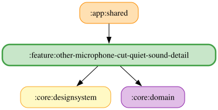

# other-microphone-cut-quiet-sound-detail

マイク設定「小さい音をカット」の詳細ペイン。マイクの小さい音を声として認識しないようにする強さを、0〜12の段階で設定する。0は「オフ（カットしない）」、既定は3。スライダーの操作完了時に保存し、リセットボタンで既定の段階へ戻せる。

`ObserveMicrophoneCutQuietSoundLevelUseCase` で保存済みの段階を監視し、`SaveMicrophoneCutQuietSoundLevelUseCase` で保存する。KoinモジュールはこれらのUseCaseを提供し、`:core:data` の `MicrophoneCutQuietSoundPreferencesRepository` を消費する。設定はDataStoreに永続化される。

「コマンド受付中もカットする」のスイッチ（既定はオフ）で、コマンド受付中にも音量ゲートを適用するかを切り替える。`ObserveMicrophoneCutQuietSoundInCommandUseCase` / `SaveMicrophoneCutQuietSoundInCommandUseCase` で保存・購読する。

保存した段階（× 0.05）は、`:core:speech-recognition-data` の `RecognitionPipeline` が音量ゲートの閾値として使う。設定を変えると、聞き取りを続けたまま次の断片から反映される。

`OtherMicrophoneCutQuietSoundDetailFlow` は保存済みの段階から UiState を生成する冷たい Flow。ViewModel は `stateIn` による状態共有と、保存・エラー記録を担当する。

<!-- MODULE-GRAPH-START -->
## Module Dependencies

<!-- MODULE-GRAPH-END -->
