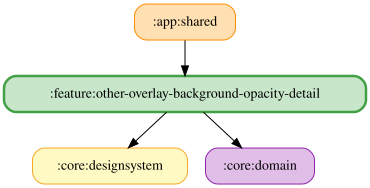

# other-overlay-background-opacity-detail

スライダーのドラッグ中は `PreviewOverlayBackgroundOpacityUseCase` で背景透明度をプレビューし、
指を離すと保存する。文字サイズと同様に、保存完了・保存失敗・ペイン破棄（`DisposableEffect` から `onPreviewStopped()`）・ViewModel破棄時にプレビューを解除する。
保存中に新しいドラッグが始まった場合は、先行保存の完了で新しいプレビューを解除しない。

`OtherOverlayBackgroundOpacityDetailFlow` は適用中の透明度から UI 状態を生成する cold Flow を提供する。
ViewModel は `viewModelScope` と `stateIn` で共有し、プレビュー・保存・競合制御・破棄時の解除を担当する。

<!-- MODULE-GRAPH-START -->
## Module Dependencies

<!-- MODULE-GRAPH-END -->
