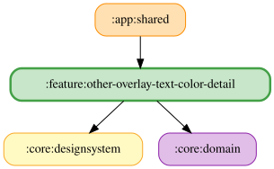

# other-overlay-text-color-detail

その他タブの「オーバーレイ設定」からオーバーレイの文字色をプリセット方式で選択する。
アンバー（既定）、白、赤、緑、青、シアン、マゼンタ、黄の8色から選択する。
色見本と色名、ラジオボタンの選択状態を表示し、アクセシビリティには色名を提供する。
リセットは選択値を `OVERLAY_TEXT_COLOR_DEFAULT` に戻す。OKで `SaveOverlayTextColorUseCase` を通じて
ARGB Longを保存する。選択時は保存せずナレーターオーバーレイへ即時プレビューし、
キャンセル・ダイアログ外タップ・ViewModel破棄・保存失敗ではプレビューを解除して保存値に戻す。
保存済みのプリセット以外の色は変更せず保持し、スウォッチは未選択として表示する。
JVMの操作・ViewModel・配線・スクリーンショットテストと、実DataStoreを使わないFake moduleを提供する。

ダイアログ破棄時は `DisposableEffect` から `onPreviewStopped()` を呼び、プレビューと未保存の選択を解除する。
確定した選択が保存中の間は解除せず、保存完了（失敗を含む）までプレビューを維持する。
保存中に選び直された場合は、ダイアログ破棄時に未保存のプレビューと選択を解除する。

`OtherOverlayTextColorDetailFlow` は観測した文字色と未保存の選択から UI 状態を合成する cold Flow。
`selectedOverlayTextColor` は観測値、`pendingOverlayTextColor` は未保存の選択があればその値、なければ観測値を使う。
ViewModel は `stateIn` による状態の共有、未保存の選択の管理、プレビュー・保存、エラー・キャンセル処理、
ライフサイクルと離脱・保存完了の競合制御を担当する。

<!-- MODULE-GRAPH-START -->
## Module Dependencies

<!-- MODULE-GRAPH-END -->
