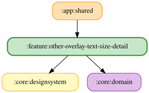

# other-overlay-text-size-detail

その他タブの「オーバーレイ設定」から文字サイズを7段階で選択する。

| 表示名 | `OverlayTextSize` | 保存ID | 文字サイズ |
|---|---|---|---|
| 極小 | `EXTRA_SMALL` | `extra_small` | 14sp |
| 小 | `SMALL` | `small` | 18sp |
| 中（デフォルト） | `MEDIUM` | `medium` | 22sp |
| 大 | `LARGE` | `large` | 28sp |
| 特大 | `EXTRA_LARGE` | `extra_large` | 36sp |
| 超特大 | `HUGE` | `huge` | 48sp |
| 最大 | `MAXIMUM` | `maximum` | 64sp |

既存の保存IDと `OVERLAY_TEXT_SIZE_DEFAULT` は維持し、未知のIDは中へフォールバックする。
文字サイズと約1.3倍の行高は `NarratorOverlayContent` のUI側で定義し、ドメインのenumには含めない。

ラジオボタンの選択は共有Repositoryのプレビュー値に即時反映し、実際のオーバーレイで確認できる。
OKで初めて保存し、保存完了後にプレビューを解除する。キャンセル・ダイアログ外タップ・ViewModel破棄では
プレビューを解除して保存値に戻す。`selectedOverlayTextSize` はプレビュー込みの適用中のサイズ、
`pendingOverlayTextSize` はダイアログでの選択値を表す。

ダイアログ破棄時は `DisposableEffect` から `onPreviewStopped()` を呼び、プレビューと未保存の選択を解除する。
確定した選択が保存中の間は解除せず、保存完了（失敗を含む）までプレビューを維持する。
保存中に選び直された場合は、ダイアログ破棄時に未保存のプレビューと選択を解除する。

`OtherOverlayTextSizeDetailFlow` は、`ObserveOverlayTextSizeUseCase` の適用中のサイズと
ViewModel が保持する未保存の選択値を合成する cold Flow。`selectedOverlayTextSize` は適用中のサイズ、
`pendingOverlayTextSize` は未保存の選択値があればその値、なければ適用中のサイズを返す。
ViewModel は `stateIn` による状態共有、未保存の選択値の管理、プレビュー・保存・解除、
ライフサイクル、エラー・キャンセル処理、保存中の選び直しや離脱との競合制御を担当する。

<!-- MODULE-GRAPH-START -->
## Module Dependencies

<!-- MODULE-GRAPH-END -->
