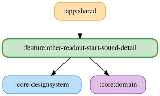

# other-readout-start-sound-detail

開始音の試聴は、選択中のシミュレーターの TextToSpeechEngine（`named(Simulator.X.id)`）で再生する。
開始音の設定自体は全シミュレーターで共有する。
ViewModel は simulatorId をキーに保持し、ダイアログを再表示した際も選択中のシミュレーターのエンジンで試聴する。

<!-- MODULE-GRAPH-START -->
## Module Dependencies

<!-- MODULE-GRAPH-END -->
