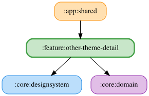

# other-theme-detail

<!-- MODULE-GRAPH-START -->
## Module Dependencies

<!-- MODULE-GRAPH-END -->

「その他」のテーマダイアログでラジオボタンを選ぶと、アプリ全体とダイアログのテーマを即座にプレビューする。選択中は保存せず、OKで確定・保存する。キャンセル、ダイアログ外のタップ、戻る操作ではプレビューを解除し、保存済みのテーマへ戻す。確定時は保存済み状態に反映されるまでプレビューを維持する。

保存に失敗した場合もプレビューを解除して保存済みのテーマへ戻す。ただし、保存中に選び直した新しいプレビューは、同じテーマを選んだ場合も維持する。選択・確定・キャンセル操作を世代で識別し、先行する保存処理が後続のプレビューや保存処理を解除しないようにする。保存処理のキャンセルは再送出し、同じ条件でプレビューを解除する。

`OtherThemeDetailFlow` は保存済みテーマと未保存の選択を合成する冷たい Flow を提供する。`selectedThemeMode` は保存済み値、`pendingThemeMode` は未保存の選択があればその値、なければ保存済み値とする。

`OtherThemeDetailViewModel` は Flow を `viewModelScope`・`SharingStarted.WhileSubscribed(5_000)`・`OtherThemeDetailUiState()` を使って StateFlow 化する。未保存の選択と世代の管理、ユーザー操作、保存処理と保存済み状態への反映待ち、エラー・キャンセル処理およびコルーチンのライフサイクルを担当する。
