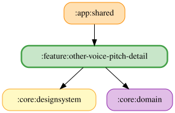

# other-voice-pitch-detail

声の高さを0.5〜2.0倍の範囲で0.1刻みに設定する詳細ペイン。スライダーの操作完了時に保存し、デフォルトの1.0倍へリセットできる。試聴ボタンで保存済みの高さ・速度・ボイスのまま読み上げを確認でき、試聴中にもう一度押すと停止する。音量が0以下のときは読み上げない。

`ObserveVoicePitchUseCase` で保存済みのピッチを監視し、`SaveVoicePitchUseCase` で保存する。試聴は`SpeakTextUseCase`と`ObserveSoundVolumeUseCase`を使う。KoinモジュールはこれらのUseCaseを提供し、`:core:data`の`VoicePitchPreferencesRepository`・`VoiceSpeedPreferencesRepository`・`VoicePreferencesRepository`・`SoundVolumePreferencesRepository`と、`TextToSpeechRepository`を消費する。設定はDataStoreに永続化される。

`OtherVoicePitchDetailFlow` は保存済みピッチと試聴状態から UiState を合成する冷たい Flow。ViewModel は `stateIn` による状態共有、保存時の丸めと永続化、保存・試聴ジョブ、試聴リクエスト世代の管理、ペイン離脱時の停止、エラー・キャンセル処理を担当する。

保存したピッチは `SpeakTextUseCase` 経由で読み上げに反映される。

<!-- MODULE-GRAPH-START -->
## Module Dependencies

<!-- MODULE-GRAPH-END -->
