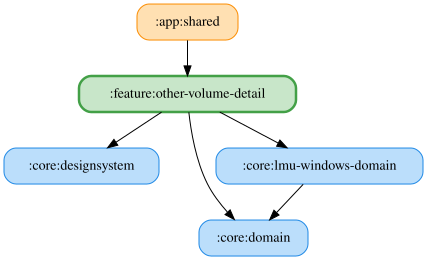

# other-volume-detail

音量の試聴は、読み上げ速度と同じ再生アイコン付きの「試聴」ボタンを使う。
保存・音量取得の待機中から停止アイコン付きの「停止」に切り替わり、再タップまたはペイン離脱で停止する。
直前のアプリ音量の保存完了を待ち、保存済みの音量・音声・読み上げ速度・声の高さで
従来の自己ベストラップの既定文言を試聴する。アプリ音量が0なら再生しない。

`OtherVolumeDetailFlow` は端末音量の更新通知と500ms間隔のポーリングを合成し、
`mapLatest` で古い読み取りをキャンセルしながら UI 状態を生成する cold Flow を提供する。
端末音量の初回取得は購読時に行い、ポーリングは購読の終了とともに停止する。
ViewModel は更新通知と取得処理を渡し、`viewModelScope`・`stateIn`・`WhileSubscribed(5_000)` による共有と購読の寿命を管理する。
端末音量の Channel による直列書き込みと成功後の即時更新通知、設定の保存、試聴ジョブと副作用も ViewModel が担当する。

<!-- MODULE-GRAPH-START -->
## Module Dependencies

<!-- MODULE-GRAPH-END -->

音量詳細ペインの「音量低下の警告」スイッチは既定でオンです。オフにしても音量ポーリングは継続し、警告の表示だけを停止します。
